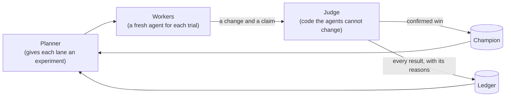
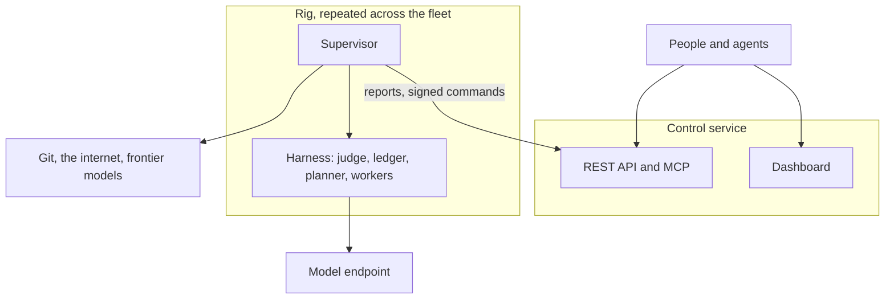

# Thermite

**Put AI agents to work on your code. Keep only what's proven.**

Thermite is open-source **autoresearch**: AI agents that run experiments in a loop, for hours or days, on your own machines. You set the goal: a faster program, a list of checks to pass, or a question to answer. A judge that the agents can't see or change measures every attempt, and keeps only what it confirms. One dashboard, with a REST API and MCP, shows and steers every campaign on every machine.

[](https://github.com/iammrduncan/thermite/actions/workflows/ci.yml)
[](LICENSE)

[](https://discord.gg/3Qs2uejUf9)

[Quick start](https://usethermite.com/tutorials/first-run/) · [Documentation](https://usethermite.com) · [Architecture](https://usethermite.com/explanation/how-it-fits-together/) · [Roadmap](https://usethermite.com/project/roadmap/) · [Changelog](CHANGELOG.md) · [Discord](https://discord.gg/3Qs2uejUf9)

> [!WARNING]
> **Thermite is under heavy development.** It changes every day, and some parts will break. If you don't want to take every update as it comes, pin a release: install from a tagged release's bundle, whose compose file pins every image by digest, and update when you choose. Most of Thermite can be driven from the dashboard, and its REST API and MCP server work well with coding agents, which can help you set it up, test it and run it.

> **Status:** v0.1.0, the first public release, is out: install it from its [release bundle](https://github.com/iammrduncan/thermite/releases/tag/v0.1.0). Work goes on toward v0.1.1: see the [roadmap](https://usethermite.com/project/roadmap/).


## The idea

A lot of engineering is a loop. Change something, measure it, keep it if it is better, undo it if it isn't, and try the next idea. **Autoresearch** hands that loop to AI agents, so it runs through the night, on many ideas at once, without you.

The hard part is trusting the results. An agent asked to make a number go up will sometimes make it only look higher: it skips the slow case, moves the timer, or just reports a win. So in Thermite, agents only propose. A separate program, the **judge**, builds each change, runs it against the best version so far on the same hardware, checks that its output is still right, and decides. The agents can neither read the judge nor change it.

## What you can point it at

Each campaign is one of three kinds, called **modes**:

| Mode | Use it to | It runs until | For example |
| --- | --- | --- | --- |
| **Hill climb** | Push one number, such as speed, size or accuracy, as far as it goes, with guards so that nothing else gets worse | You stop it | Make a matmul kernel faster without breaking its tests |
| **Goal** | Meet a list of checks: it builds, it loads the model, its answers match | Every required goal is met, or the evidence shows that they cannot be | Port a library to a new platform: it builds, matches its goldens and meets a speed target |
| **Research** | Answer a question from sources. Code checks every quote, word for word, against the page it came from | A review panel finds every question answered, its research stops adding, or its longest time is up | How do modern memory allocators keep tail latency low? |

The modes combine: a hill climb or a goal campaign can read what a research campaign found. [Choose a campaign mode](https://usethermite.com/how-to/campaigns/choose-a-mode/) helps you pick, [campaign modes](https://usethermite.com/explanation/campaign-modes/) explains each, and the [contract reference](https://usethermite.com/reference/contract/) has every field.

## How a campaign runs

1. **You set the goal.** On the dashboard, or from a script or your own AI assistant, say what to improve and how to measure it: where the project is, which files the agents may change, and a **kit** that builds, runs and checks it. The **New campaign** page can write a simple kit from your answers.
2. **Agents try ideas side by side.** Each agent works in its own **lane**, on its own copy of the code. A stateless planner gives each lane a different experiment from one shared queue, so the search stays wide. Every agent session starts fresh from the run's records, so a crash loses nothing.
3. **The judge decides.** It builds each change and measures it against the best version so far, on the same device. A change that looks better must hold up again before it counts: on fresh runs, and on test cases the agents never saw when the campaign has them.
4. **Wins become the new starting point.** The best confirmed version is the **champion**, and the next ideas build on it. A change that loses is kept too, with its code and the judge's reasons.
5. **You watch, steer and take the result.** Follow each agent live, add ideas, send the agents a message or pause the run. When you are happy, download the champion as a patch for your project.



## Why you can trust the results

- **Agents never grade their own work.** They submit a change and what they expect it to do. "The agent says it's faster" and "it is faster" stay separate: only the judge's measurement counts.
- **The judge holds the clock.** It times each change and the champion in alternating blocks on the same device, decides with statistics, and times the champion against itself once a day to learn how noisy the machine is.
- **A surprising win gets a second look.** On a rig with an auditor, an unusually large gain is audited before it is kept. You can also ask to approve every new champion yourself.
- **You can watch it catch cheats.** Each project comes with a **kit**, the judge's half of the project: how a change is built, run, timed and checked. Agents never see it. Thermite's CPU smoke kit ships 12 changes whose right verdicts are known: a real speed-up, a no-op, a timer edit, a fallback to the reference code, NaN output, memory and disk exhaustion, and an attempt to overwrite the champion. The judge acceptance test requires each one to get its expected verdict, and the [quick start](https://usethermite.com/tutorials/first-run/) shows it on your computer. [Kits](https://usethermite.com/explanation/kits/) and [judging](https://usethermite.com/explanation/why-agents-never-judge/) explain the mechanism.

## What you get

- **It keeps going.** There are no default caps on turns, submissions, failures or wall time. A campaign runs until its goals are met or its questions are answered, its research stops adding, its time is up, or you stop it; only the limits you configure apply.
- **Your machines, your models.** Run it on your own computer, on machines with GPUs over SSH, on a Kubernetes cluster, or on a RunPod GPU by the hour. The agents use a free model, a model server of your own, an API key, or a Claude or ChatGPT subscription.
- **Nothing useful is thrown away.** Every losing attempt is kept with its code and its verdict. Agents keep field notes as they work, and each campaign's records go into a knowledge base that later runs read.
- **People stay in charge.** One dashboard shows every campaign on every machine, live. You can pause, redirect, message, reset and reassign any run from the dashboard, the REST API or an MCP client, and decide which wins wait for your approval.

## Quick start

You need Linux or macOS, and Podman or Docker with compose. Thermite runs from published images: you build nothing. A model is optional at first: the judge works without one.

Before you give Thermite a model, read the [known limits](https://usethermite.com/reference/known-limits/). Agents run the code that a model writes on your computer, and under compose that code can reach your local network. [The security model](https://usethermite.com/explanation/security-model/) says what each part can reach and what it trusts.

```sh
mkdir thermite && cd thermite
curl -fsSLO https://github.com/iammrduncan/thermite/releases/latest/download/compose.yaml
docker compose run --rm init     # writes local tokens to .dev/
docker compose up -d
```

With Podman, write `podman compose` in place of `docker compose`. The first start downloads the images. To check the machine before the first `up`, run `npx thermite doctor` from the [command line](https://usethermite.com/how-to/install/one-machine/#the-command-line), built from the source with Node.js and git: it checks Docker or Podman, compose, the port, disk and the clock, and says how to fix each problem ([Troubleshoot](https://usethermite.com/how-to/operate/troubleshoot/#check-the-machine)). Then:

1. Open <http://127.0.0.1:8800/ui> and sign in with the token in `.dev/secrets/control-admin-token`.
2. Open **Rigs › local-1**, and under **Checks** press **Run it** beside **Judge smoke**. The rig builds a small benchmark and submits known changes to its judge: a real speed-up, a no-op, broken builds and attempts to cheat. Each one gets its expected verdict within a few minutes on a CPU.
3. Add a model under **Settings › Providers** (any OpenAI-compatible endpoint with tool calling, Anthropic, or OpenCode), then start a campaign from **Campaigns › New campaign**: on the sample project in [`examples/matmul-cpu`](examples/matmul-cpu/README.md), a folder of this repository, or on your own project.

The [tutorials](https://usethermite.com/tutorials/first-run/) walk through every step, up to taking the winning patch back to your project ([Your own project](https://usethermite.com/tutorials/your-own-project/)). To build Thermite from its source code instead, see [Contributing](https://usethermite.com/project/contributing/#set-up).

**Just want to look around?** `npm ci && node --experimental-strip-types scripts/dev/dashboard-demo/main.ts` serves the dashboard with synthetic campaigns and rigs at <http://127.0.0.1:8810/ui>, with no containers. It prints the token to sign in with.

## Architecture



- A **rig** is two containers. The **harness** does the research. It needs only DNS, the internet and its model endpoint; on Kubernetes, network rules keep it to those, and under compose or on a machine it can also reach the local network ([known limits](https://usethermite.com/reference/known-limits/)). The **supervisor** does everything that needs more reach: git, reporting and relaying signed commands from control.
- Rigs run under docker-compose or podman-compose on one machine. **Control** can also set rigs up on your own machines over SSH, or on a Kubernetes cluster.
- **Target drivers** connect the judge to what is measured: CUDA GPUs and CPUs today.

More in [architecture](https://usethermite.com/explanation/how-it-fits-together/).

## Documentation

| Read this | To |
| --- | --- |
| [Quick start](https://usethermite.com/tutorials/first-run/) | Go from the release's compose file to a first verdict, then to agents on your own project |
| [Write a kit](https://usethermite.com/how-to/campaigns/write-a-kit/) | Teach the judge how to build, run and check your project |
| [Judging and integrity](https://usethermite.com/explanation/why-agents-never-judge/) | See how results are accepted without trusting the agents |
| [Known limits](https://usethermite.com/reference/known-limits/) | Know the risks and what is not built yet, before you run it |
| [The security model](https://usethermite.com/explanation/security-model/) | See what each part can reach and what it trusts |
| [Settings reference](https://usethermite.com/reference/settings/) | Configure control, the harness and the supervisor |
| [Contributing](https://usethermite.com/project/contributing/) | Set up a copy, run the checks and the acceptance tests, and send a change |
| [Glossary](https://usethermite.com/reference/glossary/) | Look up a term |

## Community and contributing

Thermite's community meets on the [Hackers in the Loop Discord](https://discord.gg/3Qs2uejUf9): questions, ideas and results go there. Bugs and feature requests go in [GitHub issues](https://github.com/iammrduncan/thermite/issues).

- **Contributing:** [CONTRIBUTING.md](CONTRIBUTING.md) has the essentials. There is no contributor agreement and no sign-off rule. Read [CONVENTIONS.md](CONVENTIONS.md) before you change the code, and run `npm run check` (typecheck, lint, tests and the public-content check) before you open a pull request. [Contributing](https://usethermite.com/project/contributing/#the-checks) lists the compose and acceptance tests for changes to containers, the judge or control.
- **Code of conduct:** the [Contributor Covenant 2.1](CODE_OF_CONDUCT.md).
- **Security:** report a problem privately, as [SECURITY.md](SECURITY.md) says, never in a public issue.

## Credits

Thermite builds on other people's research and software. [Credits](https://usethermite.com/project/credits/) lists the papers, systems, programs, libraries, standards and services it draws on, runs or ships, each with its licence.

## License

[MIT](LICENSE)
