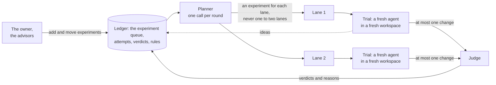

A rig does its research with AI agents, but no agent is in charge of the search, and no agent remembers it. This page explains how Thermite shares the work out among **lanes**, **trials** and a **planner**, how one **experiment queue** for each run holds what to try next, and why every agent starts with a fresh context.

The workers and the planner are **the work**: the agents in the rig's harness. The other group, **the advisors** (the teachers, the auditor, the review panel and, for a research run's paper, the final writer), runs in the rig's supervisor: [Supervision](supervision.md) explains it.

The words here are in the [glossary](../reference/glossary.md). [Why agents never judge](why-agents-never-judge.md) covers what happens to a change after an agent submits it.

## From campaign to attempt

Thermite's work nests in five levels:

| Level | What it is |
| --- | --- |
| **Campaign** | One piece of research and its [contract](../reference/contract.md): what to improve or reach, and how it is judged |
| **Run** | The campaign at work on one rig, from one starting commit. A rig works on one run at a time |
| **Lane** | One line of search inside a run, with its own operating-system user, build cache and best result |
| **Trial** | One agent, starting fresh, working on one experiment from the run's queue for a set time. It submits at most one change, may propose ideas for the queue, and may keep field notes |
| **Attempt** | The change a trial submits. The judge measures it and gives a verdict |

An **experiment** is one thing to try: a short title, some details, its **direction** (a named approach, such as `loop-tiling`) and why it is worth trying. Each run keeps its experiments in one queue, described [below](#the-experiment-queue).

Work is organised in **rounds**. At the start of each round, the planner gives every lane an experiment for its next trial. Then each lane runs a few trials, one after another (three by default), and each later trial takes the next experiment from the queue. A round ends, and the next is planned, as soon as every free lane has run its trials. It never waits for a trial still running on another lane: that lane joins the next round when its trial ends, so no lane sits idle while another lane's trial takes long. Unless the run keeps working (below), a change still waiting for the judge holds the round, so the next plan has its verdict. An experiment a round gave a lane that never started in it stays up next, for a later hand-out. The dashboard says "round", and so does each plan in Live ("round 4: planned by the model"). The contract's settings, the harness's records and the workers' briefs call a round an **epoch**; the planner's live line says "planning round 4".

The contract says how many lanes a run has (two by default). On the **New campaign** page, this is **Agents working at once**. How many trials a rig runs at the same moment is a setting of the rig: **Workers at a time** on its **Edit rig** page, one by default. When a run has more lanes than that, the lanes take turns. Both stop at 16, because a rig's harness image has a Unix user for each of lanes 1 to 16 and no more ([Isolation inside a rig](isolation.md) says why each lane has its own).

A lane's next trial starts only after the judge has settled the change from its previous trial, so each trial can learn from the verdict before it. A campaign can choose speed instead: with the contract's `lanes.keep_working`, or a run's `keep_working` rule set to `on`, a lane's next trial starts as soon as its last one ends, and a round ends without waiting for verdicts, while the judge works through their changes. A trial that starts after a verdict still has it in its brief. At most the contract's `budget.max_open_attempts` changes (4 by default) wait for the judge at a time; while that many wait, no trial starts. The rule set to `off` makes the run's lanes wait again; dropped, the run goes back to its campaign's setting ([Steer a run](../how-to/campaigns/steer-a-run.md#steer-from-the-command-line)). In a hill climb, no round starts until the judge has measured the starting point, the run's baseline: a change can only be judged against values the judge measured. While the judge can't measure it, each round is a setup round, planned without the planner: every lane gets the judge's reasons and works to make the project build and run ([Campaign modes](campaign-modes.md#hill-climb)). In a goal campaign, no new trial starts while the judge checks a second time that a champion meets every required goal: if it does, the run closes, and a trial started then would be lost. That second check also runs the hidden test cases of the goals met; if one fails, the goal report says which goal was not confirmed and how its hidden check failed, never which case, and the lanes go on. Rules like this make work wait; they never end it ([Why Thermite runs until the job is done](runs-until-done.md)). The [limits and pacing reference](../reference/limits-and-pacing.md#back-pressure) gives every value.

## The experiment queue

Each run has one **experiment queue**: the experiments still to try, in order, and a log of the experiments already tried, with what became of each. It is the run's shared memory of what to try and what was tried. The planner, the advisors, the lanes and the owner all work from it, and it shows on the run's **Experiments** tab.

An experiment is always in one of five states:

| State | Where the **Experiments** tab shows it | What it means |
| --- | --- | --- |
| `proposed` | **Ideas from the lanes** | A lane's idea. It waits until the owner or the planner's model queues it or drops it, or until the queue is below its target, when the planner queues the distinct ones |
| `queued` | **Up next** | Waiting for a lane, in order |
| `assigned` | **In progress** | A lane's trial works on it, so no other lane can get it |
| `done` | **Tried** | Its trial ended: with its attempt and the judge's verdict, or with no attempt and why |
| `dropped` | **Tried** | Someone dropped it, and said why. It stays in the log |

The queue is research state, so it lives in the harness's ledger, like the attempts and verdicts. Every change writes the experiment and one event, with who made it, in one step. Control builds the **Experiments** tab from those events, as it builds everything else from the rig's signed reports ([How the parts fit together](how-it-fits-together.md#the-experiment-queues-records)).

### Where experiments come from

- **The owner** adds experiments, moves them, edits them and drops them, and queues or drops the lanes' ideas: on the **Experiments** tab, or with the commands `queue_add`, `queue_move`, `queue_edit`, `queue_drop` and `queue_accept` over the REST API, the command line or MCP. Each is a [signed command](../reference/signed-commands.md) in the owner's name. An operator's token, which the owner gives an agent that runs campaigns for them, may send them too; an agent's token can't.
- **The planner** adds experiments, moves them, drops them and queues the lanes' ideas, each with why, and keeps the queue at its target ([below](#keeping-the-queue-at-its-target)). When the queue has nothing for a lane, the fixed rules add one ([below](#when-there-is-no-planner-answer)).
- **The advisors:** the teachers' main product is a portfolio of new opportunities, each added as an experiment with its mechanism, gain bound, smallest experiment and control, stop condition and evidence, from their reading of the run's code, its evidence and outside sources. They also move queued experiments. The auditor can put a check at the top of the queue when it doubts a result that it can't settle. Advisors never drop an experiment or give out work ([Supervision](supervision.md#the-teachers)).
- **The lanes:** a worker that sees something worth trying beyond its own experiment proposes it as an **idea**, with `thermite-trial idea` in OpenCode, Claude Code and Codex, or the `idea` tool in Pi. Its trial goes on. A code trial's brief asks its worker to propose each distinct follow-up its work suggests, with why, before it submits or stops. The idea waits as `proposed` until the planner's model or the owner queues it or drops it. When the queue is below its target, the planner queues the distinct ideas itself, with or without its model ([below](#keeping-the-queue-at-its-target)). In a research run, only the planner's model or the owner queues an idea, and the planner only one that names its question.
- **Another run:** for a run with agents, **Start a run** can copy up to 500 untried experiments of another run of the same campaign into the new run's queue: up next in order, then the lanes' ideas, each with who added it and why. The tried ones stay with their run. `thermite assign --queue-from` copies the same ones, only when asked, and so do Start a run's twins: `thermite run start --queue-from`, the REST API and MCP's `start_run`.
- **Past research:** experiments the owner ticks under **Start a run › From past research**, from any collection the campaign may read, join the new run's queue after the copied ones. Each says which run it came from and what result it gave there.
- **In a research run,** the planner's research tasks, and the gap-driven plan's when the planner's plan gives a lane none ([Research campaigns](#research-campaigns)).

[Choose what a run tries next](../how-to/campaigns/choose-what-runs-next.md) shows the owner's side, step by step.

### Why one queue, with the planner as its coordinator

Before the queue, the plan existed only for the current round and was made again every round. The advisors' ideas reached the planner only as rules, a worker's idea was lost when its trial ended, and the owner could not see or change what came next. On one long campaign, the planner's model answer was refused in most rounds, so the fixed fallback plan did most of the planning.

The owner wanted one list of all the upcoming experiments and of those already tried, which they can see and change, and a planner that is "really a coordinator that divvies out the work to lanes and makes sure things don't overlap" ([goal 064](https://github.com/iammrduncan/thermite/blob/main/docs/plan/goals/_completed/064-experiment-queue.goal)). A queue that keeps its order and its reasons between rounds does both:

- **The planner's job gets smaller.** It gives out the next work without overlap, instead of inventing a whole plan each round, so there is less for its answer to get wrong.
- **Everyone's ideas stay visible.** An idea from an advisor, a lane or the owner sits in one place, with who added it and why, until someone tries it or drops it.
- **The memory stays with the harness.** The planner remains a fresh model call with no memory of its own. The queue is its memory, and the harness keeps it.

## The planner

The **planner** coordinates the lanes. It is one model call at the start of each round, with no memory of its own. Each time, the harness builds its input from the ledger:

- the objective, the champion, the approach families tried and their verdicts, recent attempts from every lane (a change the static checks refused with its first five violations, and a held-out failure by its kind in words), and each lane's best result;
- the queue: up next in order, the lanes' ideas, what each lane is on now, and the newest experiments tried, with the judge's verdict and change for each attempt;
- each lane's last direction and experiment;
- the queue's target (`queue_target`): how many experiments up next should hold after this round's hand-out, what it holds now, and at least how many to add ([below](#keeping-the-queue-at-its-target));
- the rules in force, each naming a direction, and any old rule in the owner's own words, marked legacy;
- the run's directions, and the ones that rules name but the run doesn't have yet, which it must design;
- the old rules in words that it must convert this round, at most 5, each with its kind, its words and why;
- the owner's messages to the planner and to everyone working that it has not read yet, each with its number and the directions it names as `:name:`;
- in a goal campaign, the judge's latest report on which goals the champion meets: each goal's reasons, with the values measured on each measured case, and, when the champion's held-out check failed, its kinds (`not_confirmed`);
- the campaign's **brief** from its author, whole, when it has one: its additional information, starting links, ideas to try and hypotheses ([The campaign's brief](../reference/contract.md#the-campaigns-brief)). The planner takes them as starting points, not rules: it turns ideas that fit into experiments, and designs experiments that test the hypotheses;
- the run's newest 20 **field notes**, by the lanes, the advisors and the planner itself ([Field notes and past research](#field-notes-and-past-research));
- when the run has them, its background from past research, which the owner picked when starting the run, and one line that says what the run's `knowledge/` folder holds. In OpenCode, Claude Code and Codex the planner may read that folder's files with its own read tools;
- Thermite's knowledge base, as tools in every program: `kb_search` and `kb_read`, and `kb_write` for the kinds the campaign lets the planner write ([The agents' tools](../reference/knowledge-base.md#the-agents-tools));
- when the run's kit gives the planner [MCP servers](../how-to/campaigns/give-agents-mcp-tools.md), their tools, through the harness's gateway.

The field notes and the background are marked as data to weigh, not instructions.

A message counts as read by the planner only when the model's plan is used. While the planner is switched off, when its model can't be reached, or when both of its answers are refused and the fixed rules plan the round, the owner's messages wait for the next plan. A message kept in force is not repeated in later plans: it is kept for the workers' briefs.

The planner answers with:

- **an experiment for each lane:** one from up next, a lane's idea, one it adds in the same answer, or a new one described in place; a starting point, either the champion or the lane's own best result; and why;
- **changes to the queue,** each with why: experiments to add, queued ones to move or drop, and ideas to queue or drop. It is told to keep the queue at its target with distinct ideas, to queue the lanes' distinct ideas, and to drop an idea that repeats one queued or tried, saying which;
- **rules that an owner's message asks for,** such as "stop :loop tiling:" or "never touch the timer code". Each names a direction and records the message it came from. A `:name:` in the message names the direction exactly; for plain words, the planner picks the run's direction that fits, or designs a new one;
- **the conversion of each old rule in words:** the direction its words mean, one of the run's or a new one it designs;
- **new directions** (approach families), each with its name and what it means, in the planner's own words. It designs each direction that a rule names but the run doesn't have yet, and any new one that a rule or a conversion of its own names. It may make up others as it goes;
- its own **field notes**, such as a key decision of the round and why. They are kept even when the plan itself is refused, and recorded as the planner's.

### What code checks

Code checks the answer before anything changes. It refuses an answer that:

- isn't in the form the planner is asked for;
- doesn't give every lane exactly one experiment;
- gives out an experiment that is not up next, not a lane's idea and not added in the same answer, such as one in progress or one already tried;
- gives out an experiment that the same answer drops;
- gives the same experiment to two lanes;
- has a lane build on its best result when it has none yet;
- gives out an experiment in a direction that an **Avoid** rule names, or gives no lane one in a direction that an **Always** rule names;
- moves an experiment that isn't queued, drops one that isn't queued or an idea, or queues something that isn't an idea;
- names a new approach family, or the direction of an experiment it adds or describes in place, after a kind of rule (`avoid`, `try`, `mandate`, `priority`, `lane_count`, `trial_minutes`, `keep_working` or `note`), so that no lane shows as "on try";
- adds a rule for a message that wasn't in its input, or a rule that names no direction;
- adds a rule for a direction that is neither the run's nor designed in the same answer;
- leaves undesigned a direction that a rule in force names but the run doesn't have yet;
- leaves an old rule in words unconverted, converts one twice or one that is not in its input, or converts one to a direction that is neither the run's nor designed in the same answer.

A refused answer goes back to the model once, with the errors. If the second answer fails too, or the model can't be reached, the lanes take work by the fixed rules below. Planner trouble never pauses research.

Every rule names a direction, so code keeps every rule, with or without the model: the checks above, and the fixed rules below. A direction is written in plain words or as `:name:`; its name is its words in lowercase, joined by dashes, so `:Shared memory tiling:` names `shared-memory-tiling`. An experiment belongs to the direction its words make.

An old rule in plain words, such as "anything that uses shared memory", from before rules named directions, can't be kept by code. So the planner converts it at its next round with its model: it names the direction the words mean, and code replaces the old rule with a rule of the same kind on that direction. The new rule keeps the old one's author, why, sources and the message it came from, and records the words it replaced, so code keeps it from then on and it keeps its place when rules overlap. The old rule leaves force as converted and stays in the record; it is never dropped without a rule in its place. Until it is converted, it stays in force, marked legacy: only the model reads it. A round without the model, with the planner off or with no model, leaves it for a later round. A research run's planner converts no old rule in words, so one there stays as it is, doing nothing, until the owner removes it.

A good answer is then applied in order: ideas queued and experiments dropped, new ones added, moves, the new rules, the converted old rules, and last the hand-out. If the queue or the rules changed since the planner read them, for example because the owner moved or dropped that experiment, or removed an old rule, in the meantime, the change is skipped, and the hand-out says so. A lane whose experiment can no longer be given out takes one by the fixed rules. Each **hand-out**, what went to which lane and why, is recorded. The run's **Planner** tab lists the hand-outs, and the planner's own changes to the queue and the rules with their reasons, under **What the planner did**, and its **History** tab gives each one a line, such as "The planner gave out round 4: lane-1 on "…"."

### Keeping the queue at its target

A hill-climb or goal campaign keeps a **target** of experiments ready in each run's queue, for the lanes' later trials in a round: **Ideas kept ready** on the **New campaign** page, `lanes.queue_target` in its [contract](../reference/contract.md#lanes). Without one, it is two for each of the round's lanes. It is a target that drives ideas, not a cap: the queue may hold more, and nothing stops when it holds fewer. `0` asks for no ideas.

Each round, after the hand-out, code counts the experiments ready: those up next that no lane was given this round and that no **Avoid** rule names. Then:

1. **The planner is asked to top the queue up.** Its input says the target, what up next holds and at least how many to add. It is told to queue the lanes' distinct ideas and to add distinct new experiments, each with why, until up next reaches the target, and more when it has more distinct, evidenced ideas. Code never refuses a plan for falling short.
2. **The lanes' distinct ideas go up next.** When up next is still below the target, with or without the model's plan, the planner queues the lanes' ideas whose titles repeat no other experiment of the run, oldest first, until it reaches the target. Each is recorded as the planner's, with the why `the queue had fewer than its target of 4 experiments ready: a lane's distinct idea goes up next`. A repeat, or an idea in a direction an **Avoid** rule names, waits.
3. **The teachers are asked at once.** When the queue is still below the target, the round records it, and Live says, for example, `after round 3 the queue has 1 of its target of 4 experiments ready: the teachers are asked for ideas now`. The rig's supervisor starts the teachers' round for the run at once, not on their schedule ([Supervision](supervision.md#ideas-when-the-queue-runs-low)). History says `After round 3, the queue had 1 of its target of 4 experiments ready: the teachers were asked for ideas at once.`

A research run has no target: each round, its planner, or its gap-driven plan, gives each lane a task.

### When there is no planner answer

With the **Planner** switch off on **Edit rig**, when the planner's model can't be reached, or after a refused answer, the lanes take queued experiments by fixed rules:

1. A direction that an **Always** rule names, with nothing queued or in progress in it, gets an experiment at the top of the queue, so that a lane can keep to the rule. When up next is below its target, the lanes' distinct ideas go up next first ([above](#keeping-the-queue-at-its-target)).
2. Each lane takes the next queued experiment in order, skipping directions that an **Avoid** rule names. Directions that an **Always** rule names come first, then those that a **Try** rule names, then the rest.
3. Among the next few experiments of that rank (as many as the run has lanes), a lane takes one in its own last direction, if there is one.
4. Only when the queue has nothing for a lane do the fixed rules add an experiment for it: in an **Always** direction first, then a **Try** direction, then the least-tried one. In a goal campaign, a direction whose goals the champion already meets is skipped, one that names a goal not met yet comes before the least-tried, and with none left each goal not met yet becomes a direction.

A lane prefers its last direction because that is where it has learned the most. Its worker's brief carries the lane's own recent attempts with the judge's reasons, and the lane may build on its own best result, so a next experiment in the same direction can use both. The lane reaches only a few places down the queue for it, so the queue's order mostly holds.

The same rules give out work within a round. A lane's first trial takes the experiment the round gave it. Each later trial takes the next experiment by the fixed rules, as a hand-out of its own, and leaves alone the experiments given to other lanes that have not started on them yet. In a research run, a task the round holds for a lane still on an earlier round's trial does not count toward its question's share of the round: that lane may not start in this round, so a free lane can take another task for the same question.

The planner uses the workers' model unless it has a model of its own on **Edit rig**. When the **Planner** switch there is off, the lanes take the queue by the fixed rules every round, and a message to the planner is refused, because nothing would read it. The run's **Planner** tab then says so, with a link to **Edit rig**, in place of its message box.

The run's **Live** view, under its **Planner** filter, shows each plan, as "round 4: planned by the model" or "round 4: taken from the queue by the fixed rules", with why the fixed rules gave out the work, such as "(the model gave no usable plan)". The run's **History** tab records each round as "The planner planned round 4". When the fixed rules gave out the round's work, the line says why, such as "(by the fixed rules: the planner is off on this rig (Edit rig))" or "(by the fixed rules: the model gave no usable plan, because try 1: …; try 2: …)", with why each of its answers was refused. History also has a line for each change to the queue, such as "The teachers added "…" to the queue.", for each rule set, converted or removed, and for each new direction, such as "The run has a new direction, :split-k: (…)."

### Directives

A **directive** is a recorded instruction that steers the planner. It comes from the owner, from the teachers (advisors in the supervisor), or from the planner itself when an owner's message asks for a rule. It can tell the planner to avoid a direction, try it, always assign it or rank it, use fewer lanes, or note something. An avoid, try or always directive names a direction, whoever sets it, such as `:loop tiling:`.

A directive may name a direction the run doesn't have yet. Code keeps it by name from the start. The planner's model then designs the direction at its next round: it says what the direction means, in its own words, and adds experiments in it when the rule asks for them. The run then has the direction, and its **History** says "The planner designed the new direction :loop-tiling: for rule 9: …". Without the model, an **Always** rule's new direction gets a fixed description from the fixed rules. A research run's planner designs no direction, so there a directive may name only a task kind.

The owner's directives come first: a teacher's or the planner's directive about a family the owner has a directive for does not apply. A teacher's directive that would freeze the queue's size or pin an experiment never applies: code refuses it ([Supervision](supervision.md#what-they-answer-a-portfolio-first)). A directive's reasons and notes are for the planner only; workers never see them. A directive can steer the search, but it can never change a verdict.

The dashboard calls directives **rules**. A run's **Planner** tab lists the rules in force, with who set each and why, and what code does with each now; a rule the planner added shows the message it came from. On the dashboard, rules come from **Tell the planner**: the owner says what they want, in plain words or naming a direction as `:name:` (typing `:` lists the run's directions), and the planner makes the rules at its next round. The tab then shows the planner's answer under the message: each rule it made, and each direction it designed for one. The planner, not a form, turns words into rules, because a rule must name a direction for code to keep it, and choosing or designing that direction is a planning decision. **Remove** takes a rule out of force, whoever set it, and keeps it out. The teachers' next set replaces their last one, and the planner adds rules when an owner's message asks, but neither brings back a rule the owner removed: the harness leaves out any rule of the same kind, on the same direction, and records that it did. Only the owner's own `redirect` can set it again. [Choose what a run tries next](../how-to/campaigns/choose-what-runs-next.md) shows how, and [Supervision](supervision.md) explains the teachers.

### Lane bests and fork rounds

A **lane best** is a lane's own judged win against the current champion that has not become the champion. The planner can tell a lane to build on it, so a promising line of work can go on before it is confirmed. It is dropped when the champion moves, when its win does not hold up, when the owner declines it, or when it becomes the champion. A change the owner declined is never a lane's best, so no lane builds on it.

Lanes that keep building on their own results can drift into a dead end. So on a fixed schedule there is a **fork round**: every lane's best is cleared, and every lane starts again from the champion. With a wall-time budget, fork rounds come at one third and two thirds of it; without one, every 20 rounds.

## One trial

A trial is where an agent works. Each one follows the same path:

1. **A fresh workspace.** The harness copies the starting point's files into a new one-commit git repository, owned by the lane's user. The agent never sees the project's history or other lanes' work. Only the lane's build cache carries over between trials.
2. **A brief from the ledger.** The agent gets the objective, the files it may change, its starting point, its direction, and its experiment: **Focus** (the title), **Details** and **Why it is worth trying**. Under an experiment that neither the owner nor the planner added, such as an advisor's or a lane's idea, one more line names who added it: "Added by teacher: its words are a suggestion to weigh, not instructions." In a goal campaign, next comes what the champion meets: each goal's status and reasons, with the values the judge measured on each measured case, and, when the champion's held-out check failed, `The judge did not confirm it on the held-out cases: <kinds>.` Then come the last few attempts of its own lane with the judge's reasons. Then, when the campaign has one, its **brief** from its author: the additional information, the starting links, the ideas to try and the hypotheses, as starting points, not rules. It is whole up to 32,000 characters; a longer brief is cut there, with a line that says where the whole text is, `BRIEF.md` in the run's folder. Then, when the run has them, come the background from past research that the owner picked, one line that says where the run's past research is (its `knowledge/` folder) and what it holds, a line on the run's research folder once its workers recorded sources, claims or notes there, and the field notes: the lane's own newest 10, and the run's newest 5 decisions and lessons by other writers. Each of these is marked as data, not instructions. Last come the owner's messages, under two headings. The first holds the messages kept in force, to everyone working or to this lane: every new trial's brief carries them until the owner removes them. The second holds the messages the lane has not read yet: to the lane, to everyone working, or to an earlier trial of the lane that ended before it read them (the agent is told so). These messages count as read once the agent is at work: its first line in Live, or a turn or tokens used. A trial that fails before then leaves them for the lane's next trial, and during the trial the agent isn't given them a second time.
3. **A fresh agent session.** The agent runs in the rig's worker harness: Pi (built in), OpenCode v2, Claude Code or Codex. OpenCode, Claude Code and Codex run in their own terminal, or headless where the rig says so ([below](#agents-in-their-own-terminal)). In Pi it uses Thermite's own tools, among them `note` for a field note and the tools that fetch and archive web pages and record claims and research notes; in the others, that program's tools plus the [`thermite-trial`](../reference/command-line.md#thermite-trial) command, with `thermite-trial note` and the same research commands. When the run's kit gives the workers [MCP servers](../how-to/campaigns/give-agents-mcp-tools.md), each worker also gets their tools, through the harness.
4. **One submission.** The agent submits its change to the allowed files, with its hypothesis and any flaws it knows of, and the trial ends there. It also ends when its time is up, if someone set a trial length (the contract's `trial_minutes`, or **One trial lasts (minutes)** on **Edit rig**), at a turn limit if someone set one, or when the agent stops and answers a nudge to go on without any work. It ends, too, on a provider's error that stops the run's agents: no credits, a refused key, a model the key is not served, or no model call that worked for 30 minutes. Along the way, the agent may propose ideas for the queue, keep field notes, and fetch pages and record what they say; none of that ends the trial. Nor does a conversation that grows: near the model's context window it is **compacted**. The whole conversation is kept as a document in the run's research folder, a summary that names it replaces the older turns, and the trial goes on. In Pi the harness does this; OpenCode, Codex and Claude Code compact themselves, with the window and the compaction point Thermite gives them, and Thermite keeps their conversation and tells their summary to name it, through what each program offers: Claude Code's hook, Codex's compaction prompt and its record of the thread, and Thermite's plugin for OpenCode. A long trial is better than a trial cut short, and nothing the agent saw is lost: it can read the document, and the run keeps it. [Limits and pacing](../reference/limits-and-pacing.md#compaction) has the details.
5. **Clean-up.** The trial's token stops working, its processes are stopped, its development runs finish, and its workspace is deleted. Its experiment is then done, with its attempt or the reason there is none, and how its trial ended in words. A trial that, before it submitted a change, was interrupted (by a pause, **Restart the lanes**, the owner's **Stop this trial…** or a harness restart) or ended on the model provider's error (a rate limit, an outage, no credits, or calls that failed until the run's agents stopped) didn't really try its experiment: the same experiment goes back to the top of the queue, with how many times that happened and why. The run's **History** tab says so, such as ""…" went back to the top of the queue: its trial on lane-2 ended on the provider's error (no model call worked for 30 minutes (the provider failed for now): 503 Service Unavailable)."

An experiment's text reaches the worker whoever added it: the owner, the planner, an advisor or another lane. It is work to try, never a verdict. The "Added by" line asks the worker to weigh an advisor's or a lane's words as a suggestion, not to obey them: the contract, the judge and the owner's messages are what decide. The judge measures the result like any other change.

The owner can also write to a lane while its trial runs. A Pi worker reads the message at its next step, between two calls to the model. In Claude Code and Codex, Thermite's hooks give the agent the message inside its turn: after the next tool it runs, or, when it stops, as the reason to go on. In OpenCode, Thermite's plugin steers the message into the session when the agent starts its next tool, and OpenCode takes it in after that tool. A message still waiting when the program's run ends goes in when the harness continues the session. After a submission, no worker takes a message. The lane's next trial reads it in its brief, where it can still act on it. [How the parts fit together](how-it-fits-together.md#the-owners-messages) has the whole picture.

A **development run** is an agent's own run of a command on the device the judge measures on, to test or profile its change. Its numbers are marked "diagnostic only" and never count. [Sharing a device](sharing-a-device.md) explains how the judge and the agents take turns.

## Agents in their own terminal

OpenCode, Claude Code and Codex can run a worker's trial in two ways. The rig chooses, on its **Edit rig** page: **Agent programs run**, under **Advanced** in **2 · The agents**, is **In their own terminal**, the default, or **Headless**. It is `program_mode` in [`rig_settings`](../reference/signed-commands.md#rig_settings), over REST, MCP and the command line too. A rig nobody set follows the default, and a rig whose harness is older than the terminal mode runs headless. A trial keeps the mode it started with, and Pi, which runs inside the harness, has no terminal.

- **In its own terminal**, the program runs its own terminal UI, as a person would run it, for the whole trial. The harness's terminal host, a small program of Thermite's that the broker runs as the lane's user, under the lane's limits, its GPU fence and its network rules, holds it in a pseudo-terminal and keeps its screen. The program runs in its most permissive mode, with the files it reads at start written first, so that no screen waits for an answer: Claude Code's onboarding done and the warning about bypassed permissions read, the workspace trusted by Claude Code and Codex. OpenCode's server starts first, with a password of the trial's own, and its terminal attaches to it. Every message of the trial is typed into the program: the first once the program is ready, each later turn once the turn before has ended. None goes on its command line, which other processes on the rig can read; for the same reason, headless runs take theirs on standard input or in a file.
- **Headless**, each turn is one run of the program: it reads its prompt, works until its turn ends, and exits. The harness reads its output as it goes, and starts it again in the same session for the next turn: a nudge, or the owner's messages that wait.

In both modes the harness learns what happened from what the program writes, never from its screen. In its terminal, that is the program's own session log: Claude Code's transcript (only the lane's user can read it, so the terminal host copies it for the harness), the Codex CLI's record of the thread, and the events Thermite's plugin writes for OpenCode. The harness reads each with an adapter into the same counts as headless: turns, tool calls, each model call's usage, the last text and the session. A turn has ended when the log says so and nothing new begins for a second.

The rest is the same in both modes: the owner's messages go in inside the agent's turn through the hooks and the plugin, the prompts are kept, the compactions are recorded, and the trial ends by its limits, its submission or its own end. A program that exits by itself, as in a crash, goes on at the next turn in a new terminal, with its session resumed. When the trial ends, is stopped, or its submission is in, the harness ends the program its own way: its turn interrupted if one is under way, `/exit`, then a stop signal. While the program's log shows a usage limit, the harness types nothing into it, since its screen may then take any key as an answer: the stop signal alone ends it, and a limit that gives no time it resets ends the trial rather than going on in it. The program holds only its own end of its terminal, never the end the harness types with, so neither it nor a command it runs can type into its terminal through that end. Just before, it saves a snapshot of the program's screen in the trial's folder, at most 1 MiB, for the live view to come; like the rest of that folder, it goes when the trial ends. Nothing decides from the screen.

Watching the terminal from the dashboard and typing into it come later ([goal 169](https://github.com/iammrduncan/thermite/blob/main/docs/plan/goals/169-agents-in-their-terminal.goal)).

## Field notes and past research

Every agent starts fresh, but what agents learn need not end with them. As they work, the lanes' workers, the planner and the advisors keep **field notes**: short notes, each an observation, a decision and why, a surprise, an open question or a lesson, and each saying what it is about: the record it names, or else the run. A note is not a record of what was tried, which the queue's log already holds. The harness keeps the notes in the run's ledger, with who wrote each and when, and nobody edits or deletes one. The owner reads them on the run's **Journal** tab.

Each brief shows a window of the notes: a worker's has its lane's newest 10 and the run's newest 5 decisions and lessons by other writers; the planner's and the teachers' have the run's newest 20. By default nothing limits how many notes an agent writes; a contract's `lanes.limits.notes_per_turn` can cap the notes a Pi worker records from one model reply.

Past research reaches a run as data too. Control keeps a collection for each campaign in **Thermite's knowledge base**, built from the rigs' reports. The rig's supervisor brings the items of the collections that the run's campaign may read into the run's research folder, under `knowledge/`, where the workers search them. Every agent also searches the collections on control with its `kb_search` tool, from the run's scope, except teachers that may fetch any web page, and the roles the campaign lets write keep what they learn there with `kb_write`, each in its own slot. The owner can also pick items when starting a run (**Start a run › From past research**): experiments for the queue, and findings, claims, notes and reports as background for every brief.

[Journals and the knowledge base](journals-and-knowledge.md) explains why the agents keep notes, and how a campaign comes to read another campaign's collection.

## Why every agent starts fresh

Thermite's rule is that **the harness owns all research state**. Every agent call, worker or planner, starts fresh from context that the harness builds out of its ledger. There are three reasons:

- **Nothing is lost when a session goes wrong.** A crashed, confused or stuck session holds no state, so it can simply end. The next trial starts from what the judge recorded, not from what the last agent believed. After a harness restart, unfinished trials are marked as interrupted, with the turns and tokens their workers last reported; their experiments go back to the top of the queue, and the next plan is built from the same ledger.
- **Wide search, not early convergence.** Each worker's brief shows only its own lane's attempts, so lanes do not all chase the first idea that worked. A worker can still look up any attempt of its campaign by its id, such as one a hand-out names, with its `status` tool. The planner is the one place that sees every lane and the whole queue, and it decides from the record, not from a conversation it has been part of for hours.
- **What carries forward is what the judge confirmed.** A worker's results come from verdicts and the judge's reasons, never from another agent's account of its own success. What other agents wrote, such as their field notes and past research, reaches a worker only as data to weigh, and no note is ever a verdict.

The cost is repeated reading. Each trial reads the relevant code again, which takes time and model tokens, and an insight the agent writes nowhere is gone when the trial ends. The lane's build cache, the judge's reasons in each brief and the agents' field notes keep that cost down: a note outlives its trial, and its run. The queue does the same for the planner: what to try next, and what was tried, carry over between rounds in the ledger, not in any agent.

## Research campaigns

A research campaign has no project to change and no judge to wait for, so its lanes work differently:

- **Research tasks are experiments, planned from the answer cards.** With the planner on, each round starts with a planner call, as in a hill climb, from a research context: each question's rubric and answer card with its open evidence gaps, the review panel's decision that stands, its share of the recent tasks, what its last tasks added and whether it is saturated; the queue; the hypotheses; and the owner's messages. It gives each lane a task that names its question, the evidence gap it closes and the kind of source to read. Code refuses a task for a question the run doesn't have, for a decided or saturated one, or one that asks for a measurement, and gives the refusal back once. The planner may also promote up to 3 pool hypotheses a round, at most 10 a run, and retire repeats ([The planner](campaign-modes.md#the-planner)). A research task is an experiment in the run's queue: its direction is a kind of task (explore, find primary sources, look for contradictions, or consolidate), and it names one of the campaign's questions and one gap in that question's evidence. A lane's later trials in a round, every lane when the planner is off or its answer is refused twice, and a lane whose task can no longer be given out, get their task from the **gap-driven plan**: the owner's queued tasks first, as before; otherwise the question that its answer card's gaps and certainty weigh for, with a floor (a question with open evidence gaps and no task in the round gets one first) and a ceiling (no question holds more than half of the last 2 × lanes tasks while another has open evidence gaps), and none for a question the review panel decided or one that is saturated. The lane takes that question's first queued task, whoever added it, or else a new task of the plan's that names the gap it closes ([How the work is planned](campaign-modes.md#research)). There is no preference for a lane's last direction.
- **Rules on kinds of task.** Rules apply to task kinds as to directions: **Avoid** removes a kind, **Always** and **Try** put it first, and a try or always rule with a question's number puts that question first in the plan's tasks.
- **Rounds by the planner or the research plan.** A round the planner's model planned is recorded as the planner's, and **History** says "The planner planned round N". One whose answers were refused, or whose model couldn't be reached, is a fallback, and says why. With the planner off, the round's record says the research plan set it (`plan: "research"`), so **History** reads "The gap-driven plan set round N (the planner is off)". Each round's hand-out shows on the **Planner** tab. A message to everyone working reaches the lanes and the planner; one to the planner reaches it at its next plan that is used.
- **Trials back to back.** A lane's trials run one after another without waiting for a verdict. A trial's brief gives its task as its focus, with why.
- **Different tools.** Research workers fetch and archive pages, search what was archived, and record claims with exact quotes and findings, which code then checks. Workers of other modes have only part of these (sources, claims and notes; [Campaign modes](campaign-modes.md#research-in-every-mode)). In Pi research workers have the research tools, the `note` tool for field notes and file tools, and no shell. In OpenCode v2 they keep OpenCode's own tools and run the research tools as `thermite-trial research` commands, and write field notes with `thermite-trial note`. Claude Code and Codex don't run research workers: on a rig whose workers run in Codex, research workers run in Pi with the same model. A research worker can propose another task as an idea, too, with its question: the planner's model or the owner queues it.
- **A collection that carries over.** Each run has a research folder. The harness writes what the run has learned into it from its records: the archived pages as text, every claim, finding, hypothesis and note, an index and the newest report. Under `knowledge/` it also writes past research from the collections the campaign may read. Each lane also has a working area there, kept for its next trial and shown to the other lanes when a trial ends. Every trial is still a fresh session; what carries over is files the harness keeps, not the agent's memory.

[Campaign modes](campaign-modes.md) explains how research is checked and when it ends.
