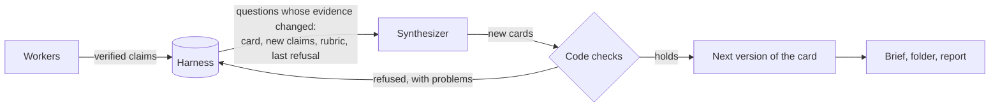

A **campaign** is one piece of research: what to improve, reach or find out, and how to judge it. Thermite runs three kinds, called **modes**. This page explains how each mode works, what ends it, and how to choose one.

| | Hill climb | Goal | Research |
| --- | --- | --- | --- |
| The question | How far can this number go without breaking anything else? | Can the project reach these goals? | What can be learned about this question in this time? |
| An agent's work | One change to the code, and any sources, claims and notes it records on the way | One change to the code, and any sources, claims and notes it records on the way | Reading sources and recording claims, with quotes, and findings |
| What checks it | The judge, by timing the change against the champion with statistics | The judge, by each goal's own test; the review panel passes goals that need judgement (and you, when the run asks you) | Code that finds every quote, word for word, in a page the rig archived, and checks each finding against verified claims; the review panel decides each question and each required hypothesis by a majority, and code checks its answers the same way |
| The best result | The champion: the best confirmed version | The champion: the version that meets the most goals | The findings, the verified claims and the report |
| It ends when | Never on its own: you pause it | Every required goal is met, or the evidence shows that they cannot be (where the contract allows it; you decide, if the run asks you) | After its minimum duration: the review panel's decisions give every question an end (you decide, if the run asks you), research stops adding (the progress rule), or its maximum duration is over |
| The dashboard's headline | The best gain over the starting point | Goals met | Verified claims |

## What every mode shares

Each campaign has a **contract**: a file that says what the campaign must achieve, what must not get worse and which files the agents may change. A contract has a version number; a changed contract is a new version, never an edit of a running one. A **run** is the campaign on one rig, and one campaign can have runs on several rigs. [Write a contract](../how-to/campaigns/write-a-contract.md) and the [contract reference](../reference/contract.md) cover every field.

In every mode, **code decides when a campaign is done, never an agent.** No agent can close a run, mark a goal met or end the research early. The owner can close a run by hand, in any mode, when they no longer want it: it ends for good ([Steer a run](../how-to/campaigns/steer-a-run.md#close-a-run)).

Nothing ends a campaign by default. There is no limit on turns, attempts, failures or time unless you set one. The contract can set three **budgets**: hours since the run was created (paused time counts too), hours of judging on the device, and money spent on the model (counted only when the rig is told the model's prices). A spent budget **pauses** the run; it never closes it. The **Stop after (hours)** field on the New campaign page sets the first. [Set a budget or a stop time](../how-to/campaigns/budget-and-stop-time.md) explains all three, and [Why Thermite runs until the job is done](runs-until-done.md) explains why there are no defaults.

A rig works on one run at a time. Starting or resuming a run on a rig pauses the run that was running there; a paused run can be resumed later.

### Research in every mode

Reading is not only for research campaigns. A change to code often rests on something read: a paper, upstream code, an issue or a specification. So workers in hill-climb and goal runs can fetch web pages through the rig's archiving fetcher, read and search what the run archived, and record a claim with its exact quotes or a research note with the sources it rests on. Code checks their claims as it checks a research run's ([Research](#research)). Findings, hypotheses and report sections stay with research runs: a hill-climb or goal run refuses them.

Such a run's research folder holds `INDEX.md`, `sources/`, `claims/` and `notes/`, which the harness writes from the run's records and keeps current, `knowledge/`, the past research described below, and `compactions/` once a trial's conversation was [compacted](../reference/limits-and-pacing.md#compaction). Once the run has recorded anything there, each worker's brief points to the folder, and tells the worker to search it before fetching a page again. The fetcher uses fixed values in these runs: it respects `robots.txt`, and fetches at most 6 pages a minute from each site and at most 5,000,000 bytes a page. In Pi, the worker has the tools `fetch`, `read_source`, `search_corpus`, `add_claim` and `add_note`; in OpenCode, Claude Code and Codex, the same five as `thermite-trial research` commands.

### The campaign's brief

In every mode, a campaign can carry its author's **brief**: additional information in Markdown (the project and its links, what was tried, limits, what good looks like), starting links, ideas to try (hill climb and goal) and hypotheses. It is part of the contract. The planner (in a hill climb or goal campaign) and the advisors read it whole, each worker reads it in its brief, and the run's folder keeps it as `BRIEF.md`. The agents weigh it as starting points, not rules: the objective, the judge and the owner's messages decide. [The campaign's brief](../reference/contract.md#the-campaigns-brief) lists what each agent gets.

### Field notes and past research

In every mode, the workers, the planner (where the run has one) and the advisors keep **field notes** as they work: short notes of what they observed, decided and learned, which the run's **Journal** tab shows. Every run's records also go into its campaign's collection in **Thermite's knowledge base** on control. Later runs of the campaign read that collection, and other campaigns' collections when the owner grants them, in their research folder's `knowledge/`. [Journals and the knowledge base](journals-and-knowledge.md) explains both.

## Hill climb

A hill climb pushes one number, the **primary metric**, up or down: operations per second, run time, a score that the kit's check reports. The contract says which way is better and the smallest gain that counts. It can also name:

- **guards:** other metrics that must not get worse, each with how far it may slip in one step and in total against the starting point's measured values, so a faster change that loses quality is not a win;
- **hard constraints:** pass-or-fail limits, such as a longest allowed run time;
- **test cases** that the judge measures every time, and **hidden test cases** that it runs only to confirm a change that already looks better. The kit and the contract call a test case a **cell**; the dashboard calls it a **case**.

**Where it starts.** A hill climb's first job is its **baseline**. Before any change is judged, the judge builds the starting point and times it alone on every test case, in three blocks, and records each case's value of the primary metric, of every guard and of the kit's other metrics, with their spread. No round of work is planned and no trial starts until it has done so. Everything after is held against those values: a guard's total allowance holds against what the starting point measured, not only against the sum of each step's estimate. During the baseline, the kit's check may keep files, such as reference outputs, in a folder only the judge can reach; every later check reads them and cannot change them. The run's page shows the baseline under **Where the run started**.

**A starting point that can't be measured yet.** When the starting point does not build, crashes on a case, fails the kit's check or gives an impossible value, the run is in **setup**. Its rounds are setup rounds: each worker's brief gives the judge's reasons, and asks for a change within the editable paths, never the kit, that makes the project build and run every case. A project that starts from nothing begins this way. The judge checks each such change with its baseline job, as it checked the starting point. The first change it can measure becomes the starting point, as a new champion, and its values the baseline; the gain counts from there. A change it can't measure gets its verdict, with the reasons, and the lane tries again. Agents never judge: the judge's baseline job decides, and the kit stays the judge's.

**How a change is judged.** The judge builds the change and checks that it works on every test case. Then it times the change and the champion together, in blocks that alternate between the two on the same device, and decides with statistics set in the contract. A change that looks better is timed again in fresh blocks and run on the hidden test cases. After the baseline, and then once a day when it has nothing else to do, the judge times the champion against itself to learn how noisy the rig is, and uses that in every later decision. [Why agents never judge](why-agents-never-judge.md) follows a change through every step.

**Who promotes.** Hands-off by default: a confirmed win becomes the new champion with no step of the owner's. On a rig with an auditor, a surprisingly large gain first goes to an **audit**: by default, a gain above 15%, or above three times the median of the run's earlier confirmed gains once it has three. So does a change whose agent declared known flaws. The auditor's clear is the last step; its block stops the change, with its reasons; anything it hands on waits for the owner. A run waits for the owner only where it was set to ask: every promotion, a gain above a line, or declared flaws. [Decide what waits for you](../how-to/campaigns/decide-what-waits.md) shows how to choose.

**When it ends.** Never on its own. A faster program can always be tried, so no code closes a hill climb. It stops when you pause it, when a budget you set pauses it, or when another run starts on its rig, and ends when you close it. Its champion is ready to download at any time.

## Goal

A goal campaign works until a list of goals is met. Each goal has its own test, which the contract names:

- **a code test:** a set of the kit's test cases, called a **verifier**, that must all pass the kit's check. A kit can order its verifiers and run an expensive one only after the cheap ones it depends on have passed;
- **a metric threshold:** a number, such as items per second, that must be above or below a value. The judge runs each test case several times (five by default) and counts the goal as met only when the whole uncertainty range is on the passing side;
- **a review:** a goal that needs judgement, such as the quality of documentation. The rig's review panel, a group of models, reviews the champion's change without knowing who wrote it, and needs at least two reviewers who all pass it (two to five in the advisors file, three on one model when its model comes from control: **Edit rig**, MCP or the REST API). Their pass meets the goal, unless the run asks the owner to accept it.

The contract also says what the finished work must be, and can list results that do **not** count, such as a special case that only passes the tests. That list goes to the auditor and the reviewers; code does not check it.

**What counts as progress.** A change makes progress when it meets a goal that the champion does not, and loses none that the champion meets. A change that could not check a goal the champion meets is not counted as worse, but not as progress either: its verdict is `inconclusive`. A change that makes progress is checked again in fresh runs, and on hidden test cases for the goals it gained, before it is promoted. If the contract has an adversarial checklist, a list of ways a change could fake success for the auditor to look for, every promotion is audited first.

**How each goal is checked.** The contract's words for a goal can drift from what the kit really runs. So the dashboard shows each goal's real check: folded under **How it is checked** below each goal in the run's **Goals** block (and in a campaign's **Goals** block before its first run), and under **How each goal is checked** on a campaign's page once it has runs: the kit's verifier or the metric threshold, the cases it runs on with the parameters the kit runs each with, each case's time limit, and the hidden test cases by name only. It comes from the kit as the run's rig reported it when the run started; for a campaign's page, from the kit control keeps when it keeps one, else from the newest run's rig report. When there is none of these, it shows what the contract says, and says why the rest is missing. `get_run` and `GET /v1/rigs/<rig>/view` give the same as each run's `goal_checks`.

**The goal report.** When the run starts, and after each promotion, the judge checks every goal on the champion. The planner and the workers see that report, so they know which goals are still open, and the next round of work waits for it, for up to two hours. For each goal checked by code, met or not, it gives what the judge measured on each test case: a metric threshold's mean and range, and a kit verifier's metrics, such as a quality ratio. So everyone sees how far an open goal is from its line, and how much room a met one leaves. A hidden test case's values are never in it. The run's **Goals** block shows them under each goal; [The goal report](../reference/verdicts.md#the-goal-report) gives the details.

**When it ends.** In one of two ways:

- **Every required goal is met**, or, if the contract says so, at least a set number of them. Because this ending is final, the judge checks the champion twice, independently, and closes the run only if both checks agree. The second check also runs the hidden test cases of every goal the champion meets: a change is checked on hidden cases only for the goals it gained, so a goal met long before would otherwise never meet them. While the second check waits or runs, no new trial starts: its work would be lost when the run closes. A trial already at work goes on, and if the second check does not agree, or a hidden case fails, the lanes go on too. A goal whose hidden case failed counts as not met, so the lanes work on it again; they learn which goal and how its hidden check failed, never which case.
- **The evidence shows that the goals cannot be met.** Thermite proposes this ending, called **"not possible"**, only when the contract allows it, and only with evidence: a number of different approaches, set in the contract, each tried at least three times with no progress. Those approaches are then set aside. By default the proposal closes the run. A run that asks you about it waits for you to accept it, which closes the run, or reject it, which reopens them; a new proposal then needs more failed approaches than the last one. No agent can propose it.

A goal campaign has no time limit of its own. Budgets pause it, as in any mode.

[Your first goal campaign](../tutorials/first-goal-campaign.md) runs one from start to finish.

## Research

A research campaign studies a topic until its questions are answered. The contract gives the topic, the questions and which web sites to include or leave out. A question can be as long as it needs, with several lines; every research worker's brief has each one whole. The brief adds the background, the starting links (the contract's `seeds`) and the author's hypotheses. The harness fetches and archives the starting links when the run starts, while the first trials run, and the run starts with those hypotheses as its own, so its workers look for sources for and against them. There is no project to change and no kit: the work is reading.

**How the work is checked.** Workers fetch pages through the rig's archiving fetcher, which keeps a copy of everything it reads. By default it respects `robots.txt`. It limits how fast it fetches from each site and how large a page may be, and never fetches private or local addresses. An answer that is not a success (an HTTP status other than 2xx) is never archived: an error page, such as a 404 or a site's challenge page, is not a source, and no claim can quote it. A page refused for a reason that lasts, such as its size, `robots.txt`, or a 404, a 410 or another 4xx answer, is refused at once when a worker asks for it again in the same run, with no new download, and the answer says it was refused before and how many times it was asked for, and to look for the same text elsewhere. A 408, a 429 or a 5xx answer can pass: it is not archived, and the next ask fetches the page again. A page a worker reads any other way verifies nothing until it is fetched through the archiving fetcher. A worker records a **claim** with exact quotes from those archived pages. Code then checks it:

- a claim is **verified** only if every quote appears word for word in the archived text, and every number in the claim appears in its quotes. Otherwise it stays a draft, with its problems listed. The same claim sent again with the same quotes is not recorded twice: the worker gets the earlier claim and its problems back, with a note to copy the words exactly or to record a note instead;
- each quote names its source by the id that the fetch gave it, such as `s-3f2a9c41d0b7`. A worker may also name it by the page's address, when that page was archived, or by its file name in the research folder (`sources/s-3f2a9c41d0b7.txt`). When that names exactly one archived source, the quote is checked against that source's text, as by its id, and the claim keeps both the id and what the worker wrote. When it names none or several, the problem says what the source could be: `fetch it first`, the ids an address was archived as, or an archived address written another way, such as `http` for `https`;
- a number from a heading or a label in the claim's text, such as `Question 0:` or `# Claim c-005`, counts like any other number. Its problem says that it comes from that heading, and that a question's number goes in the claim's `question` field;
- a verified claim whose quotes come from at least two different web sites counts as independently sourced. A site is a registrable domain, the part of an address that one owner registers: `docs.example.com` and `blog.example.com` are one site, `example.com`; `www.example.co.uk` is `example.co.uk`; `alice.github.io` and `bob.github.io` are two. Thermite keeps a short table of suffixes such as `co.uk` and `github.io` in its code; a host under a suffix missing from it counts as its last two labels, which can only count fewer sites, never more. The run's count of domains counts sites the same way. The contract can ask for more sites. The report lists these claims apart from those that rest on one site.

The run's **History** tab has a line for each claim: `lane-1 recorded a verified claim: "…".`, or `lane-1's claim stays a draft: "…". Why: …`, with the first three problems, in the words the worker got back.

When verified claims together show something, a worker records a **finding**: the conclusion in one sentence, a summary, why it matters, and the verified claims behind it. Code checks a finding too. It counts only if every claim it cites is verified and every number in it appears in those claims. Otherwise it stays a **draft finding**, with its problems listed. A finding is kept once: the same conclusion sent again gets the finding already recorded. A draft's answer tells the worker to fix its problems and send it again with the same words. A finding that repeats a draft, word for word once case, punctuation and spaces are set aside, is recorded only when it is now supported: otherwise it is refused, whatever its problems, with the draft it repeats and its own problems, and the advice to cite only verified claims and their numbers, or to record a note instead. The report lists a draft among its draft findings only until a supported finding of the same words fixes it. The report gives each finding with its support, and says how many of its claims are independently sourced.

Workers can also write research notes and draft report sections. The report shows those sections as worker sections, never as findings, and flags any number in them that is in no archived source and no verified claim. A note that repeats one of the run's last 200 notes word for word, case, punctuation and spaces aside, is refused: a note is kept once.

**Hypotheses.** The author's hypotheses, from the campaign's brief, are the run's obligations: the review panel gives each a verdict. A worker may propose more, each with the question it is about (its index) and the verified claims behind it. These go to the run's **pool**: tied to a question, kept once, and changed in place. Code refuses a hypothesis whose words repeat a live one of the run (the author's, the pool's or a promoted one), case, punctuation and spaces aside, and names the one it repeats, so the worker changes that one with `revise_hypothesis`: its words, its question or its supporting claims, which must be verified claims of the run. The author's hypotheses change only with the brief, and are refused there. A revision whose new words repeat another live hypothesis merges into it: the first one's status becomes `merged`, with the one it went into. Only the author's hypotheses and promoted ones need a verdict from the review panel; the pool's never make a review fail, and the report lists them as proposed by the run. The owner promotes one of the pool with the command [`hypothesis_status`](../reference/signed-commands.md#hypothesis_status), so the review panel must give it a verdict, returns a promoted one to the pool, or retires one, each with why: on the run's **Hypotheses** tab, **Promote**, **Return to pool** and **Retire** send it ([The Hypotheses tab](#the-hypotheses-tab)). The run's [planner](#the-planner) promotes and retires pool hypotheses too, within its bounds. The author's can't be changed this way. The worker's brief, `INDEX.md`, each file under `hypotheses/` and the report show every hypothesis with its status and its question, the author's first. The events are `hypothesis_added`, `hypothesis_revised`, `hypothesis_merged` and `hypothesis_status`, and the campaign's collection in the knowledge base follows them.

On the run's **Overview** tab, the block **Research questions** shows where each question stands, from the newest digest or final report, the answer cards and the review panel's decisions. Its top says where the end stands:

- **Questions:** how many are answered, at the best available and still open, and how many of the open ones are saturated, such as `Questions: 2 answered · 1 at the best available · 1 open (1 saturated).`;
- **Answer check:** where the check that ends the run stands, in one line ([When it ends](#when-a-research-run-ends)), including when the final writer is writing the run's paper and when the paper is in;
- the **progress rule**, while the run runs and its harness reports it: a bar, **Without an improvement**, such as `1 h 54 min of 2 h 45 min`, the time since the run last improved against the quarter of its running time the rule needs, with when the last improvement was and what the rule waits for, such as `It does not apply yet: Question 3 is not saturated, so the plan still gives it tasks.`;
- **Hypotheses:** how many need a verdict and have one, and how many are in the pool, with a link to the **Hypotheses** tab; and **Reviews:** how many, and when the newest was posted or asked, with a link to the **Reviews** tab.

Then each question, as **Question 1**, **Question 2** and so on, with its words (two lines at most, the full words on hover):

- a mark and a chip for the review panel's decision that stands: ✓ `answered · high` (or `moderate`, `low`), ≈ `best available, insufficient`, `open`, `no decision yet`, or `to review again` when its card changed after the decision; a chip counts the reviewers who dissent, with their verdicts on hover;
- `saturated`, while it is open and its last 4 tasks added no verified claim from a new site and its card's certainty did not rise: the plan gives it no more tasks;
- its answer card's answer, cut to a few lines with **more** to read it whole, after its version, certainty, the claims it cites, who wrote it and when; or `No answer card yet.`;
- **Open gaps in the evidence**, which the next tasks look for, and **Next experiments**, the gaps only a measurement can settle, for a goal or hill-climb run;
- the synthesizer's newest refused card, if one came after the card, with its first problem;
- a line of figures, such as `41 verified claims · 6 of the last 20 tasks · 9 tasks done added 23 verified claims, 9 from sites new to it · not saturated`: its share of the run's newest research tasks given out (at most 20), what its finished tasks added, and whether it is saturated; and a bar of its verified claims, measured against the question with the most. Once the paper is in, a **Research paper** line says who wrote it, whether the rig's STE checker checked it and how many next experiments went to the knowledge base, with a link to `paper.md`, and **Research paper** opens the paper beside **Latest report**. A line counts the numbers in the latest report that appear in no archived source and no verified claim, such as `3 numbers in the latest report appear in no archived source and no verified claim. The report flags each one.`, and **Latest report** opens the report.

**The research folder.** Each run has a folder of files that its workers search and add to. The harness writes most of it from its records and keeps it current while the workers record. The workers can read what the harness writes and the lanes' saved files, and change only their own lane's working area:

```text
INDEX.md          the questions, what is known so far, each question's answer card, and where everything is
REPORT.md         the newest report
paper.md          the research paper, once code accepted it, with its references and appendices
next-experiments.json  the paper's next experiments, each with its kind (hill_climb or goal), measure and what it rests on
BRIEF.md          the campaign's brief from its author, when it has one
cards/q<index>.md each question's answer card, whole, with its earlier versions (q0.md is question 1)
sources/          every archived page as text: the words a claim's quotes must match
claims/ findings/ hypotheses/ notes/ report/
                  every claim (verified or draft), finding, hypothesis, note and report section
lanes/<lane>/     each lane's files, as they were when its last trial ended
work/<lane>/      the lane's working area: syntheses, outlines, drafts, lists of what to read next
compactions/      each agent conversation the harness kept whole before each compaction
knowledge/        past research from the collections the campaign may read; its README.md says what is where
```

**How questions are numbered.** Every field an agent writes, such as a claim's `question`, takes a question's index, from 0, and so do the records and the folder's file names. Text that people read counts from 1. Where agents read it too, it names both: a worker's brief, `INDEX.md`, `REPORT.md`, a claim's file and a research task's title say `Question 1 (index 0)`. The dashboard and the review panel's notes in the journal say `Question 1`, and the paper's appendix numbers each question from 1.

A lane's working area is kept for its next trial, so a worker builds on what the trials before it learned. When a trial ends, the harness saves the lane's files, records which trial wrote or removed each one and when, and shows them to the other lanes under `lanes/`. These files are working material, not results: only claims and findings recorded through the research tools are checked and reported.

**What a worker has.** It depends on the rig's [worker harness](../reference/glossary.md), the program the agents run in:

- **In Pi**, a worker has the research tools (fetch, read an archived source, search the archive, record a claim, a note, a hypothesis or a finding, revise a hypothesis of the pool, write a report section, and see the progress) and file tools: list, read and search the folder, and write and remove files in its own working area. It has no shell. Its `idea` tool proposes another research task for the queue, and its `note` tool writes a field note.
- **In OpenCode v2**, a worker keeps OpenCode's own tools, including its shell and files, as a hill-climb worker does. It starts in its lane's working area and runs the research tools as `thermite-trial research` commands, proposes another task with `thermite-trial idea`, and writes a field note with `thermite-trial note`.

A Claude subscription runs only in Claude Code, which doesn't run research workers, so a research campaign needs another model. On a rig whose workers run in Codex, research workers run in Pi, with the same model. OpenCode's own free models work only when the agents run in OpenCode v2. A research campaign needs a model to do anything at all.

**How the work is planned.** Each round of a research run is planned from the questions' [answer cards](#answer-cards) and their gaps: by the run's **planner**, a model, when it is on, and otherwise by fixed rules in code, the **gap-driven plan** ([The planner](#the-planner) below). Each research task is an experiment in the run's [experiment queue](agents-lanes-planner.md#the-experiment-queue): one of the campaign's questions, one gap in its evidence that the task closes, and a kind of task (explore, find primary sources, look for contradictions, or consolidate). A task of the plan's names its question in its title, such as `Question 2 (index 1): Trace existing claims to primary sources (papers, specifications, data)`, and its gap on the first line of its details, such as `Evidence gap to close: the vendor's documentation of the warp scheduler`. Each **lane** (a line of search, with one worker) gets its task from the gap-driven plan for each later trial of a round, and at a round's start when the planner is off, when its answer is refused, or when the task it gave can no longer be given out:

1. **The owner's tasks first,** in queue order, as before, and any task that names no question.
1. **Then a hypothesis with no evidence.** A required hypothesis that the review panel left `undecided` with no claim for or against it gets a task of the plan's: one at a time, and at most 4. Its kind is primary sources; its title is `Find evidence for or against hypothesis h-…`, after its question's label when it has a question; and its gap is `Hypothesis h-… needs a verdict and no claim supports or contradicts it yet: find sources that confirm or refute it, and record verified claims from them, each under the question it bears on`, with the hypothesis's words. The author's hypotheses name no question, so their tasks name none either. Each of these tasks that is done shows the review panel the hypothesis again.
2. **Otherwise, the question its gaps weigh for.** Each question weighs how open its card's certainty is (`none` 4, `low` 3, `moderate` 2, `high` or `insufficient` 1) plus its card's open evidence gaps. A question with no card yet weighs as much as the most open one, and at least 5. A question the review panel decided (answered or insufficient, a decision that stands until the question's card changes) weighs nothing, and so does a **saturated** one, whose last 4 tasks added no verified claim from a site new to the question while its card's certainty did not rise (a card rewritten at the same certainty doesn't count). When every question still open is saturated, those weigh again, so the lanes keep reading while the progress rule runs; when every question is decided, they all do. The **floor**: a question with open evidence gaps, or with no card, that has no task in the round gets one first, the heaviest first. Then each task goes to the question furthest below its share of the round by weight. The **ceiling**: a question that holds half of the run's last 2 × lanes tasks given out gets no more while another question that weighs has open evidence gaps. A task the round holds for a lane that has not started in it counts as given out, unless that lane is still on an earlier round's trial.
3. **That question's first queued task,** whoever added it (a teacher, or the owner when they queued a lane's idea), or else a new task of the plan's for it. Its gap is the first of the card's open evidence gaps that no waiting task names, then each in turn; with no card, `No answer card yet: find and archive sources that answer the question directly, and record verified claims from them`; with a card that names none, `The card names no open evidence gap: find independent sources that confirm or contradict its main points, from sites its claims do not cite yet`.

The kinds of task come in turn. When an hour passes with no new source and no newly verified claim, primary sources and contradictions come first. Rules steer the kinds: **Avoid** removes one, **Always** and **Try** put one first, and a try or always rule with a question's index puts that question first. Each round's record says where each question stands, such as `research plan, gap-driven: Question 1 (index 0): certainty low, 3 evidence gaps; Question 3 (index 2): no card; Question 4 (index 3): certainty moderate, 2 evidence gaps, decided answered; Question 5 (index 4): certainty none, 1 evidence gap, saturated; …`. A task keeps the question it is about: the plan's own, a worker's idea or a teacher's item that names one (`question`, an index), or a title labelled `Question 2 (index 1)`. When its trial ends, the task keeps what the trial added, its **yield**: the verified claims its lane recorded, by question, and how many of them brought a site the question's claims had not cited; the sites new to the run among the pages it fetched; and its supported findings. The teachers read both in the queue, and the `experiment_finished` event carries the yield. A research run's page calls its queue **Tasks** (a hill climb's or goal run's page calls it **Experiments**), and labels its parts the same way: **Add a task**, **Kind of task** in place of **Direction**, and **Task** at the head of **Tried**. It shows each task's question as a chip, such as **Question 2**, when its title doesn't name it, and under **Tried** its yield, such as `finished: 3 verified claims, 2 from sites new to its question, 1 finding`; a task that added nothing reads `finished: no verified claim`, in grey. MCP's `run_queue` gives each task's `question` and `yield`. The teachers read what the run has found before they propose tasks: the sources, the claims with the harness's reasons for each draft, the hypotheses, findings and notes, the report and the lanes' files ([What the teachers read](supervision.md#what-they-read)). A worker's idea for another task, with its question, waits until the planner's model or the owner queues it or drops it. The report shows what was new in the last hour. The owner can message the lanes, the planner, the teachers and the review panel of a research run; it has no auditor to message ([How the parts fit together](how-it-fits-together.md#the-owners-messages)).

**What it produces.** The final report and the whole research folder: the archived sources, every claim, finding, hypothesis and note, each question's [answer card](#answer-cards), and the lanes' files. A digest of the report comes every hour by default, with a line that says where the answer check stands. Every report opens with **Answers**: each question's answer card, as `### Question 1: …` with its certainty, the card's version, who wrote it and when, its answer, the claims it cites and its open gaps, or `No answer card yet (12 verified claims).`; the questions, findings and claims follow, as before. When the run [ended](#when-a-research-run-ends), with every question at an end or by the progress rule, the final report starts with the run's [research paper](#the-research-paper), with its references and appendices, when the final writer's paper passed the harness's checks. Then, as supplementary material, come the answer cards, **The review panel's decisions**: how the run ended, then each question's standing decision (`Decision: answered, certainty high (review 3, card version 2; 3 of 4 reviewers).`), the first answer of its majority with the claims it cites and its next experiments, or an open question's evidence gaps, and each dissent (`- Dissent: reviewer-2: open: …`); **Hypotheses: the review panel's verdicts**: each required hypothesis supported, refuted or undecided, with why, its claims and its dissent; and the corpus. An ended run without a paper says why in its final report, such as `Research paper: none, no final writer on this rig.` A final report of a run that did not end that way says which questions stayed open. The rig's export after the final report carries the folder, without `knowledge/`, and every export carries the run's field notes and research notes ([Set up the results repository](../how-to/operate/results-repository.md#what-gets-pushed) says what reaches the repository). A full export, which **Export** on the run's page asks for, carries the folder as it stands at any time, while the run runs, is paused or is broken ([Normal and full exports](../reference/exports.md#normal-and-full-exports)).

**Web search.** Research workers search the web through an MCP server the campaign gives them ([Give agents MCP tools](../how-to/campaigns/give-agents-mcp-tools.md)). Without one, they start from the campaign's starting links and follow the links of pages already archived.

### The planner

With the planner on (**Edit rig**), each research round starts with one call of the planner's model, through the same machinery as a hill climb's ([The planner](agents-lanes-planner.md#the-planner)), from what the harness builds from its records:

- each question with its rubric, its answer card (the answer, cut at 1,500 characters with its length said, its certainty, its open evidence gaps whole, and how many measurement gaps it has), the review panel's decision that stands, whether it is decided or saturated, the weight the gap-driven plan gives it, its share of the run's last 2 × lanes tasks given out, its tasks this round and what its last 4 tasks added;
- whether every open question is saturated, whether every question is decided, and the ceiling;
- the queue, with each task's question and what each tried task added;
- the kinds of task and the rules on them;
- the hypotheses that need a verdict, and the pool, its 60 best supported with how many more there are, how many more it may promote, and those whose status the owner set;
- what a research run can't do: it measures nothing;
- the owner's messages to the planner and to everyone working that it has not read, the campaign's brief, the newest 20 field notes, the background from past research and where the run's past research is.

It answers with a task for each lane and changes to the queue, each with why: tasks to add, queued ones to move or drop, and ideas to queue or drop. Each new task names its question (an index), one evidence gap it closes (`gap`), the kind of source to read (`source_kind`), a title and details, and its kind of task. Its title gets its question's label, such as `Question 3 (index 2): Occupancy limits`, and its details read `Evidence gap to close: …`, then `What to read: …`, then the planner's details and the question. Code checks every task and refuses, in words:

- a question the run doesn't have: `question 9 is not one of the run's questions (an index from 0 to 5)`;
- a question that is decided, or saturated, unless every open question is saturated: `Question 4 (index 3) is decided (answered at moderate, review 7): its decision stands until its card changes, so give the lane a question still open`;
- a gap, or a title, details or kind of source, that asks for a measurement: `its gap asks for a measurement ("Time the"), and a research run measures nothing: …`;
- a kind of task that isn't one, or that an **Avoid** rule names, and an answer that gives no lane a task of a kind an **Always** rule names;
- a queued task or an idea, given out or queued, that names no question (the owner's tasks excepted);
- what a hill climb's planner may not do either: a lane given no task or two, one task given to two lanes, a task given out and dropped in the same answer, and moves, drops and ideas queued that the queue doesn't allow.

A refused answer goes back to the model once, with its errors; then the gap-driven plan sets the round, and the round's record says why, as the planner's rounds do. The owner's messages count as read by the planner only when its plan is used.

The planner may also promote up to 3 pool hypotheses a round, each with why, so the review panel must give each a verdict, and at most 10 in a run: every promoted hypothesis is an item each reviewer must judge, with its claims in the review's package, and one long run's reviews failed when hundreds did. The owner may promote more with [`hypothesis_status`](../reference/signed-commands.md#hypothesis_status). It may retire a pool hypothesis that repeats another or is out of scope, with why. It never promotes or retires one the owner set the status of last, nor any that is not in the pool. Its changes go through the same step as the owner's command, with `planner` as who made them: the event `hypothesis_status` with `by: "planner"`.

Live shows each round, such as `round 4: planned by the model`, each lane's task, and `hypotheses: promoted h-…; retired h-…`; or `round 4: set by the gap-driven plan (the model gave no usable plan)` with why each try gave none, or `(the planner is off on this rig (Edit rig))`.

### Answer cards

Claims alone are not an answer. So the harness keeps one **answer card** for each question: the run's current answer in a few paragraphs, its certainty, the verified claims it cites, and its open gaps. Workers add claims; they never write or change a card. The supervisor's [synthesizer](supervision.md#the-synthesizer), an advisor with its own model or else the model of the rig's first teacher, writes each card from the question's current card and the verified claims recorded for it since, and the harness checks it in code before it keeps it, as it checks a finding. A question with no card is asked as soon as it has a verified claim; after that, its card is written again once 5 new verified claims came, or once the card is 30 minutes old and any came, so the synthesizer is not called for every claim. A rig with no teacher, or with its teachers switched off on **Edit rig**, has no synthesizer, and its research runs' questions keep no card.



A card has:

- **an answer**, at most 6,000 characters: a few paragraphs, judged against the question's rubric. A contract's `rubrics` give one for each question, in order ([the contract reference](../reference/contract.md)); without them, a question's rubric is the question itself;
- **a certainty**, one word of a scale: `high` (verified claims from independent sites agree, and answer the question directly), `moderate` (they answer it, but from one site, or with small gaps), `low` (they answer it only in part, or disagree), `insufficient` (the best answer the sources allow: what is missing can come only from a measurement), or `none` (no verified claim answers it yet);
- **the claims it cites**, at most 60, by their ids;
- **its gaps**, at most 12, each at most 500 characters and of one kind: `evidence`, a gap a source could close, with the kind of source; or `measurement`, a gap only a measurement could settle, with the next experiment for a goal or hill-climb run. A research run measures nothing, so workers see only the evidence gaps.

Code keeps a card only when every claim it cites is a verified claim of the run, recorded for that question (a card may cite a claim of another question, or of none, when it says why, in at most 500 characters); every number in the answer is in the claims it cites; a certainty other than `none` cites at least one claim; and the answer, the certainty and the gaps keep to the limits above. A card that fails is not kept: the old card stands, and each problem, in words such as `the number 7777 is not in the claims it cites` or `gap 1's kind "data" is not evidence (a source could close it) or measurement (only a measurement could settle it)`, goes back with the question's next request. Every kept card is a new version: the newest is the card, and the earlier ones stay.

**Which questions are written.** The harness lists, for each running research run that has not [ended](#when-a-research-run-ends), the questions whose evidence changed since their card (a run that ended keeps its cards as they were, for its paper): those with verified claims recorded since the card was written, or with no card yet and at least one verified claim. Each comes with its card and the claims that card cites, its new verified claims (their words, their sources' sites and whether they are independently sourced), its rubric, and the problems of its last refused card. A card records the newest claim it was given, so a claim recorded while a card is written is new to the next request, never lost. A run's request is at most 150,000 characters: when it would be longer, each question shows fewer new claims, the oldest first, and the rest come in the next request; it says so. The synthesizer gets one request for each such run at each round of the advisors, rewrites each card judged against the question's rubric, and posts them; a failed call, a refused card and a question it gave no card are tried again at the next round, with no limit on tries. The harness gives the list at `GET /v1/research/cards/pending` and takes cards at `POST /v1/research/cards/<run>`, for the supervisor's token only ([the routes](../reference/advisors-file.md#answer-cards)).

**Where they are read.** A research worker's brief has each question's card before the corpus's counts: `Question 1 (index 0), certainty moderate (card version 3): …`, the answer cut to 1,200 characters with where the rest is, and each open evidence gap, or `no card yet (12 verified claims so far)`. The research folder has each card whole, with its rubric, the claims it cites, its gaps and its earlier versions, in `cards/q0.md` for question 1 (index 0) and so on, and `INDEX.md` lists each card's certainty and open evidence gaps. Every report opens with them, in **Answers**. The teachers' brief carries each card in `research.cards`, and their `read_research_file` reads a card whole.

Each kept card is the event `card_written` of the run, with the question's index, the version, the certainty, how many claims it cites and how many gaps it names, who wrote it, the newest claim it was given (`through`), and the card itself: its answer, the claims it cites (`cited`) and its gaps (`gap_list`). Each refused card is the event `card_refused`, with the question's index, who wrote it, how many problems it has and the first 20.

### When a research run ends

The minimum duration (`min_duration`) is the time a run has to collect sources and claims. After it, the run ends when every question has an end and every hypothesis that needs a verdict has one, or when research stops adding. No worker decides either: code asks the supervisor's [review panel](supervision.md#the-review-panel) about the run's items, decides each item from the reviewers' checked answers, and applies the end rules.

**The items.** A research run's items are its questions, each with its [answer card](#answer-cards), and its required hypotheses: the author's and promoted ones, not the pool's. Each item has at most one **standing decision** of the review panel. A question's decision stands until the synthesizer writes a newer version of its card; then the question is to decide again, even one answered before. A hypothesis's decision stands for good. A question **has an end** when its standing decision is `answered` or `insufficient`. A hypothesis has one when its standing decision is `supported` or `refuted`, or `undecided` with claims behind it: claims a reviewer cited for its verdict, or its own supporting claims. An `undecided` with no claim for or against it is no end, because nothing has looked for its evidence yet; the plan gives it a task (**How the work is planned**, above).

1. **Code decides when to ask.** At each digest (every `report_cadence.digest_minutes`, an hour by default) after the minimum, the harness asks the review panel only when every question has an answer card; when the run has the campaign's floor of verified claims, if it sets one (`min_verified_claims`, **Verified claims before the check** on the **New campaign** page); when no review of the run waits; and when some item has no standing decision: a question whose newest card is newer than its decision, or a required hypothesis with no end. A review is marked with the items it saw, each question's card version and the required hypotheses, and how many of the plan's tasks for hypotheses are done, if any (`items:0v3.1v2:h4-…:t1`), and is never asked twice on the same items. When nothing changed, no review is asked.
2. **The package.** Each reviewer gets the topic; the criteria; `decide`, the items to decide; the run's figures; every question with its newest card (its answer, certainty, gaps and version), the verified claims the card cites (their words; their quotes, at most 3, each cut to 400 characters; their sources' sites; and whether they are independently sourced), its rubric and its standing decision, if any; and every required hypothesis with its supporting claims and its standing decision, those to decide first. Nothing says which lane or model found what. A package longer than 200,000 characters drops, in turn, the quotes of the items whose decision stands, then those items' claims, then every claim's quotes, and then shows fewer claims for each item to decide; it says so in `shortened`, and each item counts what it left out. The prompt takes what the reviewer's context window allows, and at least 200,000 characters, with the criteria, the items to decide and the questions first; a cut is said, and the reviewer reads the rest with its tools.
3. **Each reviewer answers each item to decide.** A question is `answered`, with its certainty (`high`, `moderate` or `low`) and an answer that cites verified claims; `insufficient`, the best answer sources allow, when what is missing could come only from a measurement, named as next experiments; or `open`, when a source could still close a gap in the evidence, with each gap named. A hypothesis is `supported`, `refuted` or `undecided`, with why and the claims it rests on. A research run measures nothing, and the reviewers, the teachers and the workers are all told so: its evidence is what archived sources say, and nothing its workers run counts. So a question is never open only because a measurement is missing: it is `insufficient`, and the measurement, such as a test on the hardware the question is about or a benchmark, is a next experiment for a goal or hill-climb run to take. Workers record such an experiment in a report section or a note and propose no measurement for the queue, and teachers propose none either. Code holds them to it: in a research run, a worker's idea or a teacher's item whose words ask for a measurement is refused, with the words that ask and the advice to record it as a next experiment. The rule looks for an act of measuring, not the topic: `run a benchmark`, `benchmark the …`, `profile the …`, `time each …`, `measure the …`, an `A/B` test, running or testing something `on the card`, `on the box` or `on the hardware`, `on-box`, `run the litmus tests`, a `dev-run`, and a measured experiment's fields (`matched control`, `smallest discriminating experiment`, `expected gain`). A task about what sources report, such as `find the published benchmark results` or `documentation on the hardware scheduler`, is not refused. The owner's own tasks are never refused. The reviewers review at once, in parallel. A reviewer whose answer leaves out an item to decide, or gives one in a form code can't read, is asked once more for those alone, with the package's other hypotheses taken out, and what it gives is added to its answer. A verdict's or a certainty's word counts in any case (`Undecided` is `undecided`), and an answer, a reason or a list of claims over its limit is cut, not dropped.
4. **Code checks each answer.** Every claim an answer cites must be a verified claim of the run, and every number in an `answered` or `insufficient` answer must be in those claims, as for a finding. `answered` needs its certainty, its words and at least one cited claim; `insufficient` needs its best answer and its next experiments; `open` needs its gaps. A supported or refuted verdict needs at least one cited claim; an undecided one needs its reason. An answer that fails does not count, and its problems are kept.
5. **Each item is decided by the majority.** An item's decision is the verdict that more than half of the reviewers whose answer passed the check gave. An answered question's certainty is the median of theirs (with an even count, the lower of the two in the middle). With no such majority, or no answer that passed, the item is `open` (a hypothesis: `undecided`): with 4 reviewers, 2 answered, 1 insufficient and 1 open leave a question open. Every reviewer whose answer passed with another verdict is kept as the decision's **dissent**, with its verdict, its certainty and its reasons.
6. **The review passes** when, after it, every question and every required hypothesis has an end (`undecided` counts only with claims behind it). A pass is taken at once, unless the run asks you about reviews (**Ask me first about** › **a review panel's pass of a goal or of a research run's questions**): then it waits in **Needs you** ([Decide what waits for you](../how-to/campaigns/decide-what-waits.md#reviews)).

On a pass, no new trial starts, and the run waits for its [research paper](#the-research-paper). Once the paper is in and the trials still running finish, the run writes its final report, with the paper first and the decisions after it, and closes with the reason `every question is answered`. On a rig with no final writer, it does not wait: once its trials finish, it closes with the decisions, and its final report says `Research paper: none, no final writer on this rig.` Its page then reads **Completed**.

Each review's decisions go in the run's journal, from the harness: `Review 3 decided 8 items by the majority of 3 reviewers: Question 1 answered, certainty high (3 of 3); Question 2 open (no majority), 2 dissenting; …`. When items stay open, each reviewer that found an item open or gave an answer that failed the check adds what it found, by `panel:` and its name, and the evidence gaps of each question that stands open go in the next workers' briefs, under `# What the review panel found missing`, with the review each comes from. A gap that asks for a measurement is counted there as a next experiment, and an answer that failed the check stays out. A gap leaves the briefs when its question gets a newer card. The run goes on, and the review panel is asked again when a card changes. When you reject a pass, the run goes on too, with your note in its journal; the decisions stand, and the review panel is asked again when a question's card changes. A review whose reviewers fail to answer is tried again every 30 minutes, and its fifth try posts it, each reviewer with no answer counting as no answer to every item ([What advisors can and cannot do](supervision.md#what-advisors-can-and-cannot-do)).

**The progress rule.** A run can also end when research has stopped adding. At each digest after the minimum, the harness checks two things:

- every question still open is **saturated**: its last 4 finished tasks added no verified claim from a site new to the question, and its card's certainty did not rise while they ran. A card rewritten in other words at the same certainty, as the synthesizer does each round its claims change, is no progress;
- no item improved for a quarter of the run's running time, and for at least a quarter of its minimum: no decision ranked above the item's decision before it (for a question: open, then insufficient, then answered at low, moderate and high certainty; for a hypothesis: undecided, then supported or refuted), and no card more certain than the question's card before it. For an 8-hour run, that is 2 hours. Running time here is the run's clock, which leaves out the time while the run was paused, its agents could not work, or its rig drained before an image update: the time without an improvement leaves it out too.

When both hold, no review waits, and some item is still open, the run ends with its open items stated in its journal (`Research stopped adding: every open question is saturated, and no item improved for 6.0 h (the rule needs 2.5 h, a quarter of the running time). The run ends with these items open: Question 2. …`) and in Live: no new trial starts, the final writer writes its paper, which says what stays open and why, and the run closes with the reason `research stopped adding: its open questions are saturated`. This is not a time cap: the rule holds only once research has stopped adding, and a run that keeps adding goes on. A run whose items all have ends never ends by this rule: it waits for the review panel's pass, or for your word on it.

**Events.** Each review writes `review_items`, `item_decided` and `review_panel` events, which the dashboard's Reviews tab reads ([goal 116](https://github.com/iammrduncan/thermite/blob/main/docs/plan/goals/_completed/116-reviews-tab.goal)):

- `review_items`, one for each reviewer: `{review, reviewer, items}`, each item `{kind, key, card_version, verdict, certainty, reasons, claims, problems}`. `kind` is `question` or `hypothesis`; `key` is the question's index or the hypothesis's id, as text; `verdict` is the reviewer's word, or `none` when it gave no answer; `reasons` holds its answer, its gaps and its next experiments, cut to 1,000 characters; `problems` says why it failed the check, and is empty when it passed;
- `item_decided`, one for each item decided: `{review, kind, key, card_version, decision, certainty, dissent}`, each dissent `{reviewer, verdict, certainty, reasons}`, its reasons cut to 300 characters;
- `review_panel`: `{review, goal, result, reviewers, questions, gaps, decided, open}`. `questions` has each question decided, `{question, answered_by, decision, certainty}`, with the first answer of its majority (`answer`, cut to 500 characters, and `claims`) when it has an end; `answered_by` counts the reviewers whose answer passed with `answered` or `insufficient`. `gaps` holds the open questions' gaps, at most 20 (`more_gaps` counts the rest); `decided` is how many items the review decided, and `open` the indexes of the questions still without an end.

At each digest after the minimum, `research_progress` says where the progress rule stands: `{open, saturated, last_improvement, since_ms, needed_ms, stopped}`, the indexes of the open and of the saturated questions, when the run last improved (`null`: never), how long it has gone without, how long the rule needs, and whether it ended the run. The rule's end is `research_stopped`: `{reason, open, saturated, last_improvement, since_ms, needed_ms}`, its `open` holding `{questions, hypotheses}`. The harness keeps every reviewer's checked answer to each item and every decision in its ledger, and never changes either.

The run's **Live** says `review 3: the review panel is asked to decide questions 2, 5 and 4 required hypotheses` when the harness asks, then each reviewer's answer (`review 3 of the research questions, reviewer-1: fail. Questions: 1 answered, 0 insufficient, 1 open; 4 hypotheses judged. …`) and the review panel's outcome. Its **Overview** says under **Answer check** where the check stands, for example:

- `The check starts once the run has run for its minimum, 8.0 h. At the newest digest it had run 2.5 h.`
- `Waiting for a verified claim on questions 2, 3.`, or `Waiting for verified claims: 12 of the 40 the campaign asks for.`
- `The review panel checks whether every question is answered (review 3).`
- `Not yet: review 3 found gaps: …. The run goes on, and the review panel is asked again on new evidence.`
- `The review panel found every question answered (review 3). It waits for your acceptance in Needs you.`
- `Answered: the review panel found every question answered (review 3). The final writer is writing the paper. …`
- `The run ended before the review panel found every question answered: its final report says so.`, for a run closed at its maximum duration, by you, or by the progress rule.

The digest's own line, in `REPORT.md`, says the same for the workers, with each open question and why it is open: `Answer check: not yet. 4 of 6 questions have an end, and 3 of 4 required hypotheses a verdict; open: Question 2 (index 1) (open in review 3), Question 5 (index 4) (no decision on its newest card); the next digest asks the review panel.`

The maximum duration (`max_duration`) still ends a run when its time is up, ended or not: the trials still running finish, the final report is written and the run is closed. Without an end and without a maximum, it runs until you close it. Only time the agents could work counts: time spent paused does not, and neither does time the agents were stopped by the model provider (no credits, a refused key, no model call that worked for 30 minutes, a failing model check), waited for its rate limit, or waited for the run's MCP servers before its first plan or trial.

A rig whose supervisor has no review panel, or whose review panel is off (**Edit rig**), keeps researching: the review waits, so the progress rule waits too, and the run's **Answer check** says that its check waits for a review panel, such as `The check waits for a review panel: the review panel is off on this rig (Edit rig). The run keeps researching.`

### The Reviews tab

A research run's page has a **Reviews** tab, with its count of reviews, and so does its campaign's page, where it lists the reviews of all the campaign's runs, by run, the run at work first. Each review is a row, newest first, which opens:

- **The row** says what it decided, such as `2 of 4 questions answered, 1 at the best available; 2 of 3 hypotheses given a verdict`, or `Waiting for the review panel's answers`; when it was asked and on what (its verified claims, questions and hypotheses), and when it was posted and by how many reviewers; a chip for each item's decision, such as `Question 1: answered · high`; and its outcome: **Waiting**, **Passed**, **Not passed**, **Accepted** or **Rejected** (the owner's decision).
- **Asked**, **Posted**, **Tries**, **Outcome** and **Cost**: the times; how many tries it took, with each failed try and why, such as `Try 2, 14:05 UTC: 2 of 3 reviewers of the review panel answered (reviewer-2: …)`: the supervisor sends the harness each try it could not post (`review_try_failed`), and a rig from before that shows them as far as the run's **Live** view does; passed or not, how many items it decided and how many stay open, and the owner's decision and note; and the review panel's model use for it: its calls, tokens and time in calls, and its cost when its models have a price.
- **What it decided**: each question and hypothesis, with the decision and its certainty, each dissenting reviewer with its verdict and why, and the item's decision in the review before, such as `open (review 1)`, or `first decision`.
- Each reviewer, opened in turn: its verdict on each item, why, the claims it cites, and what code found wrong with the answer, such as `the number 12 is not in the claims it cites`. A review from a harness before item reviews shows how many reviewers found each question answered and **What the reviewers found missing** instead.
- How many field notes the reviewers wrote with it, with a link to the run's **Journal**, where its **Review panel** filter shows them.
- **Your messages to the review panel** that the review was given, with each reviewer's answer.
- **In the run's Live view**: the supervisor's lines for the review, with the time, while Live keeps them. They are not signed; the review's signed record is the rest of the row.

Beside the list, **Each item across reviews** shows each question's and hypothesis's decisions, oldest first, with the review's number, such as `open (1) → answered, certainty moderate (2)`, and `to review again` when a question's card changed since. MCP's [`get_run`](../reference/mcp-tools.md#get_run) gives the same: each review's times, what it saw, each reviewer's answers and the decisions, and the decisions that stand.

### The Hypotheses tab

A research run's page has a **Hypotheses** tab, with its count of hypotheses:

- **Need a verdict**: the author's (`AUTHOR`) and promoted ones (`PROMOTED`): the run does not end until the review panel gives each a verdict.
- **The pool**: the workers' (`POOL`), by question, the best supported first; no review waits on them. The tab shows the first 150; `get_run` lists them all.
- **Merged and retired**, folded.

Each shows its words (**more** for the rest), its question or `the whole run`, the review panel's verdict that stands, with its review and dissent, or `no verdict yet`, who proposed it (**the brief** or a lane), how many verified claims support it, its id, and the newest change of its status with why, such as `You set it to promoted 5h ago: “…”`. The owner changes one with a button, each with an info icon that says what it does:

- **Promote**, on one of the pool: the review panel must give it a verdict.
- **Return to pool**, on a promoted or a retired one: no review waits on it, and the paper's appendix lists it as proposed by the run.
- **Retire**, on one of the pool or a promoted one: no review waits on it, and workers no longer work on it.

Each opens a box with **Why** (required) and what the button does; its button sends the signed command [`hypothesis_status`](../reference/signed-commands.md#hypothesis_status), and the page follows it to the rig's answer. The author's hypotheses change only with the brief, a merged one not at all, and a closed run's not at all: they have no buttons.

### The research paper

When the run ends, by the review panel's accepted pass or by the progress rule, the harness asks the supervisor's **final writer** for the run's research paper. The final writer is an advisor: it uses its own model from **Edit rig**, or else the model of the rig's first teacher, so a rig with either (its teachers set up and switched on) has one ([Configure advisors](../how-to/operate/advisors.md#the-final-writer)). Until the supervisor says whether it has one (it says so every minute), the run waits. Its brief has how the run ended (`end`: its reason, the questions that stayed open, numbered from 1, and the required hypotheses with no verdict); each question's answer card, the claims the card cites with their quotes, its standing decision and certainty with the answers behind it and its dissent, and what only a measurement could settle (`stayed_open` for a question with no end, whose answer says what is missing); each required hypothesis's verdict with its dissent; the hypotheses the run proposed, which need no verdict; the campaign's brief; and the run's figures: its counts of sources, sites, claims and findings when the paper was asked for. The paper is written from the cards: each question is answered from its own card's evidence. A brief longer than 200,000 characters is shortened in steps that it states (`shortened`): each reviewer's answer cut to its first 1,500 characters, then the claims without their quotes, then one answer for each question, then the first 30 proposed hypotheses, then fewer of each card's claims; each list says how many it left out. The writer reads the rest with its tools. No prompt of an advisor is cut without a word: a cut says how many characters of how many it keeps. It reads the run's sources, claims, findings and files with the same read-only tools as the teachers. Meanwhile, the run's **Answer check** says `Answered: the review panel found every question answered (review 3). The final writer is writing the paper. The run ends once the paper is in and its running trials end.`; after a refused draft, `The final writer is writing the paper` goes on with `; the harness refused its last draft (…)` and the draft's first problem. The run's card under **At work now** and its **Overview** have a **writer** row: `the final writer is writing the paper`, with how long ago the harness refused its last draft, when it did.

The paper is one whole paper in Simplified Technical English (STE), descriptive text, in Markdown, written as a research paper that a person reads from start to end: paragraphs that explain, not lists of records. After its title, the writer is asked for the parts of a usual paper, each a level-2 heading, in this order:

- **Abstract**: one paragraph with the topic, how the run worked, the main answers and how certain they are;
- **Introduction**: the topic, why it is important, and the run's questions and hypotheses, in sentences;
- **Related work**: earlier work that the sources describe, when they describe it;
- **Method**: how the sources were found, archived and checked, with the figures;
- **Results**: the answer to each question from its card, with its evidence and the certainty that the review panel decided, in words;
- **Discussion**: what the answers show together, the hypotheses with the review panel's verdicts, and where reviewers dissent;
- **Limitations**: claims from a single site, open gaps, questions that stayed open, and draft findings left unverified;
- **Future work**: first what only a measurement could settle, under `### For a hill climb` for improvements a hill climb measures against its champion and `### For a goal campaign` for outcomes a goal campaign proves;
- **Conclusion**: the main result, in a few sentences.

The writer chooses the parts and their words that fit the topic: code does not check them. Each sentence that states a fact cites its claims as `[c-ID]`.

On acceptance, code turns each citation into the numbers of its claims' sources, such as `[1]` or `[1, 3]`, numbered in the order the paper first cites them, and appends three parts that the writer does not write:

- **References**: each source, numbered as the paper cites it, with its title, its site, the day it was archived and its address, such as `[1] Harness notes. example.org, archived 2026-10-24. <https://example.org/a.html>`;
- **Appendix A: The review panel's decisions**: how the run ended; a table of each question with the review panel's decision, its review, its certainty, how many reviewers gave it and each dissenting reviewer's verdict and reasons; the same for each hypothesis that needs a verdict; and the hypotheses the run proposed, which the panel did not judge;
- **Appendix B: The claims cited**: each claim the paper cites, with its words and its reference numbers. This maps each `[1]` back to the claims behind it.

Code checks the paper before it is accepted, in the harness, where the writer cannot change the checks:

- the title is the only level-1 heading, and there is no **References** part or appendix;
- every question is answered somewhere: the paper cites at least one claim of its evidence, the claims of the question's card or other verified claims of that question, unless the question has no verified claim;
- every cited `[c-ID]` is a verified claim of the run;
- every number in a paragraph, a list item or a table row is in the claims it cites, or is one of the figures the writer was given. The numbers in the questions' and the hypotheses' own words pass too. Numbers in headings, record ids, question numbers (`question 2`) and a list item's own number are not checked;
- a verdict the paper gives a hypothesis, in a table row whose first cell names its id or in a `Verdict:` line under a heading that names it, is the review panel's decision (or `undecided` when it has none): the writer reports the verdicts, it does not judge. The review panel's certainty on each question and its verdict on each hypothesis are always in Appendix A, written by code;
- a hypothesis the run proposed, which the review panel did not judge, is given no verdict of `supported` or `refuted`;
- each next experiment rests on at least one supported finding or verified claim of the run;
- when the rig has an STE checker, the checker found no error in the paper. The supervisor runs the checker itself on the text it posts, and sends the text's SHA-256 with the result; the harness refuses a result of another text. The model never reports its own result.

The writer checks its drafts first with two tools: `check_paper` runs the harness's checks on a draft and gives each problem with its line, and `ste_check` runs the rig's STE checker. Each step is an event of the run, with a line in its **History**: `research_paper_requested` when the writer is asked (with the figures it is given), `The final writer was asked to write the research paper.`; `research_paper_refused` with the problems (the first 20) and whether the STE checker ran, `The harness refused the final writer's paper: 3 problems, the first: ….`; and `research_paper_accepted` with the writer, the STE checker's result or why there was none, the number of claims cited, each cited claim's reference numbers (`citations`), the number of references, the next experiments and the paper, `The research paper passed the harness's checks and the rig's STE checker. It cites 12 claims, and 2 next experiments went to the knowledge base.` (or `(no STE checker on the rig)` in place of the checker's part). A paper that fails is refused with its problems, which also go in the writer's next brief; the writer revises it in the same call (in Pi) or at the supervisor's next round. There is no limit on tries. The advisors file's `max_turns` and `timeout_s`, when it sets them, bound one call, and in Pi the same problems three times running end a call too; a call that gave no paper is tried again 30 minutes later.

Thermite ships no STE checker and none of the standard's vocabulary: ASD-STE100's notice forbids sharing the standard. A deployment that has a checker gives the supervisor its path ([`THERMITE_STE_CHECKER`](../reference/settings.md#places-and-advisors)); its guide, when one is beside it, goes in the writer's prompt, and without a checker the prompt has short STE rules of Thermite's own. A paper written on a rig without a checker is accepted as not checked for STE: its event, the run's journal and **Answer check** say so.

An accepted paper is `paper.md` in the run's research folder at once, and starts the run's final report, which is written once the run's running trials end; the run then closes. Until then, **Answer check** says `Answered: the review panel found every question answered (review 3). The research paper is in, checked against the rig's STE checker. The run ends once its running trials end.` (or `, not checked for STE (the rig has no checker)`), and once the run is closed, `… The final report starts with the research paper, then the review panel's answers and its verdicts on the hypotheses.` In the final report, the paper, with its references and appendices, is followed by a horizontal rule and the heading `# Supplementary material: the review panel's decisions and the corpus of <campaign title>`. The export after the final report carries the folder with `paper.md`, and the knowledge base's final report holds it. To read or keep the paper, open **Research paper** on the run's **Overview**, or press its `paper.md` link, which opens it as plain text, named `<run>-paper.md` when you save it. MCP's [`get_run`](../reference/mcp-tools.md#get_run) gives it too, in the run's `paper`.

The writer also gives each of its next experiments as an item: a title, why, details, its kind, its measure, and the supported findings or verified claims it rests on. The kind is `hill_climb` (an improvement; its measure is the metric it should move, and which way) or `goal` (an outcome; its measure is how a check would know the goal is reached), read whatever its case, such as `Hill climb` or `goal campaign`. Code refuses a next experiment with no kind, with a kind that is neither, or with no measure, and a paper with no section for a kind its items have: for example `next experiment 3 ("…") has no kind: give hill_climb (…) or goal (…)`. The writer's draft check sends its next experiments too, so in Pi it fixes these within its call. Code keeps each one as an experiment in the campaign's collection of the [knowledge base](../reference/knowledge-base.md), from the run and the writer (`writer:<name>`), tagged `for a hill climb` or `for a goal campaign` and starting `For: …` and `Measure: …` (`Reached when: …` for a goal), with what it rests on in words; and in the run's research folder as `next-experiments.json`, which the run's export carries. The run's **History** counts them by kind, such as `3 next experiments (1 for a hill climb, 2 for a goal campaign)`, and `get_run`'s paper gives `next_for`, `{hill_climb, goal}`, so **Start a run** can take it into a goal or hill-climb run's queue from **From past research**.

A run that closes after it ended but before its paper passed the checks, at its maximum duration or by your **Close run**, has no paper. Its final report says why: `Research paper: none, the run ended before the final writer's paper passed the harness's checks.`, or `Research paper: none, the run ended before a final writer was asked for one.`

## Choosing a mode

- You have a **number** to make better, and things that must not break: a **hill climb**.
- You have a **list of conditions** that the work must meet, and you want to know if it can: a **goal** campaign.
- You have a **question**, and a few hours or days to spend on it: a **research** campaign.

The first step of the **New campaign** page, **Aim**, offers the three as **Hill climb**, **Reach a list of goals** and **Research a question**. [Choose a campaign mode](../how-to/campaigns/choose-a-mode.md) says what each one needs before you start, and [Your own project](../tutorials/your-own-project.md) starts a hill climb there.
