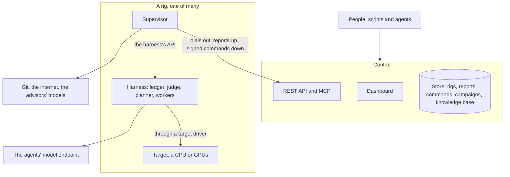
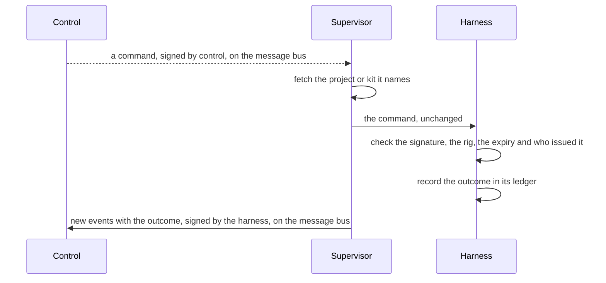
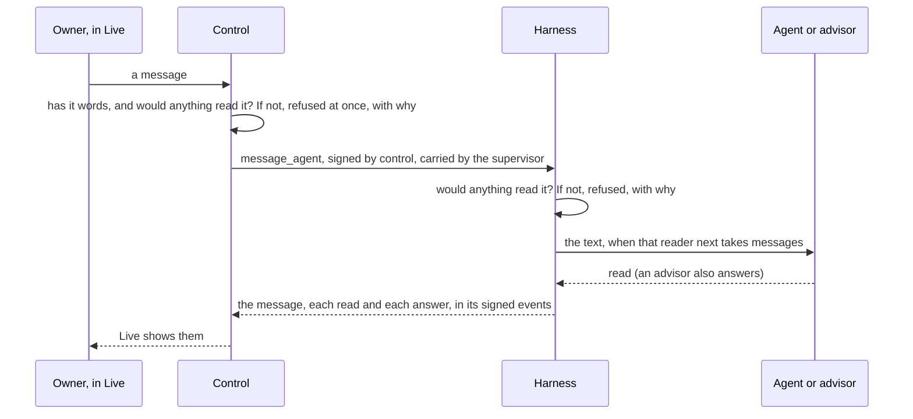

Thermite has three parts. **Control** is one central service that shows and steers everything. A **rig** does the research, and a rig is two containers. **Target drivers** connect a rig's judge to the hardware that the work is measured on. This page explains what each part does, how they talk to each other and where they can run, and why Thermite is split this way. The [glossary](../reference/glossary.md) explains any Thermite word that this page does not.

## Control

Control is the one place where people, scripts and AI agents watch and steer the work. It serves a **dashboard** for people, a **REST API** for scripts and an **MCP server** for AI agents. Its **store** keeps what the rigs report, the commands sent to them, and the campaigns, kits, providers and machines you give it, with every key sealed. It also keeps **Thermite's knowledge base**: a collection for each campaign, built from what the campaign's runs report ([The knowledge base](#the-knowledge-base)).

Control measures nothing and decides no verdict. It shows what the rigs report and passes on what people decide, as commands that it signs with a key of its own. A decision that only the owner may make, such as approving a promotion, names the owner inside the signed command, and the rig checks that again.

There is one control service, with one store. That keeps every campaign in one place and makes control simple to run. The price is that steering waits while control is down; the research does not (see [How they talk](#how-they-talk)). [The REST API](../reference/rest-api.md), [the MCP tools](../reference/mcp-tools.md) and [Tokens and roles](../reference/tokens.md) say what each way in offers and who may use it.

### The dashboard's pages

The dashboard follows the levels of the work: a campaign, its runs on the rigs, and what each run's agents are doing.

- **The left navigation** holds the pages, then the campaigns: each folder with its campaigns, then the campaigns in no folder, each with its state. It lists every campaign that is not archived, finished ones too, and a rig check's campaign while it is at work. You make, rename and delete folders there, and drag a campaign onto a folder; a folder folds, and the browser remembers it. It does not list the rigs: **Rigs** does ([Archive campaigns and sort them into folders](../how-to/campaigns/archive-and-folders.md)).
- **Campaigns** puts the runs at work now first, then the decisions that wait for you, then one row per campaign: its runs, its best result, its last activity and its rigs. Filters and a search box narrow the list. By default it hides finished campaigns, rig checks (the campaigns named `rig-check-*` that a rig's smoke check makes, when someone runs it) and archived campaigns; the **All**, **Rig checks** and **Archived** filters show them. **Archived** has **Unarchive** on each row.
- **A campaign's page** shows what the campaign is for, its runs at work, and its earlier runs in one table. Control lists them from its record of every run it assigned or a rig created, so a run stays there wherever it ran: one of a retired rig, or from before its rig's full reset, is under **Earlier runs**, marked `on <rig>, retired` or `before <rig>'s full reset`, and opens like any run. A run's page is at `/ui/campaigns/<campaign>/runs/<run>`, and what the run owns hangs from it, such as an attempt's page at `/ui/campaigns/<campaign>/runs/<run>/attempts/<attempt>`: a run's name is used once on control, and the rig it ran on is a fact about it, not part of its address. In a hill climb, an earlier run whose champion other rigs' judges confirmed is marked `cross-verified on …`, and the line under the title links to the **leaderboard**. **Start a run** starts a run of it on a rig you choose, with its agents on or off. Only a rig with the hardware that the campaign's kit measures on can take it. With the agents on, it can also copy the experiments that another run of the campaign had not tried yet into the new run's queue, and pick items **From past research**: experiments for the queue, and findings, claims, notes and reports as background for every agent's brief. A campaign assigned over the API, MCP or the command line can be started again here too, even before a rig reports a run of it: control assigns it as before, with the same contract, starting point and imports, as a new run. **Copy**, beside **Start a run**, makes a new campaign with another name, the same contract and kit, and its own empty collection in the knowledge base, so that a second model starts from zero; a research campaign's copy can give its agents other MCP servers. The copy's page says where it came from. **⋯**, after them, has **Move to folder**, which puts the campaign in a folder of the left navigation, and **Archive**, which takes it out of the navigation, **Needs you** and the Overview's lists; control refuses it while a run of the campaign is at work or waits to start. An archived campaign's page says so, with **Unarchive**, and has no **Start a run**. Under the runs, the **Knowledge** section shows the campaign's collection, the other collections its agents may read (**Can read from**) and the campaigns that read it. The page's sidebar shows the campaign's **Model use**: its cost, tokens, calls and speed over all its runs on every rig, and each run's ([Model use and cost](../reference/model-use.md#a-campaigns-page)).
- **A run's page** starts with its model use, above its tabs, so it shows on every tab: one line with its trials, rounds, time and time in calls, then its cost and its tokens ([Model use and cost](../reference/model-use.md#a-runs-page)). It has six tabs, **Prompts** for a run with agents, and **Stats** for a run with agents or with a pod's spend on RunPod: **Overview**, **Experiments** (the run's experiment queue: up next, what each lane is on, the lanes' ideas, and everything tried with its result), **Journal** (the field notes that the lanes, the planner and the advisors write as they work, and the run's research notes), **Attempts** (with the run's audits and reviews), **History** (what happened, in words: verdicts, rounds and hand-outs, changes to the queue, rules set or removed, restarts of the lanes, and changes made on **Edit rig** while the run was at work), **Planner** (the rules for the plan, **Tell the planner** with the planner's answers, what the planner gave each lane and why, the run's directions, the planner's model and the agents' figures), **Prompts** (each prompt the run's agents were sent, newest first, with where each of its parts came from, and each one on a page of its own: [What a run's agents were sent](../reference/agent-roles.md#what-a-runs-agents-were-sent)) and **Stats** (its model calls in each round and in a trial, and what they cost and used by agent and model, with a RunPod rig's GPU time). A research run's page has two more, after **Journal**: **Reviews** (every review of the review panel, each reviewer's answers and the decision on each item) and **Hypotheses** (the author's, the pool, promoted, merged and retired ones, with **Promote**, **Return to pool** and **Retire**), and its campaign's page has **Overview** and **Reviews** tabs, the latter with the reviews of all its runs ([The Reviews tab](campaign-modes.md#the-reviews-tab)). Its header holds **Live**, **Message**, **Pause** (or **Resume**), **Export** (an export of the rig that holds the run, of what changed or a full one) and **⋯**, with **Restart the lanes** while the run is running and **Close run** while it is running or paused: the owner ends the run for good, with a reason. A run without agents, such as a try of a kit, has no **Message** and no **Restart the lanes**: it has no one to write to and no lanes. Its page says it is judge only, and its **Experiments** tab says that the experiments in its queue wait for a run with workers ([Judge-only runs](../reference/verdicts.md#judge-only-runs)). A paused run's label reads **Paused**, even while a decision waits in it; the decision still shows under **Needs you**. A closed goal run that met its goals, and a closed research run whose questions the review panel found answered, read **Completed**; any other closed run, **Finished** ([Run labels on the dashboard](../reference/verdicts.md#run-labels-on-the-dashboard)).
- **Live** shows one run at a time as its agents, its judge and its advisors work. A worker's stream shows mostly its tool calls and their results: the model's reasoning and its words between calls don't always reach Live yet ([goal 093](https://github.com/iammrduncan/thermite/blob/main/docs/plan/goals/093-live-shows-reasoning.goal)). Its one-line header holds the run, its rig and its progress, **Open the run**, **Pause** (or **Resume**) and, while a run with agents is running, **Restart the lanes** under **⋯**. It has a filter for everyone, for each lane (a lane that starts while the page is open gets one too), the planner, the judge, the advisors, and your own messages. Its list also holds the runs that ended in the last day; with no run at work, Live asks you to pick one of those to see its lines. Under the stream, one message box writes to the run's agents and advisors (see [The owner's messages](#the-owners-messages)). A rig's page still opens that rig's own live view, with every session on the rig. That view has no message box: it links to the Live view of each run on the rig. A worker's session there, in a program that runs in its own terminal, shows the program's screen as it is, and under it the owner's console, which types into it ([The Live view](../reference/live-view.md#a-trials-terminal)).
- **Metrics** shows the model use and cost of every campaign and rig, for today (from midnight in your own time zone), the last 7 days or all: by model and by campaign ([Model use and cost](../reference/model-use.md#metrics)). Each model's price is in **Model prices**, in **Settings › Providers**.
- **Knowledge** lists every campaign's collection in the knowledge base, with what it holds and which collections each campaign reads, and searches them all.
- **Rigs** is one table to scan, one row for each rig: its state (live, stale, offline, refused, or stopped for a RunPod pod), where it runs and on what, its version, the run at work and its progress, its last report, and a RunPod rig's price per hour. A rig behind control's version shows **needs update**, which opens the rig's page, where the update runs. The details (checks, keys, history, the update) are on each rig's page ([The Rigs list](../reference/rigs-list.md), [A rig's page](../reference/rig-page.md)).

## A rig

A rig is one **harness** container and one **supervisor** container, with the devices that it measures on. A rig works on one **run** (one campaign on this rig) at a time, and one machine can host several rigs.

The two containers are split by what they are trusted with. The harness runs code that agents wrote, so it gets as little reach as possible. The supervisor holds the rig's credentials for git and for control, and no worker's or candidate's code ever runs in it.

### The harness: where the research happens

The rig's agents form two groups. **The work**, the workers and the planner, runs in the harness. **The advisors** run in the supervisor ([below](#the-supervisor-the-rigs-link-to-everything-else)).

- **The ledger:** the rig's own database, and the authority on everything that happened: campaigns, runs, attempts, measurements, verdicts, champions, each run's experiment queue, the agents' field notes, each run's briefing from past research, and steering.
- **The judge:** it builds each submitted change, measures it against the champion, gives the verdict and promotes winners.
- **The scheduler and the planner:** they split each run into **lanes**, give each lane its next **experiment** from the run's queue, never the same one to two lanes, and start **trials**. A research run's planner plans each round from the questions' answer cards and their gaps; with the planner off, or when its answer is refused, the gap-driven plan in code gives out the round's tasks ([Campaign modes](campaign-modes.md#research)).
- **Workers:** one fresh agent session per trial. Each runs in the rig's **worker harness**, the program that gives the model its tools (Pi, OpenCode v2, Claude Code or Codex), and works in its own copy of the code.
- **A small broker,** the only part that runs as root. It starts every other process as its own operating-system user, so no agent, build or measured run can read the judge's files.

The judge, the scheduler and the exports run as separate loops, so a slow model call never holds up a measurement. The harness's API needs a token for everything but a health check, and the only part of Thermite that calls it from outside is the rig's own supervisor. The harness's own connections go out to its model endpoint and the internet.

[Agents, lanes and the planner](agents-lanes-planner.md) and [Isolation inside a rig](isolation.md) go deeper.

### The supervisor: the rig's link to everything else

The supervisor connects the rig to the outside. It runs six loops side by side, so a slow one never holds up the others:

- **Reports:** it publishes the harness's new events on control's [message bus](how-the-parts-talk.md#reports-over-the-message-bus), pushes the rig's results to git and uploads each new champion's patch to control, once a minute by default.
- **Commands:** it takes each of control's commands from the [message bus](how-the-parts-talk.md#commands-over-the-message-bus) as soon as control issues it, fetches any project, kit or champion it names, and hands it to the harness, so a pause or a message lands at once.
- **Live view:** every few seconds, it publishes the harness's newest live lines on the bus, with lines of its own, for **Live** on the dashboard ([Live lines over the message bus](how-the-parts-talk.md#live-lines-over-the-message-bus)). Control pushes each new line to the pages that show it.
- **Model route and MCP servers:** it hands the harness the agents' model and key chosen on control, by the owner or an operator's agent, and the [MCP servers](../how-to/campaigns/give-agents-mcp-tools.md) that its runs' kits give the workers and the planner, and keeps the advisors' for itself. They come in the rig's config on the bus as control changes them, sealed to the rig ([Config over the message bus](how-the-parts-talk.md#config-over-the-message-bus)).
- **Past research:** every three minutes by default, it asks control on the bus for the new items of the collections that each running run's campaign may read, and hands them to the harness, which writes them into the run's `knowledge/` folder.
- **Advisors:** it runs **the advisors**: the teachers (one or two, and with two a merged by model that merges their advice), the auditor and the review panel, but only those the rig is given, in an advisors file or as models from control (the rig's **Edit rig** page, MCP or the REST API). The teachers set directives for the planner and add experiments to the run's queue; the auditor can add a check to it. Each advisor may also keep field notes, which the supervisor passes to the harness. The teachers can search a knowledge base in the advisors file, and the advisors get the tools of the MCP servers that the run's kit gives them, which the supervisor calls for them. Each step of an advisor round is a line in the run's Live view: what each teacher suggested, the directives set and why, the experiments added, each audit and each review. A message from the owner to the teachers starts their round at once. [Supervision](supervision.md) explains them.

The supervisor does all of the rig's git work. It holds no signing key: it carries commands in and reports out, but it cannot write either one. [Trust between control and rigs](trust.md) explains how that is checked, and [the settings reference](../reference/settings.md#how-often-it-talks-to-control) lists each loop's interval.

## Targets and drivers

A **target** is what a campaign is measured on. The judge reaches it through a **target driver**. Thermite has drivers for CPUs (`cpu`) and for NVIDIA GPUs (`cuda-gpu`). A rig with GPUs measures on `cuda-gpu`, and a rig without measures on `cpu`.

A driver identifies the device, so that results from different devices are never compared. It checks that the device is idle and healthy before every timed block, and reports anything that spoiled a block, such as a GPU too hot to keep its speed, so the block is measured again. It does not hold the clock: the broker times every measured run from outside, so nothing a change prints about itself is ever its score.

Each kit names the one kind of target it measures on, and a rig accepts only a kit for its own kind. [Kits and rigs, side by side](kits-and-rigs.md) explains how the two meet, and [Sharing a device](sharing-a-device.md) explains when the judge and the agents share one device and when each has its own. Drivers for other hardware, such as boards on a serial line, are planned in [goal 052](https://github.com/iammrduncan/thermite/blob/main/docs/plan/goals/052-more-target-drivers.goal).

## How they talk

**Everything starts from the rig.** The supervisor dials out to control's message bus, where it sends its reports and takes its commands, and calls control's address only to register its keys on the bus and to send large files. Control never opens a connection to a rig's containers, and the supervisor listens on no port. A rig only has to be able to reach control, at its address for rigs and at its message bus's port beside it, so it can sit behind a home router or a firewall that lets connections out but not in. A rig that can't reach the bus doesn't work, and control shows it broken.

- **Commands go in signed.** The harness checks each one before it acts on it. A command that brings content, such as a project, a kit or another rig's champion, names that content by its git commit or its hash. The supervisor fetches it, and the harness accepts it only if it matches.
- **Reports come out signed.** The harness signs its events with the rig's own key. Control pins that key at the rig's first report, or holds it until the owner accepts it. It takes a report only if it follows on from the ones it already has. So the supervisor relays reports, but it cannot forge, replay or skip events.
- **Results go to git.** At most once an hour by default, when something new happened, the harness writes an export: its new events, its ledger without its table of hidden test results, each new attempt and champion as a patch, the field notes and research notes recorded since the last export, the briefing of each new run, and each finished run's research folder when it has one. The supervisor pushes it to the rig's results repository, when the rig has one. [Set up the results repository](../how-to/operate/results-repository.md) shows how. Rigs that control sets up on machines and clusters, and joined rigs, have none yet ([goal 061](https://github.com/iammrduncan/thermite/blob/main/docs/plan/goals/061-gaps-found-by-the-docs.goal)): their supervisors send each export to control instead, and the dashboard's **Exports** page downloads it as one archive ([Get a rig's results from control](../how-to/operate/exports-on-control.md)). **Export** on a rig's or a run's page asks for one at once, of what changed or a full one.

**A rig keeps researching when control is down.** The harness has everything it needs for the run it has: the project, the kit, the model route and its own ledger. Reports and commands wait, and catch up when control is back. (One exception: a rig whose agents use a ChatGPT sign-in gets a one-hour access token, and only control renews it.)

To set up and manage a rig, control does connect to the machine over SSH, or to the cluster's API. That reaches the machine or the cluster, never the rig's containers.

[How the parts talk](how-the-parts-talk.md) follows every channel between the parts: what travels on each, which side starts it, how often, and how long a change takes to show.

## The owner's messages

The owner can write to a run's agents and advisors while they work. The message box is under the run's stream in **Live**, and the **Message** button on a run opens it; the run's **Planner** tab has a box for the planner alone, while the planner is on. Each message is a signed command, `message_agent`, that only the owner may issue. An operator's token, which the owner gives an agent that runs campaigns for them, may send one in the owner's name. No worker, planner or advisor can send one. The judge takes no messages: it is code, and no message can change a measurement.

**Who can read it.** A message goes to one of these:

- **everyone working** (`all`): every lane at work, and the planner of a hill-climb or goal run when the planner is on. The lanes at work are the contract's lanes, or fewer when a rule for the number of lanes says so;
- one **lane** (`lane-N`), or one **trial** of a lane (`trial:ID`). A message to a trial that ends before it reads it goes to the lane's next trial, which is told so;
- **the planner**;
- **the advisors**: all of them (`advisors`), or only the teachers (`teachers`), the auditor (`auditor`) or the review panel (`review_panel`).

Live's box offers all of them but a single trial, which only the REST API, MCP and the command line can reach.

**Refusals.** A message that nothing would read is refused, with why, and it is checked twice. Control checks first, the same way for every way in: Live, the **Planner** tab, MCP, the REST API and the command line. From what the rig reported, it refuses a message with no words ("Write a message first."), and one to:

- the planner when it is off on **Edit rig**;
- an advisor role switched off on **Edit rig**, or one that the rig's supervisor reports it has not set up;
- the auditor of a research run;
- the lanes or the planner of a run without agents (a try, where the judge alone measures the kit).

Such a message never reaches the rig. Its sender gets control's reason at once (**Live** shows it as **Not sent.**), and control's audit log records it. Then the harness checks again what reaches it, with what only the rig knows, such as a lane the run doesn't have, a closed run, or the review panel of a run with no goal it reviews. The command then shows as failed on the **Commands** page, with the reason, and once the rig's answer is back, **Live** shows **Not sent.** and the rig's reason above the message box. The run's **Planner** tab does the same for a message to the planner, above **Tell the planner**. Live also greys out each recipient that would never read the message, with the same reason, and its box takes no message of spaces alone.

**Kept in force.** A message to everyone working or to a lane can be kept in force (📌 in Live's message box). Every new trial's brief then carries it, under its own heading, until the owner removes it: **Remove** in Live's list of kept messages, or the `unkeep_message` command. Live then shows the removal as your own line, under **You**: "📌 You removed your kept message: …". Other messages are given once to each reader.

**When each reader reads it.** Each reader (each lane, the planner, and each advisor role) reads a message once; only a message kept in force is read again, by each new trial. A read counts only when the agent works with the text. A message in a trial's brief counts once the trial's agent is at work: its first line in Live, or a turn or tokens used. A trial that fails before then leaves the message for the lane's next trial. A message given at a worker's next step, or in a continued session, counts at once. One given inside a turn through a program's hook counts once the hook has handed it to the program, and through Thermite's OpenCode plugin once OpenCode says it took it in. An advisor's read counts with its work: the teachers' once a teacher gives a review, the auditor's and the review panel's once their audit or review is posted. Fetching a message is not reading it.

| Reader | When it reads a message |
| --- | --- |
| A lane with no trial running | In the brief of its next trial, once that trial's agent is at work |
| A Pi worker | At its next step: when the model's current turn ends, before its next call to the model |
| A Claude Code or Codex worker | Inside its turn, through Thermite's hooks: after the next tool it runs (its PostToolUse hook adds the message to what the model reads next), or when the model stops (its Stop hook gives the message as the reason to go on, and the agent goes on with it). One message at a time. A message that arrives after the turn ended goes in when the harness continues the session |
| An OpenCode worker | Inside its turn, through Thermite's plugin: when the agent starts its next tool, the plugin steers the message into the session, and OpenCode takes it in after that tool. A message still waiting when its turn ends goes in with the worker's next turn |
| Any worker, after it submits | It doesn't. A submission ends the trial, and the lane's next trial reads the message in its brief, where it can act on it |
| The planner | In its next plan, if the model's plan is used. While the planner is off, its model can't be reached, or both its answers are refused, the message waits |
| The teachers | In a round that starts at once, for a running run. Between rounds, the supervisor looks for new messages to the teachers every few seconds; a round already under way finishes first |
| The auditor and the review panel | In the package of their next audit or review. One comes only when the judge holds a result for an audit, a goal needs a review, or a research run's questions are checked |

**Answers.** Each advisor that reads a message is asked to answer it in one or two sentences, as part of the answer it gives anyway. The supervisor passes the reads and the answers to the harness, which records them. An answer is for the owner only: it can't change a verdict, pause a run or reach a worker. [Supervision](supervision.md#the-owners-messages) says more.

**Records.** The harness keeps all of it in the run's ledger, as events. They reach control in the rig's signed reports, and go into the rig's exports:

| Event | What it records |
| --- | --- |
| `agent_message` | The message: its text, who it is for, and whether it is kept in force |
| `agent_message_read` | Each reader's first read: a lane (with its trial and how its agent was given the message), the planner (with its round) or an advisor role |
| `agent_message_unkept` | The owner took a message out of force |
| `advisor_answer` | An advisor's answer |

Live shows the message, a ✓ line as each reader reads it, and each advisor's answer. It draws them as such only from lines that the harness signed. A line that the harness files under the planner or the advisors shows at once, in its own words. A line filed under a trial, such as a message to a trial or a lane's ✓, shows as a plain line until the run's signed event arrives with the rig's next report; Live then draws it again in place, with the words from the event. A line that isn't signed always shows as a plain log line, whatever it claims. A worker can't make one up: a trial may post only its own session's text, thinking, tool calls and results. Live's **You** filter gathers them. [Steer a run](../how-to/campaigns/steer-a-run.md) shows how to send one, and the [signed commands reference](../reference/signed-commands.md) gives the command's fields.

## The experiment queue's records

Each run has one **experiment queue**: what its lanes will try next, in order, and everything they tried. It is research state, so it lives in the harness's ledger, and the planner gives its experiments out to the lanes ([Agents, lanes and the planner](agents-lanes-planner.md#the-experiment-queue) explains how). Three kinds of writer reach it, each in its own way:

- **The owner** changes it with signed commands, like any other steering: `queue_add`, `queue_move`, `queue_edit`, `queue_drop` and `queue_accept`, plus `drop_directive` to remove a rule. They are the owner's alone: an operator's token may send them in the owner's name, and an agent's token can't.
- **The teachers and the auditor** add experiments through the supervisor, and the teachers move them too. The harness records each with the advisor's role as its author. The review panel has no way into the queue.
- **A lane's worker** proposes an idea with its own trial's token, only while its trial is open.

A new run's queue can also start with another run's untried experiments, at most 500, which come in its `assign_campaign` command. **Start a run** offers this only for a run with agents, and takes each one from control's records of the earlier run. So does `thermite assign --queue-from`, which asks control for them first, and so do Start a run's twins on the REST API, MCP (`start_run`) and the command line (`thermite run start`), which run the same code as the panel. Over MCP, control does the same whatever the caller wrote, for an experiment from a run of the new run's campaign or of a campaign whose collection that campaign may read: its title, details, direction, why and author come from control's own record of it, with every edit, and its details end with what became of it there, such as "In run-3 (matmul) it was …", when the campaign's collection has that. Any other keeps the caller's words, and its author is `copied`: one that control has no record of, and one from any other run.

The planner's own changes, its hand-outs and each trial's result are written inside the harness. Every change is an event in the run's ledger, with who made it:

| Event | What it records |
| --- | --- |
| `experiment_added` | A new experiment: its title, details, direction, why, who added it and its state (`queued`, or `proposed` for a lane's idea). A research task names its `question`, an index from 0. A copied one also names the run it came from. In a ledger from before goal 079, one put back after its trial was interrupted or failed names the experiment it repeats, with that trial, its lane and how it ended (`requeued_from`) |
| `experiment_accepted` | A lane's idea, queued: by the owner, or by the planner, with why (its model's, or, below the queue's target, the fixed rules') |
| `experiment_moved` | A new place in the queue |
| `experiment_edited` | New text |
| `experiment_dropped` | Dropped, with who dropped it and why |
| `experiment_assigned` | Given to a lane's trial |
| `experiment_finished` | Its trial ended, with the attempt or the reason there is none, and how the trial ended in words (`cause`). A research task's has its trial's `yield`: `{verified_claims, by_question: [{question, verified_claims, new_domain_claims}], new_domains, domains, findings, card_changes}` |
| `experiment_returned` | Its trial never really tried it (interrupted, or the model provider's error): the same experiment back at the top, with the trial, its lane, the cause and how many times it came back (`returns`) |
| `parent_screened` | A change written on an older champion, measured against that champion by the judge's `parent_screen` job: its verdict there, its gain and the effect in words. No verdict of the change's own ([A change written on an older champion](../reference/verdicts.md#a-change-written-on-an-older-champion)) |
| `port_queued` | A port queued at the top of the run's queue: the change it carries, the champion it goes onto (`onto_seq`), the experiment and why |
| `planner_handout` | One hand-out: which experiment went to which lane, and why |
| `directive` | A rule for the plan: its kind, its direction, why and who set it. One the planner made from an owner's message names that message (`from_message`). One converted from an old rule in words names that rule and its words (`converted_from`) and keeps its author |
| `directives_superseded` | Rules replaced by their author's next set |
| `family_added` | A new direction: its name, what it means, who added it, and the rules it was designed for (`for_rules`) when a rule named it before the run had it |
| `directive_dropped` | A rule taken out of force |
| `directive_converted` | An old rule in words that the planner converted at its round: the old rule, the new rule in its place (`to`), its kind, its direction and the old words |
| `directives_left_out` | Rules a new set named that the rig left out, with why: rules the owner had removed, named by the advisors, the planner or an agent's token; an advisor's rule that would freeze the queue's size or pin an experiment (`reason`: `freezes_queue` or `pins_experiment`); and, in a research run, an advisor's rule for a direction that is not a task kind |
| `queue_low` | A planner's round left the queue below its target: the round, the experiments ready, the target and the lanes. The supervisor starts the teachers' round at once |

Control builds a run's **Experiments** and **Planner** tabs, and the MCP tool `run_queue`, from these events and the messages' events above. The run's **History** tab tells each change in words, such as "You dropped "…": why.", "The planner moved "…" to place 1." or ""…" went back to the top of the queue: its trial on lane-1 was interrupted (…)." [Choose what a run tries next](../how-to/campaigns/choose-what-runs-next.md) shows how to change the queue.

## The model usage records

Every model call that a run's agents make is counted, so that you can see what a run, a campaign or the whole system used: the tokens in, how many of them the provider read from its cache, the tokens out with the reasoning among them, and how fast the model answered. Code records each call where it is made, never an agent: the harness for the workers and the planner, the supervisor for the advisors. Each record is one `model_call` event of its run, so it reaches control with the rig's other signed events, and an export keeps it with the run.

How much each record can say depends on the program the agent runs in, because Thermite reads what that program reports and never guesses:

| The agent runs in | One record is | What it reports |
| --- | --- | --- |
| Pi | One model call | Tokens in and out, from the call's usage. The cached tokens and the reasoning tokens only when the provider's answer names them. The time from the request to the first token, and to the last. A Pi worker's own process measures its trial's calls and hands them to the harness with the trial's token |
| OpenCode v2 | One step, which is one model call | Tokens in, cached and out, with the reasoning, as OpenCode's step reports them (OpenCode gives 0 where the provider names none). Headless, the time to the step's first text, reasoning or tool call, and a step's whole time only for a step that ran no tool, because OpenCode ends a step after its tools. In its own terminal, from the events Thermite's plugin writes, the cache written counts in the tokens in, and there are no times |
| Codex | In its own terminal, one model response, from its record of the thread. Headless, one turn of `codex exec`, which makes one or more model calls; Codex does not say how many | Tokens in, cached and out, with the reasoning: headless, what the turn added to its thread's totals. No times |
| Claude Code | In its own terminal, one model call, from its transcript, once for each message however many records repeat it. Headless, one run of `claude -p`, with the calls its stream showed (the advisors' JSON output shows none) | Tokens in, the cache read and written included, the cached tokens and the tokens out; Claude Code names no reasoning tokens apart from the output. Headless, the run's time in API calls, and its first call's time to the first token; a run cut off before its result, as a submission does, keeps the tokens its stream showed, with no times. In its own terminal, no times, and the title the terminal asks the model for at each typed prompt has no record: the transcript leaves it out |

A command-line advisor (`cli`) says nothing about its calls, so it has no records. A model check is no run's work, and is not counted.

| Field of `model_call` | What it records |
| --- | --- |
| The event's subject | The run |
| `trial` | The worker's trial, or `null` |
| `round` | The planner's round, such as `epoch 3`, or the advisors': `teachers <time>`, `audit <attempt>`, `review <id>`, for the synthesizer's answer cards `cards <time>`, or, for the final writer's research paper, `final paper <review>`. `null` for a worker |
| `agent` | `workers`, `planner`, `teachers`, `merged_by` (the teachers' merged by model), `auditor`, `review_panel`, `synthesizer` (the writer of a research run's answer cards) or `final_writer` (the writer of its paper) |
| `harness` | `pi`, `opencode`, `codex` or `claude-code` |
| `provider` | The provider's name in **Settings › Providers**, or `null` for a rig's own model settings and an advisors file that names none |
| `model` | The model's name |
| `calls` | How many model calls the record covers, or `null` when the program does not say |
| `at` | When the call, or the program's run, started |
| `tokens_in` | Every input token, cached or not |
| `cached_in`, `uncached_in` | The input tokens read from the provider's cache, and the rest |
| `tokens_out` | Every output token, the reasoning included |
| `reasoning` | The output tokens spent on reasoning |
| `first_token_ms` | Milliseconds from the request to the first token |
| `call_ms` | Milliseconds in calls: from the request to the last token, added up over the calls the record covers |

A figure that the program does not report is `null`, never 0, and every sum says how many records lacked it. A Pi worker that could not hand some records to the harness says how many in its trial's `trial_finished` event (`usage_unrecorded`). Records the supervisor could not hand over are an error line in the run's **Live** view.

Control keeps each record as a row, also after the rig leaves its ledger in a full reset: the calls were made. It sums them for a run, for a campaign (all its runs on every rig) and for the whole system, today, over the last 7 days or for all time: calls, tokens, the cached share, output tokens a second (the median, the 10th and the 90th percentile over the records with a time), the time in calls, and the cost. A call's cost is its tokens at its model's price, from the provider's model list when it gives one, else one the owner sets; a subscription's calls are on its plan, and a call whose model has no price known has none, never 0. A rig on RunPod adds its pod's spend: control counts it every 30 seconds while it follows the pod, and gives each count to the run the rig was running then. The REST route [`GET /v1/usage`](../reference/rest-api.md#model-usage) and the MCP tool [`model_usage`](../reference/mcp-tools.md#model_usage) give these sums. The dashboard shows them at the top of a run's page and on its **Stats** tab, in a campaign page's sidebar and on **Metrics**, and keeps each model's price in **Model prices**, in **Settings › Providers** ([Model use and cost](../reference/model-use.md)). The views that control builds from every event, such as a run's **History** tab and a rig's newest events, leave the records out.

## The knowledge base

The agents write down what they learn as they work: the lanes, the planner and the advisors keep short **field notes**, and workers in every mode can record the sources they read, claims with their quotes and research notes. Each run's ledger keeps them, with who wrote each and when, and they show on the run's **Journal** tab.

Control turns the rigs' records into **Thermite's knowledge base**, with one **collection** for each campaign. It builds the collections from the events in the rigs' signed reports, as it builds every other view, so no agent writes to a collection. Each run's items go in the collection of the campaign that control assigned the run on its rig; the campaign that a rig's own events name counts only for a campaign that control has assigned to no rig. A collection holds everything the campaign's runs produce: the runs and their trials, experiments with their results, attempts with their verdicts, field notes and research notes, the documents lanes write, sources with the text that was read, claims, hypotheses, findings and reports, each with its rig, run, writer and time.

Past research then flows back to the rigs:

- **Into each running run.** The supervisor's past-research loop fetches the items of the collections that the run's campaign may read: its own campaign's other runs, and the collections the owner granted it. The harness writes them under `knowledge/` in the run's research folder, where the workers search them. The planner and the advisors search them too, read only, with a tool, except teachers that may fetch any web page.
- **Into a new run's briefing.** **Start a run › From past research** puts ticked experiments in the new run's queue, and ticked findings, claims, notes and reports in its **briefing**, inside the signed `assign_campaign` command. Every agent's brief shows the briefing as background, except the brief of teachers that may fetch any web page.
- **Beside another knowledge base, when you want one.** Another knowledge base you run, such as GBrain, is an MCP server added in **Settings › Providers**. A campaign's kit names it for its workers, planner or advisors, which then call its tools: the harness makes the calls for the workers and the planner, and the supervisor for the advisors ([Give agents MCP tools](../how-to/campaigns/give-agents-mcp-tools.md)). Control copies no collection to it.

Each export also carries the run's field notes, its research notes and its briefing to the results repository. [Journals and the knowledge base](journals-and-knowledge.md) explains why it works this way, and [the knowledge base reference](../reference/knowledge-base.md) lists what each collection and file holds.

## Where rigs run

The same two images run in each of these ways, and every rig here reports to control in the same way, by dialing out:

| Way | What it is | Who sets it up and manages it |
| --- | --- | --- |
| **Compose, on one computer** | Control and a rig, `local-1`, in one stack, on the CPU or on the machine's NVIDIA GPUs; a second CPU rig is optional | You, with `docker compose`, `podman compose` or podman-compose |
| **A machine, over SSH** | The two containers as systemd services, so the rig survives logouts and reboots | Control, from **Rigs › Add a rig** and the rig's page |
| **A Kubernetes cluster** | The two containers in two pods on one node, in a namespace control creates or one the cluster's operators made for Thermite | Control, from **Rigs › Add a rig** and the rig's page |
| **Joined by you** | The same as the two ways above, for a machine or namespace that control cannot connect to | You: a one-time join command sets it up, and the rig's page shows the commands to manage it |

The compose rig gets every CPU and all the memory that Docker or Podman has, and, on Linux with NVIDIA's container toolkit, every NVIDIA GPU, through a second compose file that `thermite local init` writes ([What the rig gets](../how-to/install/one-machine.md#what-the-rig-gets)). Control can start short test pods on RunPod to check a GPU there. A rig on RunPod runs in **pull mode**: it never dials out, and control connects to it through RunPod's proxy, with every request signed and every body sealed ([Rigs in pull mode](trust.md#rigs-in-pull-mode)). The owner launches such a rig from control, follows its cost, and stops, starts and terminates it ([Run a rig on RunPod](../how-to/install/runpod-rig.md)).

**New images for a rig on a cluster.** After control itself is updated, it may deploy other images than a rig it set up on a cluster runs. The rig's page then offers **Update to these images**, and MCP has `update_rig_images`. Control applies the rig's two deployments again with its images and its address for rigs, then waits for the new pods and for a report from them, and shows each step on the rig's page. Only the deployments change. The rig's secret (so its tokens), its volume, its service and its network rules stay, and so do its runs, its results and its lanes' build caches. A rig at work drains first: it starts nothing new, and its pods restart once its running trials and the judge's job under way end. Skipping the wait stops a trial in progress, and its experiment goes back to the top of the run's queue. A stopped rig stays stopped, and runs the new images when it starts. A newer harness upgrades the rig's ledger, so an older image may not open it again. A rig whose Thermite version is behind control's, on a machine or a cluster, also offers **Update to** control's version: control pauses its runs, moves it onto its images (over SSH on a machine), waits for a report from its own version, runs the isolation check and resumes the runs. Rigs you joined can't be moved to new images from control yet ([goal 035](https://github.com/iammrduncan/thermite/blob/main/docs/plan/goals/035-rig-upgrades.goal)).

An update also carries control's address for rigs ([`THERMITE_CONTROL_PUBLIC_URL`](../reference/settings.md#rigs-that-control-sets-up)), so it needs that address to be set, or the rig would no longer know where to report. Control records the address it gave each rig. When only that address changed, the rig's page offers **Give it control's new address**, which restarts the rig's pods with the new address on the same images. After an update that failed, the page offers **Try the update again**, on control's images. `update_rig_images` does each of these over MCP. Control makes one change at a time: it refuses an update while the rig is still being updated or starting. A start or a restart waits for the pods and for a report from them, as an update does, with steps of its own on the rig's page. A stop or a removal ends that wait, so a rig stopped in the meantime isn't marked failed later.

**A new size for a rig on a cluster.** When a rig's place gains room, such as another GPU and a larger quota in its slot, **Edit rig** changes the rig's GPUs, CPUs and memory, and MCP has `set_cluster_rig_resources`. Control checks the new size as it checks a new rig, reads the slot's quota again, and then moves the rig as an image update does: the same two deployments, applied again on the images the rig runs, with the same drain first and the same wait for new pods and a report. The rig never moves between none and some GPUs: that would change its harness image and its target, and its runs' timings would no longer compare with each other.Over MCP, `cluster_rig` also stops, starts or restarts such a rig, as its page does, and `rig_setup` shows each step.

The how-to guides give the steps for each way: [Install Thermite on one machine](../how-to/install/one-machine.md), [Add a rig on a machine over SSH](../how-to/install/rig-on-a-machine.md), [Add a rig on a Kubernetes cluster](../how-to/install/rig-on-a-cluster.md) and [Join a rig yourself](../how-to/install/join-a-rig.md). [Stop, restart, remove or reset a rig](../how-to/operate/rig-lifecycle.md) explains what each of those keeps.

## Where to read more

- Models and keys: [Connect a model provider](../how-to/models/connect-a-provider.md) and [Who holds your keys](who-holds-your-keys.md).
- GPUs: [Give a rig several GPUs](../how-to/install/several-gpus.md).
- Every setting, port, volume and secret file: [Settings](../reference/settings.md) and [Ports, volumes and secret files](../reference/ports-volumes-secrets.md).
