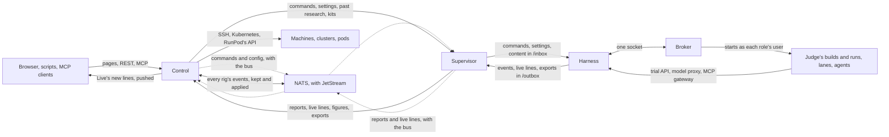
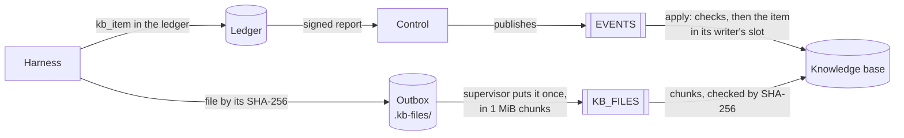

[How the parts fit together](how-it-fits-together.md) explains what control, a rig and its targets are, and why a rig dials out. This page goes one level down. It follows each channel between the parts: what travels on it, which side starts it, how often it runs by default, and so how long a change takes to reach the other side. The settings it names are in [Settings](../reference/settings.md), and [Trust](trust.md) explains the signatures that every command and report carries.

## Control and a rig

Every channel between control and a rig is started by the rig's supervisor, on a timer. The supervisor asks control, and control answers; control never waits on a rig. A rig on RunPod is the one exception, below.

| What travels | Direction | How often, by default | Setting |
| --- | --- | --- | --- |
| The harness's new events, in pages of up to 1,000, each signed by the harness | rig → control | every 60 seconds | `THERMITE_POLL_SECONDS` |
| The supervisor's own figures | rig → control | every 60 seconds, with the events | `THERMITE_POLL_SECONDS` |
| Commands waiting for the rig, each signed by control, and their outcomes | control → rig, then back | every 5 seconds | `THERMITE_COMMAND_POLL_SECONDS` |
| Live lines: what the lanes, the planner, the judge and the advisors are doing | rig → control | every 3 seconds, when there are new lines | `THERMITE_LIVE_INTERVAL_MS` |
| The agents' model route, and the MCP servers they may use | control → rig | every 30 seconds; with the message bus, as control changes them | `THERMITE_MODEL_ROUTE_POLL_SECONDS` |
| The advisors' models | control → rig | at the start of each advisors' round; with the message bus, as control changes them | — |
| Past research for each running run, from the knowledge base | control → rig | every 180 seconds | `THERMITE_KB_SYNC_SECONDS` |
| Exports, when the rig has no results repository, in parts of 8 MiB | rig → control | after each export, at most once an hour | `THERMITE_EXPORT_MINUTES` |
| Each new champion's patch | rig → control | after each export that holds one | — |
| The daily report | rig → control | once a day | — |
| A kit or a project kept on control, as git over HTTP | control → rig | when an assignment needs it | — |

Each channel keeps its own place, so a call that fails is simply made again at the next tick, and nothing is lost or taken twice:

- **Events** carry a cursor. Control takes a page only if it follows on from the last one it has, and tells the supervisor where to start if it does not. A page that control refuses as too large is sent again in halves.
- **Commands** stay pending on control until the harness's outcome comes back. The harness takes each one once, whatever the number of times it is delivered.
- **Live lines** are a view of what is happening now, and control keeps only the latest of them; the record is the events.
- **A call that hangs** ends after 5 minutes with no answer, and is made again at the next tick, as a call that failed.

### Reports over the message bus

The events travel on a message bus: a NATS server with JetStream, which runs beside control, as the compose stack's `nats` service. Control always uses it (`THERMITE_NATS_URL`), and keeps every rig's events there, below. When `THERMITE_NATS_URL` names it for the supervisor too, as it does by default in the compose stack and on every rig control sets up on a machine or a cluster, the supervisor publishes each page of events, as the harness signed it, to the rig's own subject, `thermite.rig.<rig>.report`, in the `REPORTS` stream, instead of posting it to control. Control reads the stream with one consumer, one message at a time, in order, and takes each page with the same checks as a page posted to it. Commands, live lines and the rig's config travel on the bus too, below. The other channels in the table stay on HTTP, and the supervisor still reads its harness's new events every `THERMITE_POLL_SECONDS`.

- **The supervisor moves on once the bus has a page.** A page's message id names its ledger and its events, so a page published twice within two minutes is kept once. A page too large for one message, 8 MiB, goes in halves.
- **The stream is an inbox.** It keeps a page only until control has taken it or refused it for good: then the page is gone. The events themselves are in the `EVENTS` stream, below, which is control's record, and the rig's summary in control's store. A supervisor publishes a page every round, events or not, and those pages kept for good would outgrow the events. At most 32 pages of one rig wait there, so at most 256 MiB of one rig's: while a rig has 32 waiting, its next page is refused, and its supervisor publishes it again at its next round, while other rigs' pages go on. Nothing waiting is dropped, and a page waits however old it is; a full store refuses a new page, never one that waits.
- **Control reads on past a page it refuses.** A page control has already is passed over. A page it refuses for good is recorded as one posted to it would be (a gap in the events, for one, is `report_refused` in its audit log), its log says why in a line `report from the bus refused`, and it reads on; the page is gone from the stream. A page refused for now, with the bus's store full for one, stays and is handed again 5 seconds later, before any later one.
- **An older stream is made again once.** A control from before kept every page for good, in a stream the server can't turn into an inbox in place. The first time control starts with this version, it takes that stream's subjects off it first, so that no new page comes in; its consumer takes every page the stream still holds, as before; then control removes the stream and makes it again as an inbox. A supervisor's page published meanwhile finds no stream: its log says `relay error` with `no stream on the bus takes thermite.rig.<rig>.report yet: control makes it`, it keeps its cursor, and it publishes the page again at its next round, into the new stream. No page is lost.
- **Control's answer sends the supervisor back.** No answer to a page on the bus reaches the supervisor, so a page control refused, for example while the rig's key waits for the owner or while the rig's clock is ahead, would leave every later page refused as a gap. Instead, control's answer to the supervisor's figures, its regular call, names where control is in the rig's events: the ledger and the cursor after the last event it holds. When control is still behind what the supervisor had sent by its call a round before, in the same ledger or holding none of that ledger, control is not just slow to read: it refused a page. The supervisor goes back to where control is, and its log says `control is behind this rig's reports on the bus; sending again from its cursor`. It then sends one page a round, as a page posted to control is tried again once a round, until control's answer shows that control took it; then the rest goes at once. A page sent again unchanged within the bus's two minutes is kept once, so it reaches control a round or two later. A rig whose builds control refuses gets no answer at all, so it goes back once control works with it again.

### Control's events on the message bus

Control keeps every rig's events in one place: the `EVENTS` stream, kept for good. It takes each report, over HTTP or from the bus, with its checks, publishes the report's new events to the stream, and answers once it has applied them, below. Everything else reads that stream: what control derives from the events and its views are written from it by the apply, and a rig's events over REST, a run's prompts and the knowledge base's reading again are read from it. Control keeps no other copy of the events.

- **One message for each event,** as the rig recorded it, in canonical JSON. A run's event goes on its run's subject by its kind, `thermite.run.<run>.ev.<kind>`; a change to a run's queue of experiments, on `thermite.run.<run>.queue.<op>`, by what it did (`added`, `accepted`, `moved`, `edited`, `dropped`, `assigned`, `finished` or `returned`); an event with no run, or of a run that control's run registry gives only other rigs, on the rig's own subject, `thermite.rig.<rig>.ev.<kind>`. A run no rig holds yet is the reporting rig's: control writes a run a rig created in its run registry as it takes the report, before it publishes the report's events, so every event of a run a page creates goes on the run's subject. The registry takes a rig's run only when control assigned that rig the run, or assigned no rig a run of that name (a rig check, a run started on the rig itself); a run of a name control assigned another rig is not written, and its events stay on the rig's own subject. A run's campaign there is its assignment's; a run control did not assign keeps the campaign its event names only when control knows no campaign of that name, and is its own campaign otherwise. Campaign pages and the leaderboard list a run under the campaign the registry gives it. The attempt's and the trial's ids stay in the event, not in the subject: the server keeps each subject in memory for as long as the stream lives. The rig, its ledger and the report it came in travel in the headers `Thermite-Rig`, `Thermite-Ledger` and `Thermite-Report`; an event moved from the events table of an older store carries its place there instead of a report, `Thermite-Seq` (below).
- **Published first, one report at a time.** Control is the stream's one writer. In its turn, one report at a time whichever way it came (the ingest route, the reports stream, or a rig in pull mode through the route), it publishes the events after the last event of the report's ledger it holds, the ledger's *held cursor*, in the ledger's order, in batches of up to 1,000 events and 8 MiB, each stored whole or not at all. Then it waits until the apply has applied them, and only then answers the rig, or takes the next report from the bus. At most 32 reports wait for the turn; one more is refused for now.
- **Each event once.** Each message's id is its rig, its ledger and its number there, `<rig>:<ledger>:<id>`, so an event published twice within the server's two minutes is kept once. Beyond them, the held cursor keeps it once: after a publish that fails or gets no answer, control reads where the stream ends and waits for the apply to get there before it reads the held cursor again; and each batch names the stream's last place it expects, so that one the server stored late refuses the next. A report of several batches that fails part way leaves only whole batches in the stream, the ledger's next events in order: the report sent again publishes only what follows them.
- **The bus away, its store full, or the apply late: refused for now.** Control keeps nothing of the report but what the stream took, answers 503 with why, such as `the message bus did not take this report's events: the bus's store is full: …`, and the supervisor sends it again at its next round, from the same cursor. A report from the reports stream is handed again 5 seconds later, before any later one. A full store never refuses a report for good. Control's log says `a report refused for now`, once for each reason, and `reports' events go on the bus again` once one is taken.
- **The gap check reads the held cursor.** A report must start no later than the events control holds of its ledger, or it is refused with `a gap in the event stream` and the held cursor as `expected_cursor`. A full reset's new ledger starts at 0. Control's place in a rig's events, in its answer to the supervisor's figures and as `last_cursor` in `GET /v1/rigs`, is the held cursor of the rig's current ledger.
- **Kept for good.** No limit on the stream's count, size or age; no message can be deleted or purged, and control's own user may not delete or purge the stream. It is compressed on disk.
- **What the bus can't carry.** An event larger than a message on the bus, 8 MiB with its headers, can't go on the stream, nor one whose kind or ledger a subject or a header can't hold, so control refuses a report's page that holds one, before it keeps anything of it, the rig's key too: `event <id> (<kind>) is too large for the message bus: …`, or `… can't go on the message bus: …`.

#### A store from before: its events table, moved once

A store from v0.1.0, or from a control that kept its events in a table of its store and copied them to the stream, still holds that table. At its first start with this version, before it takes a report, control moves the table to the stream, checks it there, and drops it.

1. **The move.** Control publishes the rows the stream lacks, in the table's order, after the last row the stream holds: the first time, every row. Each message carries the row's place in the table, `Thermite-Seq`, and no message id; each batch names the stream's last place it expects, so a stop part way, a lost answer or a batch stored late never moves a row twice. The rows come first in the stream, so the places of all events follow control's order. Control's log says `moving control's events table to the events stream`, with how many rows it has to move, then every 100,000 how far it got, then `control's events table moved to the events stream`, with the seconds it took. While the bus is away, or its store is full, it waits and tries again every 5 seconds: `control's events table not moved yet; trying again`.
2. **The check.** The stream must hold the table whole: as many moved events as rows, from its first place, the last at the table's last seq, and at 64 places spread over them the event of the row its `Thermite-Seq` names, in order, the same as the table keeps it. Control's log says `the events stream holds control's events table whole`.
3. **The drop.** Store migration 12 drops the table, and the rig's `last_cursor` with it, which the held cursors replaced. A migration runs as the store opens, before control has its bus, so this one waits for the check: until then the store stays at version 11, and any later migration waits with it. Control copies the store just before, beside it, as `control.db.v11.<time>.kept`, and keeps the copy until you remove it: the copies a migration makes otherwise, the two newest of them kept, never remove it. Control's log says `kept a copy of the database before a migration, until you remove it`, then `control's events table dropped: the events stream keeps every event`, with the copy's path. A table that holds no row goes at once, with no kept copy.

Against the pinned server with 256 MiB, over TLS, 100,000 rows took about 3.2 seconds to move, 0.8 to check, and 0.2 to copy the store and drop the table; the whole first start, with the apply and the views, took about 9 seconds, the server's memory at 168 MiB at most. A report's page of 1,000 events then took about 37 milliseconds from its arrival to control's answer, published and applied.

A move that can't end with the stream holding the table whole stops control at start, and the table stays: a stream that holds rows past the table's last, or events published first where the table's rows would go (`control's store is older than the stream`); a stream that lacks rows of the table, or holds others at their places (`the events stream lacks rows of control's events table: …`); and a row too large for the bus, kept before control refused such events. Control takes no report on top of a stream that does not hold its table: the rows it lacks could never go before the events published after them. [Troubleshooting](../how-to/operate/troubleshoot.md#control-stops-at-start-its-events-table-cant-go-to-the-events-stream) says what to do.

The apply reads the stream in its order. For each event it writes a run the rig created in the run registry, a command's outcome as the harness gave it, a model call's usage, and the run's items in its campaign's collection of the knowledge base: Thermite's records of the run in its `records` slot, and a writer's `kb_item` event in that writer's own slot (below). Then it writes, in the same transaction, the last event of each rig ledger it applied, its held cursor, and the stream's place it applied through. So control's store and the stream never disagree about what was applied. Last, it hands each event to control's views.

- **In the stream's order, from the store's place.** The writer waits for the apply after each report it publishes, and the move nudges it after each batch. When control starts, the apply goes on from the place its store applied through: a control started again, or a store restored from a backup older than the stream, catches up by applying what came after. The first start of a store from before the apply goes through the whole stream once, and writes each record the same again.
- **Each event once.** An event at or below its ledger's held cursor is applied already, and changes nothing. A full reset's new ledger starts its own held cursor at 0. The knowledge base of a store from before was indexed from its events table before the apply fed it: an event moved from a row at or below the table's place it reached then (its `Thermite-Seq`) is in it already, and is not indexed twice. The rigs' places in the knowledge base count its items, as before, not the stream's places.
- **A store past the stream's end is refused.** When the store's place is past the stream's last, as when the bus's volume was restored from an older backup, or removed, control does not start: its log says `control's store has applied the EVENTS stream to place …, past its last, …`, with what to do. Going on would skip the stream's next events.
- **What it can't read, or a failure.** A message that does not read as an event is passed over, counted, and said in control's log as `an event on the bus not applied: control can't read it`. An event the knowledge base can't index is left out of it, with `kb_failed` in the audit log. Any other failure leaves the store as it was, place and all, and the apply tries again every 5 seconds, with `events not applied from the bus; trying again` in control's log.
- **The knowledge base's reading again.** When an upgrade of Thermite reads new kinds of item from the events, the knowledge base reads the events of those kinds again, once, from the stream, as control starts and before the apply's first page: those it indexed before, from each rig's current ledger. They are the events the apply had applied, up to the store's place, and those indexed from control's events table before the apply fed it, up to the table's place it reached then; the apply indexes every later one as it comes. A run filed in a collection already stays in it. Its log says `the knowledge base read events again for its new reading`, with how many; 60,000 events of a stream of 100,000 took about 3 seconds.

#### The knowledge base's writes

A write to the [knowledge base](../reference/knowledge-base.md#writes) is a durable event like any other. The rig's harness records it in the run's ledger as a `kb_item` event, with its writer as the event's actor, and it reaches control in a signed report; control publishes it to `EVENTS` with the rest of the page. As the apply takes it, control checks that the run is the rig's, by its run registry, and that the item's slot is its writer's own: Thermite's code writes the `records` slot, an agent only its own slot, never another writer's. Then it stores the item in its slot, or, refused, writes `kb_item_refused` to its audit log with why, and goes on with the page. An item's file travels apart, on the `KB_FILES` stream:

`KB_FILES` is an inbox, a work queue: a chunk waits there until control has taken it, puts the file together in its state, checks its size and SHA-256, and keeps it once. Each rig puts its files on its own subject, `thermite.rig.<rig>.kbfile`, each chunk naming its file's SHA-256 in a header, so no rig can put a file under another's; a rig's user may not read the stream or remove from it. At most 256 chunks of one rig wait there, each at most 1 MiB and its headers, so at most about 257 MiB of one rig's: while a rig has 256 waiting, its next chunk is refused, and its supervisor puts that file again from its start at its next round, while other rigs' files go on. Control writes no chunk while its disk is at its [floor](../reference/settings.md#address-and-state): each waits on the stream, and control tries again every minute. A rig's first chunk of a file drops any file of that rig that control was putting together and that was cut short, so control holds at most one such file for each rig. The item and its file meet on control by the SHA-256, whichever arrives first, and neither is lost while the other waits: with control or the bus away, the event waits in the ledger and the supervisor's report, and the file in the outbox, or on the stream once put.

Against the pinned server with 512 MiB, over TLS: a rig put a 50 MiB file in 51 chunks in 0.44 seconds, control took both files waiting, checked and kept them in 0.3 seconds, and the stream was empty after, the server at 22 MiB of memory. A rig's put on another rig's subject, its consumer, a read of a message by its place or the last of a subject, the stream's state, and a removal, purge or delete were each refused as a permissions violation.

#### Searches of the knowledge base

The agents' `kb_search` and `kb_read` need an answer at once, so they are no stream's: each is a request with its one answer. The rig's supervisor takes them from its harness, which never calls out, and asks control on its own subject, `thermite.kb.search.<rig>` or `thermite.kb.read.<rig>`; control answers at the rig's inbox, and only there, and nothing is kept. With no bus, the supervisor asks control's HTTP API the same. Control works out what the run may read from its own records of the run, never from the request ([How a search reaches control](../reference/knowledge-base.md#how-a-search-reaches-control)).

#### Control's views

Control's pages, REST and MCP read views of the rigs' events: one fold for each rig, of its current ledger's events, that the apply keeps up to date.

- **Built at start, in one pass.** As control starts, the apply reads the stream from its first message: the events up to the store's place it hands to the views alone, and applies the rest as above. Control serves its pages only after that, so a page never shows part of a rig. Its log then says `control's views built from the events stream`, with how long it took. Against the pinned server with 256 MiB, over TLS, 100,000 events took about 1.2 seconds, the server's memory at 94 MiB at most; the time grows with the stream.
- **A read folds nothing.** A view is read from its fold as the apply left it: a page asks control's store for no event. An event reaches the views before control answers the report it came in. Each event's `seq` in a view is its place in the stream, as over REST. A view leaves out what no page reads, as before: the text of a source and of a document, which the knowledge base keeps, and the model calls, which the usage sums keep.
- **A full reset's new ledger starts a new fold.** Until the new ledger's first events reach the stream, the rig's view shows its new ledger with nothing in it.
- **Earlier ledgers and retired rigs are read when a page needs them.** A run that ran before its rig's full reset, or on a retired rig, is read from a fold of that ledger's events, which control reads from the stream the first time a page needs it: the rig's own subject and those of the runs its events name, which the views know from every event they took, with the rig's and the ledger's headers. Against the same server, a ledger of 5,000 events in a stream of 100,000 took about 0.25 seconds. Control keeps the 16 such folds read last. A rig brought back from retirement has its fold made ready first.
- **A fold that fails** on an event, a mistake in control's code, is dropped: the rig's views say which event, in words, and control's log says `a rig's fold failed on an event`. The rig's next ledger starts a new one, and so does control started again.

#### Reads of the stream

- **A rig's events,** `GET /v1/rigs/<rig>/events`, come from the stream: the rig's own subject and those of the runs its events name, with the rig's header, in the stream's order, up to the last event control's views have. Each event's `seq` is its place in the stream, so the next page starts after the last one's. A page of 5,000 took about a quarter of a second against the same server.
- **A run's prompts,** on its **Prompts** tab, over REST and MCP, are its rig's `agent_prompt` events on the run's subject, `thermite.run.<run>.ev.agent_prompt`, with the rig's header: never those of another rig's run of the same name.

### Commands over the message bus

With the same setting, control publishes each command it issues to the rig's own subject, `thermite.rig.<rig>.cmd`, in the `COMMANDS` stream, as well as keeping it as before. The message is the command exactly as control signed and stored it, with the command's id as its message id, so a command published twice within its life, a week at most, is kept once. The supervisor takes its rig's commands from its own consumer, `rig-<rig>-commands`, which control makes, as soon as they are published, and delivers each one as it delivers one it fetched: it stages the content, hands the command to the harness, and gives control the harness's answer. A command reaches the harness within a fraction of a second, instead of at the next poll.

- **Control's store stays the record.** Its table of commands is control's own signed record of each: the stream keeps a command only until the rig takes it. A command's status there stays the truth, and the harness still checks control's signature on every command; only the harness's outcome comes from the rig's events.
- **Control publishes its pending commands again as it starts,** each rig's oldest first. A command the stream holds, or one its rig took, is not kept twice; one the stream lost, as after a restore of the bus's volume, reaches its rig at once, not at the next poll. Its log says `pending commands published on the bus again`, with how many.
- **The supervisor acks a command only once control has its outcome.** Until then, the bus hands it again every 5 seconds: while its content is still being fetched, while the harness is applying it, or while control does not answer. The commands after it go on meanwhile. A command the supervisor delivered already is acked and not delivered again, and one past its expiry is acked and not delivered.
- **The poll stays, slower.** With the bus, the supervisor asks control for its pending commands every 3 minutes instead of every `THERMITE_COMMAND_POLL_SECONDS`, for a command that reached control's store but not the bus. A publish that fails leaves the command pending, and that poll delivers it. The poll also keeps a command alive while its content is fetched, as without the bus.
- **The stream is a work queue.** A command the supervisor acked is gone from it. It holds up to 100 commands for each rig, and a command for at most a week: a full queue refuses the next command, which stays pending on control for the poll.
- **A cancelled command is taken off the bus,** so the rig's supervisor never delivers it, unless the supervisor had taken it already.

### Live lines over the message bus

With the same setting, the supervisor publishes the live lines to the bus instead of posting them to control. It still reads its harness's new lines every `THERMITE_LIVE_INTERVAL_MS`, and the harness hands them over ready for the bus: the lines of each source of each run (the planner's, the judge's, one trial's) in a message of their own, signed by the harness as a batch sent over HTTP is. Each message goes to its run's subject, `thermite.run.<run>.live.<source>`, in the `LIVE` stream. A line that names no run, such as the judge's between runs, goes to the rig's own subject, `thermite.rig.<rig>.live.<source>`. In a subject, a trial's source is `trial-<trial>`, and the rig travels in the message's `Thermite-Rig` header. The supervisor's own lines, its advisors', go the same way, unsigned, as they always have.

- **The stream is a view.** It keeps a message for an hour at most, at most 1,000 messages of each subject, and 256 MiB in all. When one of these is reached, the oldest messages go first, so a publish is never refused for room, and long lines can't fill the disk that the reports need. A message holds at most 1 MiB: the harness puts a source's lines in more than one message when they would not fit, and never cuts a line.
- **Control folds them in order,** with its consumer `control-live`, into the same live view as lines posted to it, after the same checks: the harness's signature against the rig's accepted key, and the supervisor's unsigned lines only under its own source. It also checks that its run registry gives the run to the rig. A message it refuses is counted by why, logged as `live lines from the bus refused`, and passed over: the live view is not a record. While control is away, the stream keeps the lines for it, for an hour at most.
- **What control refuses is not shown later.** A message that fails control's checks, such as one from a rig whose new key the owner has not accepted yet, is left out and counted, where a post over HTTP is sent again until control takes it. Live lines are a view of what the agents are doing, not a record: the rig's ledger and its reports keep the record.
- **A run the bus doesn't open to the rig yet.** A rig may publish only its own runs' live lines and its own (below). Control gives the rig's user a new run within seconds of assigning it, or of the rig's first report of a run it made itself, such as a rig check. Until then, the supervisor sends that run's lines on the rig's own subject, each line still naming its run, and control takes them there.
- **The supervisor counts what it published and what it dropped,** in its figures: in all, and by subject for the 100 subjects it used last. It drops a message only when the bus refuses it on the rig's own subject too, or when it is too large. When the bus does not answer, the supervisor keeps its place and sends the round again; the bus keeps each message once, by its id: its log and its first and last line.
- **The live view's posts go.** With the bus, the supervisor no longer posts live lines to control. A rig without the bus still does.

### Config over the message bus

With the same setting, control writes each rig's configuration to the `CONFIG` stream, a key-value bucket that keeps the latest value of each key, and the supervisor no longer asks control for it. Each rig has three keys, one for each kind of value, so that a change to one rewrites only it:

| Key | Subject | What it holds |
| --- | --- | --- |
| `model-route` | `thermite.rig.<rig>.config.model-route` | The model route of the rig's agents and the planner's own, each with its provider's key or a subscription's token, as `GET /v1/rigs/<rig>/model-route` answers |
| `advisor-routes` | `thermite.rig.<rig>.config.advisor-routes` | The advisors' routes by role, as `GET /v1/rigs/<rig>/advisor-routes` answers |
| `mcp-servers` | `thermite.rig.<rig>.config.mcp-servers` | The MCP servers the runs control assigned the rig name, each with its sign-in as headers, and those control can't give, as `GET /v1/rigs/<rig>/mcp-servers` answers |

- **Control writes a key only when its value changes.** It looks at every rig on the bus every 5 seconds, makes each value as the routes above make it, and compares it with the one on the bus by its revision. The revision changes with the value and with the seal key it is sealed to, and only control's secrets key makes it, so it tells nothing of a secret. Each look also renews what a value holds before it ends, a ChatGPT login's token or an MCP server's sign-in, as the rig's poll did. Control started again reads each key's revision back from the bus, and writes nothing that did not change.
- **Each value is sealed to the rig's own seal key.** The supervisor makes this key beside its key on the bus, keeps its private part in `bus-seal.pem` in its state folder, and sends its public part on the same call (below). Control seals each value whole to it: a fresh key for each value, as the pull-mode tunnel seals its bodies, bound to the rig and the key. Only that rig's supervisor opens it, and a value can't pass for another key's or another rig's. The bus and its store hold no secret in the clear.
- **The supervisor applies a change at once.** Each time it starts watching its rig's keys, it reads the latest value of each by its subject, then takes each new one from its consumer, `rig-<rig>-config`, which control makes. It hands a new route to the harness, and new MCP servers to the harness and to the advisors, as soon as it opens them; the advisors use their new routes from their next round, and an idle advisors' loop looks at once. A value written reaches the supervisor within milliseconds.
- **It keeps what it knows.** A message it can't take, such as one it can't open or a key a newer control writes, is counted and passed over, and the value it holds stays. While the bus is away, it keeps every value it holds, and takes the next one when the bus is back. A value control can't make, such as a provider's key that no longer opens, is not written, and the rig keeps the one it has, as an error over HTTP changes nothing.
- **The polls go.** With the bus, the supervisor no longer asks control for its model route, its MCP servers or its advisors' routes. Every `THERMITE_MODEL_ROUTE_POLL_SECONDS` it only looks at its own harness, and hands it again what it lost, such as its MCP servers after a restart. Control gives a rig whose keys are on the bus its config only there: the three HTTP routes answer it 409, so its keys never cross HTTP. A rig without the bus still polls.
- **Its figures count the updates** it took and the messages it refused, in all and by subject.

### Where the bus runs, and how rigs reach it

The bus runs beside control, and every connection to it is over TLS on NATS's own port, 4222. The compose stack's own rigs reach it inside the stack, as `nats:4222`. A rig control sets up on a machine or a cluster, or one you join yourself, reaches it from outside, at control's host on the same port, or at `THERMITE_NATS_PUBLIC_URL`: a second port beside control's HTTPS, which the operator opens to the rigs. NATS's port takes no HTTP proxy, so the bus brings its own TLS.

- **Control is the bus's certificate authority.** At its first start with the bus, control makes an authority of its own and keeps it beside its signing key. It signs the server's certificate for the names the server is reached by, and makes a new one before it ends.
- **Each rig gets the authority's certificate as it gets control's public key:** with its files and units at setup on a machine, in its deployment on a cluster, from control's volume in the compose stack. An update of the rig's images gives it the one control has then. The rig trusts the bus's server through that certificate alone, and signs in with the key it made itself.
- **No secret travels for TLS.** The authority's key stays in control's state; the server's key is written only to the folder the server reads; a rig holds only a certificate.
- **A rig on RunPod** keeps [pull mode](#a-rig-on-runpod): control reaches the pod, and the pod never dials the bus.

A rig whose supervisor has no `THERMITE_NATS_URL` reports, takes its commands and gets its config over HTTP, as the table at the top says, and control keeps its events on the bus all the same: [Run the message bus](../how-to/operate/message-bus.md#keep-the-rigs-off-it) says how to keep the compose stack's rigs off it. Control itself does not start without the bus.

### The bus's state

Control's health, `GET /v1/health`, says whether control holds a connection to the bus now (`connected`) or holds none and tries again (`away`). Control's `GET /v1/bus`, the MCP tool `bus_state` and `/metrics` show the bus as control sees it: whether control reaches its server, each stream with its messages and what each consumer has still to take, the writer of the events stream (the reports' events it published, the rows a move published at control's start, the reports it refused for now, and why it refused the last) and its apply (the stream's place control's store applied through, how many messages it has still to apply, and why it waits or stopped), the live stream's figures, from control (the lines it took and the messages it refused, by why) and from each rig's supervisor (the lines it published and dropped), and the config bucket's, from control (the values it wrote, by key, and those it could not write) and from each rig's supervisor (the updates it took and refused). The owner's and the reader's tokens read it. [The REST API](../reference/rest-api.md#the-message-bus) lists its fields.

### Who may use the message bus

Only control, its backups and the rigs' supervisors sign in to the bus, each with a NATS user key of its own, an nkey. The server knows each key by its public part. The secret part, the key's seed, never leaves the part that made it.

- **A rig's supervisor makes its own key** the first time it starts with the bus, and keeps the seed in its state folder, `bus-key.seed`. It sends the key's public part to control on its regular call, the one that carries its figures, which the rig's token already authenticates: once before its first report, then with every call. Beside it, it makes its seal key, `bus-seal.pem`, and sends that key's public part on the same call, for its config. A NATS user key signs; it can't be sealed to, so the seal key is an X25519 key of its own.
- **Control writes the server's users.** It records the key for the rig, writes every user to the users file that the server's settings include, and asks the server to reload the file, which the server does without a restart. Control answers the supervisor's call once the server has reloaded, so the supervisor can sign in at once. A rig with no key registered has no user.
- **A new key replaces the old one.** A supervisor that lost its state folder makes a new key at its next start. Control keeps the change as a step in the rig's history, `bus_key_changed`, and in its audit log, `rig_bus_key_changed`, each with the fingerprints of the old key and the new one, and the old key no longer signs in. A new seal key is `seal_key_changed` and `rig_seal_key_changed` in the same way, and control seals the rig's config to it at once. A full reset keeps both keys.
- **Control makes the backup's key** at its first start with the bus, and keeps its seed in its state folder, `bus-backup.seed` (0600), where `thermite backup` and `thermite restore` read it, run where that folder is mounted ([Back up and restore control](../how-to/operate/backup-and-restore.md)).
- **Control looks at its users every 5 seconds.** It writes the file, and asks the server to reload it, only when the users changed: a rig retired loses its user, a rig brought back has it again, and a run control gives a rig opens that run's live lines to the rig.
- **Control makes each rig's two consumers,** `rig-<rig>-commands` and `rig-<rig>-config`, with their settings, in the same look, once the rig has a user; every minute it looks at every rig's again, and makes one the bus lost. A rig's user makes no consumer and removes none: it only reads its own two and takes from them.

Each user may do only its part:

| User | May |
| --- | --- |
| Control | Everything on the bus but delete or purge the `EVENTS` stream, which is kept for good: make the streams, make the reports stream again as an inbox, fold the reports, publish their events and move an older store's events table, publish commands and take back a cancelled one, write each rig's config, and take the knowledge base's files from `KB_FILES` |
| A rig's supervisor | Publish to its own report subject, `thermite.rig.<rig>.report`; publish its own live lines, `thermite.rig.<rig>.live.*`, and those of each run that control's run registry gives the rig (assigned to it, or made there), `thermite.run.<run>.live.*`, the newest 1,000; read and take from its own consumer of the commands, `rig-<rig>-commands`; read and take from its own consumer of its config, `rig-<rig>-config`, and read the latest value of each of its own keys by its subject; ack what it took; put the knowledge base's files on its own subject of `KB_FILES`, `thermite.rig.<rig>.kbfile`, which it may not read or remove from; ask control to search and read the knowledge base on its own subjects, `thermite.kb.search.<rig>` and `thermite.kb.read.<rig>`; and receive replies only under its own inbox, `_INBOX.rig.<rig>` |
| The backup's user | For the `EVENTS` stream only: read its state and a message by its place, take its snapshot and ack its chunks, and restore it, which the server does only where it has no stream of that name; and receive replies only under `_INBOX.backup`. Nothing else: no publish to a stream, no delete or purge |
| Control's system user | Ask the server to reload its users, and for JetStream's figures (`JSZ`, the server's monitoring): how much of its store JetStream uses, and its limit, for [control's disk floor](../reference/settings.md#address-and-state) |

So a rig can't publish another rig's reports or the live lines of another rig's runs, take another rig's commands, read another rig's config or another rig's consumer, make or change a consumer, its own included, write any config, its own included, or reach the `EVENTS` stream at all; and a key the server does not know is refused. The bus's credentials add to the signatures and do not replace them: each report still carries the harness's signature, and each command control's.

### A rig on RunPod

A RunPod pod can't be reached from outside except through RunPod's own HTTPS proxy, and it has no fixed address to dial. So for a rig on RunPod, **control** starts every connection: after the pod enrolls, control calls it through the proxy in a loop, and each call carries what control has for the rig and brings back what the rig has for control. The supervisor's own calls to control go to a port inside the pod and wait there for the next exchange. Because the proxy ends TLS, every exchange is also sealed and signed by Thermite itself. [Trust](trust.md#rigs-in-pull-mode) explains it.

## Inside a rig

The supervisor and the harness are two containers, and they talk two ways:

- **The harness's API.** The supervisor calls it: for the events and live lines it relays, for the commands it delivers, for the run's settings, and, for the advisors, about 25 routes that read the run and post their answers. The harness never calls the supervisor.
- **Two shared folders.** The supervisor puts what a command brings (a project, a kit, another rig's champion, a model) in `/inbox`, which the harness may only read, at `/controller/inbox`: a folder of the harness image that only the harness's controller may enter, so the agents and the judge's runs never reach it. The harness writes each export to `/outbox`, and the supervisor takes it from there to git or to control, then tells the harness it is done.

Inside the harness container, the **controller** (the harness itself) and the **broker** talk over one socket, a JSON object per line each way. The broker runs as root and starts every other process as its role's own user: each lane's agent, the judge's builds and runs, and the kit's checks. The judge takes its jobs from the ledger, where the controller queues each attempt. [Isolation](isolation.md) explains the users and what each one can reach.

## The agents

A worker is a process the broker starts for one trial, as the lane's user.

- **Its trial** comes in a file that only it can read, and its result goes back as the last line it prints.
- **While it works,** it calls the harness's trial API on the container's own loopback: for its live lines and progress, its model use, and the tools that change the lane's files. An agent program such as Claude Code, Codex or OpenCode writes its events to a file in the lane's folder, and the harness reads the new lines every second.
- **Its model.** OpenCode, Codex, a Pi worker on a ChatGPT route, and the planner reach the provider through the harness's **model proxy**, which adds the provider's key to each call. The agents' MCP servers are reached through the harness's **MCP gateway**, which adds each server's sign-in.
- **The owner's messages** reach a Pi worker at the end of its turn. An agent program gets them in its next prompt, when it is started again within the trial.

The advisors run in the supervisor, not in the harness. They reach their models the same ways, from there.

## People and programs

- **The dashboard** is pages that control renders. Live gets its new lines pushed: control sends them to the page as server-sent events as soon as it has them, from the message bus or over HTTP alike, and the browser connects again on its own after a drop, from the last line it has. A page that falls behind, with more than 500 lines waiting for it, keeps what it shows, gets the newest 500, and says how many lines it did not get. A page that follows a change (a command's progress, a rig's set-up) asks every 2 seconds for its first 2 minutes, then every 5. Other pages show what control had when they were loaded.
- **REST** and **MCP** answer on demand. MCP uses streamable HTTP, and each request is answered on its own.
- **The command line** calls control's REST API, or a rig's harness on the rig's own machine.

Control also reaches out, to set up and manage rigs: to a machine over SSH, with its host key pinned; to a cluster through the Kubernetes API; and to RunPod's API, every 30 seconds for each RunPod rig.

## How long a change takes to show

Because each hop waits for its timer, the time a change takes to show is the sum of the waits on its way, at the defaults above:

| A change | Its way | At most, by default |
| --- | --- | --- |
| A command, such as **Pause** | control → supervisor → harness | 5 seconds; with the message bus, a fraction of a second |
| A step of an agent, in Live | agent → harness → supervisor → control → Live | about 3 seconds; Live shows it as soon as control has it |
| A verdict, on the run's page | judge → ledger → supervisor → control | 60 seconds, then a reload of the page |
| A new model route | control → supervisor → harness | 30 seconds; with the message bus, 5 seconds |
| New items in the knowledge base, for a running run | control → supervisor → the run's folder | 180 seconds |

The research itself never waits on these channels. A rig runs its trials and judges its attempts on its own, and keeps working while control is away; the channels only carry what happened and what the owner decided.

## Where to read more

- [How the parts fit together](how-it-fits-together.md): control, a rig and targets.
- [Trust](trust.md): signed commands, signed reports and pinned keys.
- [Isolation](isolation.md): the users inside a rig.
- [Settings](../reference/settings.md): each interval above.
- [Signed commands](../reference/signed-commands.md): every command a rig takes.
