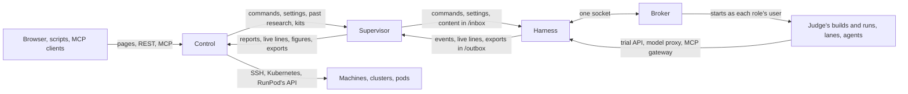

[How the parts fit together](how-it-fits-together.md) explains what control, a rig and its targets are, and why a rig dials out. This page goes one level down. It follows each channel between the parts: what travels on it, which side starts it, how often it runs by default, and so how long a change takes to reach the other side. The settings it names are in [Settings](../reference/settings.md), and [Trust](trust.md) explains the signatures that every command and report carries.

## Control and a rig

Every channel between control and a rig is started by the rig's supervisor, on a timer. The supervisor asks control, and control answers; control never waits on a rig. A rig on RunPod is the one exception, below.

| What travels | Direction | How often, by default | Setting |
| --- | --- | --- | --- |
| The harness's new events, in pages of up to 1,000, each signed by the harness | rig → control | every 60 seconds | `THERMITE_POLL_SECONDS` |
| The supervisor's own figures | rig → control | every 60 seconds, with the events | `THERMITE_POLL_SECONDS` |
| Commands waiting for the rig, each signed by control, and their outcomes | control → rig, then back | every 5 seconds | `THERMITE_COMMAND_POLL_SECONDS` |
| Live lines: what the lanes, the planner, the judge and the advisors are doing | rig → control | every 3 seconds, when there are new lines, from the supervisor's first report on | `THERMITE_LIVE_INTERVAL_MS` |
| The agents' model route, and the MCP servers they may use | control → rig | every 30 seconds | `THERMITE_MODEL_ROUTE_POLL_SECONDS` |
| The advisors' models | control → rig | at the start of each advisors' round | — |
| Past research for each running run, from the knowledge base | control → rig | every 180 seconds | `THERMITE_KB_SYNC_SECONDS` |
| Exports, when the rig has no results repository, in parts of 8 MiB | rig → control | after each export, at most once an hour | `THERMITE_EXPORT_MINUTES` |
| Each new champion's patch | rig → control | after each export that holds one | — |
| The daily report | rig → control | once a day | — |
| A kit or a project kept on control, as git over HTTP | control → rig | when an assignment needs it | — |

Each channel keeps its own place, so a call that fails is simply made again at the next tick, and nothing is lost or taken twice:

- **Events** carry a cursor. Control takes a page only if it follows on from the last one it has, and tells the supervisor where to start if it does not. A page that control refuses as too large is sent again in halves.
- **Commands** stay pending on control until the harness's outcome comes back. The harness takes each one once, whatever the number of times it is delivered.
- **Live lines** are a view of what is happening now, and control keeps only the latest of them; the record is the events.

### A rig on RunPod

A RunPod pod can't be reached from outside except through RunPod's own HTTPS proxy, and it has no fixed address to dial. So for a rig on RunPod, **control** starts every connection: after the pod enrolls, control calls it through the proxy in a loop, and each call carries what control has for the rig and brings back what the rig has for control. The supervisor's own calls to control go to a port inside the pod and wait there for the next exchange. Because the proxy ends TLS, every exchange is also sealed and signed by Thermite itself. [Trust](trust.md#rigs-in-pull-mode) explains it.

## Inside a rig

The supervisor and the harness are two containers, and they talk two ways:

- **The harness's API.** The supervisor calls it: for the events and live lines it relays, for the commands it delivers, for the run's settings, and, for the advisors, about 25 routes that read the run and post their answers. The harness never calls the supervisor.
- **Two shared folders.** The supervisor puts what a command brings (a project, a kit, another rig's champion, a model) in `/inbox`, which the harness may only read. The harness writes each export to `/outbox`, and the supervisor takes it from there to git or to control, then tells the harness it is done.

Inside the harness container, the **controller** (the harness itself) and the **broker** talk over one socket, a JSON object per line each way. The broker runs as root and starts every other process as its role's own user: each lane's agent, the judge's builds and runs, and the kit's checks. The judge takes its jobs from the ledger, where the controller queues each attempt. [Isolation](isolation.md) explains the users and what each one can reach.

## The agents

A worker is a process the broker starts for one trial, as the lane's user.

- **Its trial** comes in a file that only it can read, and its result goes back as the last line it prints.
- **While it works,** it calls the harness's trial API on the container's own loopback: for its live lines and progress, its model use, and the tools that change the lane's files. An agent program such as Claude Code, Codex or OpenCode writes its events to a file in the lane's folder, and the harness reads the new lines every second.
- **Its model.** OpenCode, Codex, a Pi worker on a ChatGPT route, and the planner reach the provider through the harness's **model proxy**, which adds the provider's key to each call. The agents' MCP servers are reached through the harness's **MCP gateway**, which adds each server's sign-in.
- **The owner's messages** reach a Pi worker at the end of its turn. An agent program gets them in its next prompt, when it is started again within the trial.

The advisors run in the supervisor, not in the harness. They reach their models the same ways, from there.

## People and programs

- **The dashboard** is pages that control renders. Live asks control for new lines every 2 seconds while its tab is open, and a page that follows a change (a command's progress, a rig's set-up) asks every 2 seconds for its first 2 minutes, then every 5. Other pages show what control had when they were loaded.
- **REST** and **MCP** answer on demand. MCP uses streamable HTTP, and each request is answered on its own.
- **The command line** calls control's REST API, or a rig's harness on the rig's own machine.

Control also reaches out, to set up and manage rigs: to a machine over SSH, with its host key pinned; to a cluster through the Kubernetes API; and to RunPod's API, every 30 seconds for each RunPod rig.

## How long a change takes to show

Because each hop waits for its timer, the time a change takes to show is the sum of the waits on its way, at the defaults above:

| A change | Its way | At most, by default |
| --- | --- | --- |
| A command, such as **Pause** | control → supervisor → harness | 5 seconds |
| A step of an agent, in Live | agent → harness → supervisor → control → Live | about 3 seconds, then Live's next refresh |
| A verdict, on the run's page | judge → ledger → supervisor → control | 60 seconds, then a reload of the page |
| A new model route | control → supervisor → harness | 30 seconds |
| New items in the knowledge base, for a running run | control → supervisor → the run's folder | 180 seconds |

The research itself never waits on these channels. A rig runs its trials and judges its attempts on its own, and keeps working while control is away; the channels only carry what happened and what the owner decided.

## Where to read more

- [How the parts fit together](how-it-fits-together.md): control, a rig and targets.
- [Trust](trust.md): signed commands, signed reports and pinned keys.
- [Isolation](isolation.md): the users inside a rig.
- [Settings](../reference/settings.md): each interval above.
- [Signed commands](../reference/signed-commands.md): every command a rig takes.
