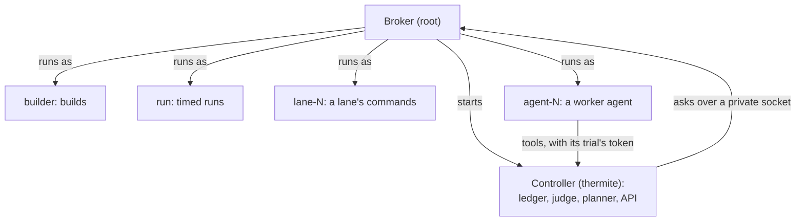

A rig runs code it does not trust all day long: the agents' commands, their builds and tests, and the candidate programs the judge times. Thermite's rule that [agents never judge](why-agents-never-judge.md) holds only if that code can't reach the judge. This page explains how the **harness**, the rig's container for the research, keeps each kind of work apart, and how it checks that it does.

The words here are in the [glossary](../reference/glossary.md).

## One user for each kind of work

Inside the harness, every kind of work runs as its own Unix user. These are **role users**:

| Role | What runs as it |
| --- | --- |
| `thermite` | The controller: the ledger, the judge, the planner and scheduler, and the harness API |
| `builder` | The judge's builds of each change, under the kit's limits. On a rig with several judge GPUs, each further card builds as a builder of its own, so builds run at once and none can reach another's |
| `run` | The judge's timed runs of a change. On a rig with several judge GPUs, each further card has a timing user of its own |
| `planner` | The planner's calls, when it runs in OpenCode, Claude Code or Codex |
| `model-check` | The model check, when it runs in OpenCode, Claude Code or Codex |
| `lane-1` … `lane-16` | One lane's commands and file tools. On a GPU, a lane's development runs also run as its user, with the device's group added |
| `agent-1` … `agent-16` | One lane's worker agent process, when it runs in Pi, the built-in worker harness |

The [harness image reference](../reference/harness-image.md#users-and-groups) lists every user.

The operating system enforces these users. A lane's commands run as `lane-3`, so they can read and write only what `lane-3` may, whatever the code tries.

No two kinds of work share a user. When a user's work ends, the broker stops what that user still runs, so that nothing a run started outlives it: after each command, or, for what a lane's commands leave running, when the lane's trial ends. A user shared by two kinds of work would let one's cleanup stop the other.

## The broker

Switching users needs root. So the harness starts a small **broker** as root, and it is the only part that runs as root. It:

- prepares the harness's folders, and clears the scratch area of anything an earlier run left, except each lane's own cache folder;
- closes the shared temporary places (`/tmp`, `/var/tmp` and `/dev/shm`) to every role, which each get a temporary folder of their own;
- reads the rig's secret files, hands their values to the controller alone, and closes their folders. It refuses to start if a secret file can still be read by other users;
- stops any role process left over from before;
- serves a socket that only the controller can reach, and starts the controller as `thermite`.

The broker accepts only a few requests, such as running a command as a role or handing a folder to one, and every path must be inside the scratch area. It never runs anything as root. For every run, it sets the role's user and groups, a limit on processes, the CPUs a timed run may use and the GPU fence (below) before the command starts. After each lane run, it clears set-user and set-group bits in the lane's folder, so a file a lane leaves behind can't lend its owner or group to a later command. If the controller stops, the broker stops every role's processes before it starts the controller again.

## Each lane on its own

A lane is one line of search ([Agents, lanes and the planner](agents-lanes-planner.md)). Lanes are kept apart from the judge and from each other:

- **Its own workspace.** Each trial gets a fresh copy of the project, owned by the lane's user, inside a folder for that trial only. The lane never sees the harness's copy of the project, its history or another lane's workspace.
- **One shared collection, written by the harness.** What the lanes share on purpose is the run's research folder: the pages fetched for any lane, the claims and research notes any lane recorded, and the past research under `knowledge/` ([Campaign modes](campaign-modes.md#research-in-every-mode)). The controller writes it from its records, as its own user: every lane reads and searches it, and no lane can change what the controller wrote. The [isolation self-test](#the-isolation-self-test) tries this as every role. In a research run, each lane also has a working area of its own there, which only that lane writes, and the other lanes see its files when its trial ends ([Research](campaign-modes.md#research)). Each worker's brief also carries the run's newest decisions and lessons from other lanes, the planner and the advisors, marked as data.
- **A token for one trial.** The worker's tools reach the workspace through the harness API, with a token bound to its run and lane. The API runs each request as the lane's user, only inside that trial's workspace, and the token stops working when the trial ends.
- **Limits on everything it runs.** The lane's memory and disk limits cover everything its commands start ([Per-process and per-trial limits](../reference/limits-and-pacing.md#per-process-and-per-trial-limits)).
- **The agent apart from its lane.** In Pi, the built-in [worker harness](../reference/glossary.md), the worker agent runs as `agent-N`, which can read none of the lane's files: its tools act through the API, as the lane's user. Its folder, with its trial's details and token, belongs to it alone. Under OpenCode, Claude Code or Codex, the agent program runs as the lane's own user, with the lane's access and none of the judge's.
- **Web pages through the harness.** A worker's research tools, such as `fetch` in Pi or `thermite-trial research fetch`, are calls to the harness API with the trial's token. The controller fetches the page itself, refuses private and local addresses, and archives the page in the run's research folder, where every lane can read it.
- **MCP tools through the harness.** A worker's MCP tools are calls to the harness's gateway with the trial's token. The controller adds the server's sign-in, which it keeps in memory, and gives the worker only the servers and tools that the run's kit gives the workers ([Give agents MCP tools](../how-to/campaigns/give-agents-mcp-tools.md)).

## The judge's files

The controller keeps its state where no role can look around in it:

- the ledger, the harness's copies of projects and kits, and imported files are open to the controller alone;
- stored builds and model files can be reached only by their exact path. Build outputs are hashed and made read-only, and checked again before every timed run;
- each timed run gets a folder of its own, with a read-only copy of the files the kit's `run.copy` lists. The judge owns that copy; the run can read it but not change it;
- the kit's check runs as the controller, in the kit's own folder, which no role can open.

The results of hidden test cases stay in a table of the ledger that never goes into an export. The owner sees each hidden case's name, how it failed and its value against its threshold, through the judge's `held_out_checked` event, which reaches control and no agent. The agents see only that a hidden check failed and its kind, such as "a held-out check timed out": never which case, its inputs or its output ([Held-out failures](../reference/verdicts.md#held-out-failures)).

## GPUs: device groups and the fence

A GPU is a device file, and whoever can open the file can use the card. The broker decides who can open each one.

- **One GPU, shared.** Every GPU device file belongs to the `gpu` group. Only the judge's timing user and a lane's development runs have it. The judge and the development runs take turns on the card ([Sharing a device](sharing-a-device.md)).
- **Several GPUs, dedicated.** Each card's device file gets a group of its own. The judge's timing user for a card gets that card's group, and a development run gets the group of the card it was given. A program can't open a card its groups don't name, whatever its environment says. Every card in the container must have its place in the layout, or the rig refuses the layout.

Where the container allows it, the broker puts each device file's owner and permissions back before every run, and at regular intervals.

The **GPU fence** adds a second lock where the kernel supports it: a Landlock rule set on each role's command, which its child processes keep. It leaves out every device file the role may not open. Where the device files' owner and permissions can't be changed inside the container, as on some GPU clouds and under rootless Podman, the fence is the lock that keeps roles off the cards.

If a rig can't set up its GPU layout this way, it neither times anything nor allows development runs. It never falls back to sharing the cards.

## Why the harness has a container of its own

The broker needs a few of root's powers: to change files' owners and permissions, to open any file, to switch users and groups, and to stop any process. The compose file, and the rigs control sets up on machines and clusters, give the harness container only those, with every other power dropped and no way for a process to gain new ones. So the broker controls every process, temporary folder and device file in its container.

The **supervisor**, which holds the rig's git keys, its token for control, the advisors' keys and the sign-in of the MCP servers its runs give the advisors, runs in a separate container that no role is part of. It listens on no port. The two containers share only the harness API, which the supervisor reaches with a token of its own; an inbox the supervisor fills and only the harness's controller can read, in a folder of the harness image that no role may enter; and an outbox the harness fills and only the supervisor's group can read. [Who holds your keys](who-holds-your-keys.md) follows each secret.

### One container, on RunPod

A RunPod pod runs one container, so the [one-container rig image](../reference/harness-image.md#the-one-container-rig-image) puts the supervisor in the harness's container. The supervisor is then one more user beside the roles, and the same means keep the roles from it: its folder and its token are its own user's, closed to everyone else, and only the controller's group reads the inbox it fills. It runs with no way to gain privileges, and in the GPU fence with no card, so neither it nor an advisor's program it starts can use the GPU the judge times on.

A pod is less closed than the containers Thermite sets up itself, and the image makes up for the difference:

- **Privileges.** RunPod lets a process gain privileges through a setuid program, so the image has none: its build removes every setuid and setgid bit.
- **RunPod's variables.** RunPod puts its own variables in the container's environment, an API key among them. The image's entry point removes them before anything else starts, so no process of the rig has them.
- **The GPU's device files.** On RunPod they keep the owner and permissions they came with, open to everyone, and the broker cannot change them. The GPU fence alone keeps every role but the GPU's own off them.
- **Control's key.** The supervisor and the harness share a container, so the supervisor must not choose the key the harness trusts. Enrollment brings control's key to the supervisor; root checks it against the SHA-256 the launch named and gives the harness a copy that only root can write. The enrollment code reaches the supervisor alone.
- **The volume.** RunPod's volume refuses even root a change of owner, and owners are what keep the parts and roles apart. So the rig's state lives on the pod's own disk, with the owners it has everywhere else, and root keeps a snapshot of it on the volume, which it puts back after a stop. The volume also ignores file modes: a folder only root may open is open to every user there. So the snapshot is sealed, every file encrypted and authenticated with a key that control makes for each pod at its launch and that only root holds. A part or role that reads the volume learns nothing from it, and one that changes a file gets the whole snapshot refused at the next start. It can still delete the snapshot, or put back an older one of the same pod ([Where the state lives](../reference/harness-image.md#where-the-state-lives)).

The isolation self-test checks all five, and the supervisor's user, in that image.

## The isolation self-test

The **isolation self-test** runs every time the harness starts, while nothing else is running yet, and control shows the result with the rig's hardware. You can also run it as a rig check ([Check a rig](../how-to/operate/check-a-rig.md)), or with `thermite selftest isolation` as root inside the harness container.

For each kind of role, the self-test asks the broker to run a small probe as that user. The probe tries what the role must not do, such as reading the ledger, a kit or a secret file, reaching the broker's socket, changing a stored build or a run's research folder, or opening a GPU it may not use. Every one of those must be refused. A few things must succeed: a timing user must read its run's copy of the kit, the workers' and the planner's users must read the research folder, and a role with a card must open it and see exactly that one card.

The result is one sentence, `isolation holds: every probe of <n> roles came out as it must` or `isolation does NOT hold` with what got through. Each probe stops its role's processes, so the test wants an idle rig. The [rig checks reference](../reference/rig-checks.md#isolation-check) lists every probe.
