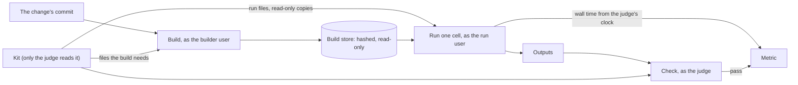

A **kit** is the judge's half of a project. It says how to build a changed version of the project, how to run it on each test case, how to score the run and how to tell whether its output is right. The project is what the agents change; the kit is how Thermite decides whether a change counts. Agents never see it.

This page explains why the benchmark is kept apart from the project, what a kit holds, how the judge uses it and how it reaches a rig. To write one, see [Write a kit for your project](../how-to/campaigns/write-a-kit.md). For every field, see the [kit manifest reference](../reference/kit-manifest.md).

## Why the benchmark is not part of the project

The obvious design is to let a project carry its own benchmark and tests, and have the agents run them. Thermite does not, because the agents change the project. A benchmark that agents can edit is a benchmark they can win without improving anything:

- a timer that starts late or stops early;
- a "fast" routine that quietly calls the slow reference version;
- a reference made trivial, so that a wrong answer matches it;
- a number printed to the log that the loop believes.

Thermite's CPU smoke kit keeps a test change for each of the first three, and the judge ignores printed numbers altogether. The rule behind this is Thermite's first: **agents propose; code judges.** The kit is that code. It lives in its own repository, the judge keeps it where no agent can read it, and the only number that counts is one that the judge measures or that the kit's own check reports.

Agents still build and test their own changes in their own copies of the project, and the notes in the campaign's [contract](../reference/glossary.md) can tell them how. Those test runs help them search, but their numbers never count.

## What a kit holds

A kit is a git repository with a manifest, `kit.json`, and whatever scripts the project needs, in any language.

| Part | What it is |
| --- | --- |
| **Target** | The kind of hardware the kit measures on: `cpu` or `cuda-gpu` |
| **Build** | A command that builds a changed version from its source, the files that make up the result, and limits on time, memory and disk |
| **Cells** | The test cases, which the dashboard calls **cases**. Each is a name and the parameters that make it different, such as a problem size, a seed or an input file, and, if it needs one, its own time limit |
| **Run** | A command that runs one build on one cell and writes its outputs, with its own limits |
| **Metrics** | The scores: a rate from the judge's own clock (work divided by seconds), the run time itself, or a number that the check reports |
| **Check** | A program that the judge runs on a run's outputs to decide whether they are correct. The last line it prints decides, not its exit code; a kit described on the **New campaign** page is wrapped so that its exit code decides |

Goal campaigns add **verifiers**: named sets of cells. A goal that names a verifier is met when every cell in it passes the check. Verifiers can be ordered, and **gated**: one runs only once the verifiers it requires have passed, so a change that fails a basic goal doesn't spend the judge's time on goals that depend on it.

A kit can also name **MCP servers**: tools from outside Thermite, such as a knowledge base or a code host, that the campaign's workers, planner or advisors may call ([Give agents MCP tools](../how-to/campaigns/give-agents-mcp-tools.md)). They belong in the kit because they are part of how the campaign is run, chosen once with the benchmark and pinned with it by commit. The judge never uses them, so they can't change a measurement. The kit names a server by its name in control's **Settings**, never with a secret: a campaign whose kit names a server **Settings** lacks can't start.

## How the judge uses a kit

1. **Build.** The judge exports the change's commit into a fresh directory, copies in the kit files that the build needs, and runs the kit's build command as a separate builder user. It hashes what the build produced and moves it into a store that nothing else can write. The same commit, kit and compilers are built once and reused.
2. **Run.** For each cell, a separate run user runs the stored build with the cell's parameters. Before every run, the judge checks the build's hashes again and gives the run a fresh, read-only copy of the kit's run files, such as a driver script.
3. **Time.** The judge times the whole run from outside, with its own clock. Nothing the run prints is a score.
4. **Check.** The judge runs the kit's check on the outputs, with its own copy of the parameters, as a checker user of its own that reads the kit and writes only its own folder. If the check fails, the run is invalid, however fast it was.

A kit can also have a **driver**: a program of its own that runs beside the candidate, as a user apart from the candidate's, sends it input and reads its answers through their standard input and output, and writes the outputs the check reads ([A kit's driver](../reference/kit-manifest.md#a-kits-driver)).

A hill climb does this for the **champion**, the best confirmed version so far, and for the change, cell by cell, and compares them with statistics. A goal campaign runs each goal's cells and records which goals are met.

## Where the trust is

A change controls more than its own source files. Its code runs during the run, and its build scripts run during the build: a project's CMake files, for example, can run anything at configure time. So everything in the build directory and in the run's outputs is evidence to be checked, never instructions.

The kit directory, the check and the judge's copy of the parameters are out of the change's reach. That is where a kit's trust lives:

- **The check recomputes or compares.** It works from the parameters and from references kept in the kit, not from anything the run says about itself.
- **Run files are the judge's.** The run user cannot read the kit. The judge copies only the files a run needs into each run, read-only, so neither the build nor the run can rewrite them. The run can read those copies, so they never include anything the check relies on.
- **The check confirms that the change's code did the work.** The smoke kits link a probe that counts calls to the reference version, so a change that quietly calls it is caught.

## Hidden test cases

The kit defines every cell. The contract chooses which cells count, and which of them are **hidden** (the contract calls them held-out cells). The judge runs hidden cells only to confirm a change that already looks better, and, in a goal campaign, to check the champion again before the run closes; never while it screens. Their results go to the code that decides promotion and, for the owner, to the dashboard: each hidden cell's name, how it failed and its value against its threshold. The agents see only that a hidden check failed, and its kind, such as "a held-out check timed out": never the cells' names, parameters or outputs ([Held-out failures](../reference/verdicts.md#held-out-failures)).

In a hill climb, a change passes its hidden check when, on every hidden cell, its output passes the kit's check and its primary metric, the median of three runs beside the champion's, is worse than the champion's by no more than twice the contract's `equivalence_band`: 1% at the default band.

In a goal campaign, a goal's status comes from its visible cells, and its hidden cells are checked before a gain is promoted, and again for every goal the champion meets before the run closes. A goal that should have a hidden check needs at least one visible cell and one hidden cell in its verifier, or among its threshold's cells.

## How a kit reaches a rig

The contract names the kit by its repository and its commit. The kit can come from three places:

- a git repository you name, public or private (control gives the rig access to a private one);
- a kit that control keeps itself, because you described it or uploaded it on the **New campaign** page, or gave it as a git bundle (`thermite kit add`, or the MCP tool `kit_add`);
- a git bundle file that you put in the rig's inbox yourself.

When a run is assigned, control sends the rig a signed command that names the kit's commit. If the rig does not have that commit yet, the command also names a file in the rig's inbox for the kit and, unless you put the file there yourself, where to fetch it from. The supervisor then fetches the commit and writes it into the inbox as a git bundle. The harness accepts the bundle only if it holds that exact commit, and only if the file's hash matches when the command gives one. So neither the supervisor nor the network can swap the kit.

Before any agent starts, the harness checks that the kit fits: that it measures on the rig's kind of hardware, and that every cell, metric and verifier the contract names is in it. A kit that does not fit is refused with the reasons. The kit then stays on the rig, in the harness's private store, so later runs can use it again.

## Pinning and changing a kit

Because the commit is pinned, the kit that judged a result can always be identified, and a kit cannot change under a running campaign.

The cost is that a kit changes slowly. Any change is a new commit, so a new contract version, and every build is done again, because the kit's commit is part of what identifies a build. For a large project, that means a full rebuild for a one-line fix to a run script. This is why a kit is tried on the unchanged project before agents start: a mistake found then costs one rebuild, not a campaign. The New campaign page's **Try the kit first** does this: a **try** is a run with no agents, in which the judge builds and measures the unchanged project.

## What a kit costs

A kit is real work, and it is the part of a campaign that is easiest to get wrong without noticing. Its failures are quiet:

- **A check that is too loose** lets wrong answers win.
- **A check that is too strict** rejects every honest improvement.
- **A run that fails for its own reasons,** such as a flag the project no longer accepts, makes every change look broken.
- **A run dominated by start-up** buries the work being measured in noise, because the judge times the whole process.

A kit that fails quietly looks like a stream of bad changes. So a kit is tested like code: keep a set of known changes with known verdicts, and read the results of a try of the kit before trusting any number. [Test a kit with known candidates](../how-to/campaigns/test-a-kit.md) shows how.

## Kits and targets

A kit measures on one kind of target. A rig accepts a kit only if the kit's target matches its own: a `cpu` kit on a rig without GPUs, a `cuda-gpu` kit on a rig with them. A project measured on both kinds has two kits. [Kits and rigs, side by side](kits-and-rigs.md) says more about how the two fit.
