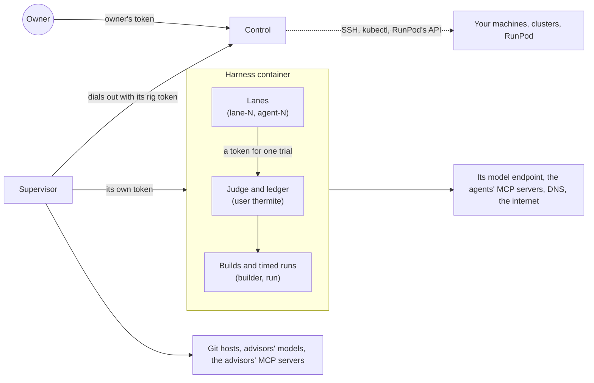

Thermite runs code that AI models write. Its security model starts from that fact: the agents' code may try anything that its operating-system user is allowed to do, so each part of Thermite gets only the reach and the trust that its job needs. This page shows, in one place, what each part can reach and what it trusts. The pages it links to give the details, and [Known limits](../reference/known-limits.md) lists what the design does not cover yet.

The words here are in the [glossary](../reference/glossary.md).

## Three rules

1. **Agents propose; code judges.** Nothing that an agent writes reaches a measurement, a verdict or a promotion. The agents' code runs as users that can't read or change the judge's files ([Why agents never judge](why-agents-never-judge.md), [Isolation inside a rig](isolation.md)).
2. **Signatures decide, not the path between.** Control signs every command, and the harness signs every report. The supervisor carries both, but it can make neither ([Trust between control and rigs](trust.md)).
3. **A key goes only where it is used.** Control seals every secret you give it, and hands a rig only what that rig uses ([Who holds your keys](who-holds-your-keys.md)).

## Control

- **Runs as** a user other than root. The compose file drops every Linux capability.
- **Listens on** one port, 8800: the dashboard, the REST API, MCP and `/metrics`. Compose publishes it on `127.0.0.1` only. Rigs on other machines reach it through a reverse proxy with HTTPS that you provide ([Let rigs on other machines reach control](../how-to/install/one-machine.md#let-rigs-on-other-machines-reach-control)).
- **Reaches** model providers, to list their models; OpenAI, for a ChatGPT sign-in and its plan's usage; git hosts, to read a project's commit and file list for the **New campaign** page; your machines over SSH and your clusters' API, to set rigs up and manage them; RunPod's API, its test pods, and the pods of rigs launched there, through RunPod's proxy ([Rigs in pull mode](trust.md#rigs-in-pull-mode)); and the MCP servers in **Settings**, to read their tools and to sign in (an OAuth server's sign-in and token endpoints). It connects to no other running rig: every other rig dials out to control. With `compose.lifecycle.yaml`, which is for development only, control also gets the container engine's socket, to restart the compose rigs.
- **Trusts** a request only with a token, and only for what that token's role may do ([Tokens and roles](../reference/tokens.md)). It takes a rig's report only when the report is signed with the key that control pinned for that rig, and a champion's patch only when its hash matches the rig's signed record.
- **Holds** every key and sign-in that you add, sealed, MCP servers' keys, client secrets and OAuth sign-ins included; its own signing key; and tokens as hashes, where it can.

## The supervisor

- **Runs as** a user other than root, in a container of its own, with every Linux capability dropped. No agent's, build's or candidate's code runs in it, and it listens on no port.
- **Reaches** control, by dialing out; its harness's API; git hosts, to fetch projects and kits and to push results; the advisors' model providers; public web pages, for advisors that the advisors file lets fetch them; and the MCP servers that its runs' kits give the advisors, which it calls for them.
- **Trusts** control, at the address that it was given. It doesn't need to trust anything else, because the harness checks each command, and each project, kit, model or champion that the supervisor fetched, against what control signed. Before it fetches a command's sources, it asks its harness to check control's signature on the command, and fetches nothing for one the harness refuses. It fetches a model file only from an address on the internet, a source that names no Git access with no key, and a Git access's repository only on that access's host.
- **Holds** the rig's outside credentials: its rig token for control, its token for the harness, the results repository's deploy key, used for the results repository alone, a private repository's Git access for one fetch at a time, the advisors' keys, and the sign-in of each MCP server its live runs name, in memory. It holds no signing key, so it can't make a command or a report, submit a change or set a verdict.

## The harness

- **Runs as** a small broker, as root, with six capabilities (`CHOWN`, `DAC_OVERRIDE`, `FOWNER`, `KILL`, `SETGID` and `SETUID`) and no way to gain more. The broker starts everything else as a role user of its own.
- **Listens on** port 8700, the harness API, which is never published. Over the network, only its supervisor calls it; inside the container, the workers' tools call it on `127.0.0.1`. Every route but a health check needs a token.
- **Reaches** DNS, the internet and its model endpoint, and through the internet the MCP servers that its runs' kits give the workers and the planner, which it calls for them. Where the rig runs decides what else it can reach ([below](#where-a-rig-runs)).
- **Trusts** a command only when control signed it, for this rig, before it expired, from an issuer allowed for its kind. It takes a project, kit, model or champion only when it matches the commit or hash in that command. What the supervisor hands over, such as the advisors' experiments and past research, reaches the agents as data, never as a verdict.
- **Holds** the rig's report signing key, the ledger, the agents' model route and the sign-in of the workers' and the planner's MCP servers (in memory only), where no lane, build or timed run can read them.

## The lanes

A lane is one line of search, worked by one agent session after another ([Agents, lanes and the planner](agents-lanes-planner.md)).

- **Run as** a user of their own, `lane-1` to `lane-16`. In Pi, the built-in worker harness, the worker agent runs as `agent-N`. Each trial works in a fresh copy of the project that the lane owns.
- **Reach** the harness API with a token for one trial, which stops working when the trial ends; the run's research folder, where they read what the harness wrote and, in a research run, write only their own working area; and the harness container's network. A worker's research fetches go through the harness, which refuses private and local addresses. The commands that a lane runs use the container's network directly.
- **Are trusted with** nothing that decides. A lane proposes a change, and the judge measures it. Thermite's hooks in Claude Code and Codex and its plugin in OpenCode run as the lane's user too, with the same trial token: they get only the owner's messages to that trial, and what they report of the agent's turns is a hint for the live view, never a count of turns, usage or results. A lane can't read the ledger, the kits or the secret files, list or change the stored builds, or open another lane's workspace or a GPU that it wasn't given. The isolation self-test checks this every time the harness starts.
- **Hold** what their worker harness needs. In Pi, the model key is in the environment of the agent's process (`agent-N`), which the lane's commands can't read. OpenCode and Codex never get the key: they call the model through the harness's proxy with the trial's token. Claude Code runs as the lane's own user, and reads the subscription token from a file descriptor when it starts, so the token is in no environment and no file. The commands that it starts get no credentials, but they run as the same user as Claude Code, so Thermite does not count on keeping the token from them.
- **Can hold a program in its own terminal.** Thermite's terminal host keeps an agent program's own terminal UI in a pseudo-terminal, for a trial on a rig that runs its agent programs in their own terminal ([Agents in their own terminal](agents-lanes-planner.md#agents-in-their-own-terminal)). The broker starts the host as the lane's user, under the lane's limits and the GPU fence, and the host starts the program on a terminal of its own, as the same user; Claude Code's token comes on a file descriptor, as it does without a terminal. The agent's commands run as that user too, so they can reach the host's socket in the trial's folder, but each request must carry a secret that the harness gave the host on its standard input: without it, they get only refusals. What else they could do to the host, such as end it, read the program's screen or type into the program's terminal, they can already do to their own program. The host copies the program's session log, which only the lane's user may read, into a file the harness can read. That copy and the screen are the lane's own word, never a measurement.

## MCP servers

An MCP server gives agents tools from outside Thermite ([Give agents MCP tools](../how-to/campaigns/give-agents-mcp-tools.md)). Its secret goes where the call is made, never to an agent:

| Who | Reaches the server | Holds its secret |
| --- | --- | --- |
| Control | Yes: to read its tools when you add it or press **Read tools again**, and to sign in, renew a sign-in and get a client's token | Sealed in its store: a key, a client secret, an OAuth refresh token |
| The supervisor | Yes, over the internet: the calls of the run's teachers, auditor and review panel, when the run's kit gives the server to the advisors | In memory: the headers control gave it, an access token rather than the refresh token or the client secret |
| The harness | Yes, over the internet: the calls of the workers and the planner, when the run's kit gives them the server | In memory, the same headers. Nothing is written to its disk |
| A lane, the planner's own process in OpenCode, Claude Code or Codex | No: it calls the harness's gateway with its trial's token, or one made for the planner's call, and the gateway calls the server | No. Its configuration names the gateway, with its own token in the file (OpenCode, Claude Code) or in its environment (Codex) |
| An advisor in Claude Code, OpenCode v2 or Codex | No: it calls a server the supervisor serves on `127.0.0.1` for that call | No. Its token for that server, made for the call, is on Claude Code's command line (`--mcp-config`), and in OpenCode's and Codex's environment |
| The judge | No | No |

Control hands a rig a server only when a run it assigned that rig names it. The gateway gives each kind of agent only the servers and tools its run's kit gives it, and a call to another is refused. What a server answers reaches the agent as data, never as a verdict; a write tool the kit gives an agent can change things on that server.

## The judge

- **Runs** inside the harness's controller, as `thermite`. It builds each change as `builder` and times it as `run`, with a builder and a timing user of its own for each further judge GPU, each under limits on time, memory, disk and processes ([Per-process and per-trial limits](../reference/limits-and-pacing.md#per-process-and-per-trial-limits)).
- **Reaches** the network through the harness container, as the lanes do: builds and timed runs have no network of their own.
- **Trusts** the kit and its own clock. The broker times every measured run from outside, so a number that a change prints about itself is only a cross-check. Build outputs are hashed, made read-only, and checked again before each timed run.
- **Runs the kit as trusted code.** A kit's check runs as the judge itself, in the kit's own folder. A kit reaches a rig only by its commit, in a command that control signed, and no agent ever sees it. So use kits that you wrote or read ([Why the benchmark lives in a kit](kits.md)).
- **Takes no messages.** No message, rule or advisor can change a measurement.

## Where a rig runs

The harness's network depends on where the rig runs. Its supervisor needs the internet and control everywhere, and takes no connections.

| Where | What the harness can reach | What can reach the harness |
| --- | --- | --- |
| **Compose**, on one computer | DNS, the internet, your computer (as `host.docker.internal`) and your local network, through the normal `egress` network. It is not on control's network | Its port is not published on your computer. It shares an internal network with its supervisor alone |
| **A machine**, set up by control over SSH or joined by you | The same as compose: the rig's `egress` Podman network leads to the internet and to the machine's local network | Its port is not published on the machine |
| **Kubernetes**, in a namespace that control creates or that you join | DNS, and addresses outside the private ranges of RFC 1918, by the network rules that control adds. The cluster's network plugin must enforce them | Only its supervisor, on port 8700 |
| **Kubernetes**, in a slot that the cluster's operators made | What the operators' network rules allow. Control refuses a slot unless those rules keep the harness off the private ranges | What the operators' rules allow |
| **RunPod**, a one-container rig that control launched | DNS and the internet. Thermite adds no network rules in a pod, so code that a lane runs can reach any outside address | Nothing from outside: the harness's API answers only inside the pod. The supervisor serves one port, through RunPod's proxy, and answers only control's signed requests; anything else gets the same empty 404 ([Rigs in pull mode](trust.md#rigs-in-pull-mode)) |

On Kubernetes, neither of a rig's pods gets a service-account token. Nothing in them calls the cluster's API: control starts, stops and updates the rig.

[Ports, volumes and secret files](../reference/ports-volumes-secrets.md#networks) lists each network and rule.

A **RunPod test pod** runs Thermite's CUDA harness image, or the one-container rig image, with a probe in place of the broker, and no agents. The probe checks the platform, starts the broker as a rig would, runs the isolation self-test, and serves what it found on port 8000. Control reads that report through RunPod's public HTTP proxy, at an address with a random token in its path. The report holds names and results only, never the value of a variable. Control removes the pod when the test ends ([Test a GPU on RunPod](../how-to/install/runpod-test.md)).

## Where to read more

- [Isolation inside a rig](isolation.md): the role users, the broker, the GPU fence and the isolation self-test.
- [Trust between control and rigs](trust.md): signed commands, signed reports and pinned keys.
- [Who holds your keys](who-holds-your-keys.md): where each secret is kept and where it travels.
- [Known limits](../reference/known-limits.md): what this design does not cover yet.
- To report a security problem, follow the [security policy](https://github.com/iammrduncan/thermite/blob/main/SECURITY.md).
