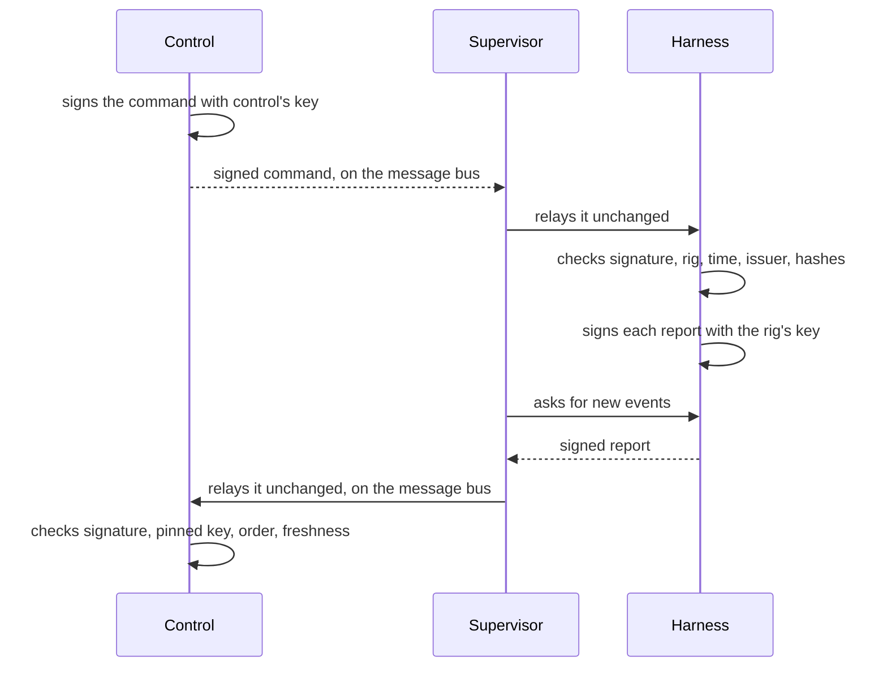
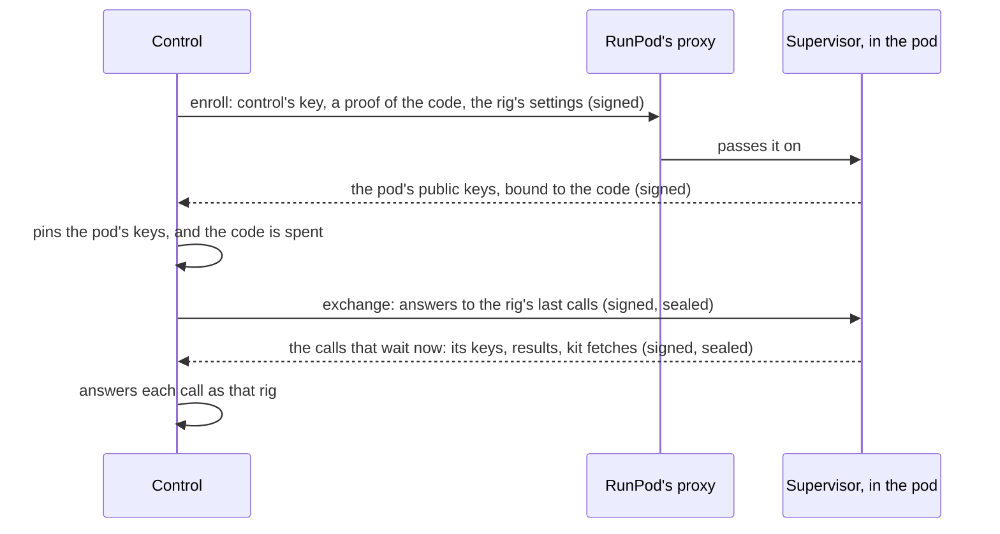

Control and its rigs often run on different machines, and everything between them passes through each rig's **supervisor**, which also talks to git hosts, model providers and web pages all day. Thermite is built so that the supervisor does not have to be trusted with what matters most: control signs every command, the harness signs every report, and each side checks the other's signature. This page explains those checks and how keys are first trusted.

The words here are in the [glossary](../reference/glossary.md). A rig is two containers: the **harness**, which holds the judge, the agents and the record of the research, and the supervisor, which connects it to everything else ([How the parts fit together](how-it-fits-together.md)).

## Two keys

There are two signing keys, one in each direction. Both are Ed25519 keys.

- **Control's key** signs commands. Control makes it the first time it starts and keeps it in its own directory. Its public half goes to every rig when the rig is set up.
- **The rig's key** signs reports. The harness makes it the first time it starts and keeps it in its private state. It survives a full reset, so control's trust in the rig survives too.

The supervisor holds neither key. It can carry signed messages, but it cannot make one.

## Signed commands

Control steers a rig with **signed commands**, such as assign a campaign, pause a run or approve a promotion. One path in control issues them all, whether they start on the dashboard, the REST API or MCP.

Each command is an envelope that names its own id, the rig it is for, its kind, who issued it, when it was issued, when it expires, and what it asks. Control signs the whole envelope. The harness then checks:

- that the signature is control's;
- that the command is for this rig, so a command can't be replayed on another rig;
- that it has not expired, and was not issued in the future (beyond a small clock difference);
- that its content matches what its kind allows;
- that it was not issued before the rig's state was last wiped;
- that its id has not been applied already. A command seen twice gets its first outcome again and runs only once.

Commands expire after an hour by default, so an old command that was never delivered can't take effect much later, and control never delivers one that has expired. The [signed commands reference](../reference/signed-commands.md) lists every kind and every check.

### Who issued it

The issuer is inside the signature: the owner through the dashboard, the REST API or MCP, an operator acting for the owner, or an agent. Some kinds are the owner's alone, such as approving a promotion, accepting a review, wiping the rig, changing its settings, messaging the run's agents and advisors, and changing a run's experiment queue or removing a rule for its plan. The harness accepts those kinds only from an issuer in the owner's name, and control decides which kinds each token may ask for. So an agent's token can't get an owner's command through, even though it reaches control. An operator's token, which the owner gives an agent that runs campaigns for them, may send messages and change the queue, in the owner's name. When the dashboard refuses something, such as a message that control won't send, control's audit log records the refusal and why.

This is how only the owner can write to the agents and the advisors. The advisors can answer the owner's messages, through the supervisor, but they can't send one, and the judge takes no messages at all: it is code, and no message can change a measurement. A run's **Live** view shows a line as the owner's message, a read receipt or an advisor's answer only when the harness signed it; a line that isn't signed shows as a plain log line, whatever it claims. A worker can't make one up either: a trial may post only its own session's text, thinking, tool calls and results. [Tokens and roles](../reference/tokens.md) says what each token may do.

### Content checked by hash

Some commands bring content that the supervisor fetches: the project and the kit, a model file, or another rig's champion. The command does not carry the content, only what it must be: a git commit for a project or a kit, a SHA-256 for a model file, and for a champion, the patch's SHA-256 and the git tree that must result. The contract travels inside the command, with its own hash.

The supervisor fetches the bytes into the rig's inbox, and the harness checks them against the signed values before it uses anything. So neither the supervisor nor a git host in between can swap one project, kit, model or champion for another.

### The harness's record decides

The supervisor tells control quickly whether a command was delivered, but that is only the fast path. The harness records each command it applied in its signed report, and that record replaces whatever the supervisor said.

## Signed reports

The harness signs every report it gives the supervisor: each page of new events, with the rig's name, the record's id, where the page starts and ends, and when it was made. Control takes a report only when:

1. it names the rig it arrived for;
2. its signature is good, made with the key control pinned for that rig;
3. it continues the stream control already has, with no gap;
4. it does not come from a record the rig has left behind, such as one from before a full reset;
5. it is not older than the newest report control has taken, and not dated in the future.

So the supervisor cannot forge a report, replay an old one, or drop events from the middle of the stream. Only the harness's signed reports make a rig show **Live** on the dashboard's **Rigs** page. A champion patch that the supervisor uploads is kept only if its SHA-256 matches the one in the rig's signed record of that champion. A run's **Live** view is for watching the work as it happens; the record of what happened is these signed events. The same goes for a run's experiment queue: control builds the **Experiments** and **Planner** tabs from the signed events alone. So does Thermite's knowledge base: every item in a campaign's collection comes from an event in a rig's signed report ([below](#the-knowledge-base-grants-and-mcp-servers)). When a new run copies another run's untried experiments, from **Start a run** or its twins (`POST /v1/campaigns/<campaign>/runs`, MCP's `start_run`, `thermite run start`), with `issue_command` over MCP, or with `thermite assign --queue-from`, control takes each one's title, details, direction, why and author from its own record of the experiment it was copied from, not from what an MCP caller wrote. Over MCP, control takes that record only from a run of the new run's campaign, or of a campaign whose collection the new run's campaign may read. Any other experiment keeps the caller's words, marked `copied` as its author. `--queue-from` follows the same rule: an experiment from a run of any other campaign keeps the words control shows for it, marked `copied`.

## Pinning the rig's key

The first time control sees a rig's report, it must decide whether to trust the key that signed it.

- **By default, the first key is pinned** when its report verifies: trust on first use. The dashboard shows the pinned key.
- **With `THERMITE_CONTROL_REQUIRE_KEY_ACCEPT=1`** on control, even the first key waits for the owner.
- **A changed key always waits.** Control holds it and shows a **New key** item in **Needs you**, on the **Overview** page. Until the owner accepts it, reports signed with it are refused.

The owner accepts a key by its **fingerprint**: the first 16 hexadecimal characters of the SHA-256 of the public key. The rig's harness logs its own at every start, and the owner can also work it out on the rig from the public key in the harness's state; the owner compares it with the one control shows. Control accepts only the key with the fingerprint the owner saw. A full reset keeps the rig's key. A rig whose harness state was lost makes a new key, which waits for the owner. [Accept a rig's key](../how-to/operate/accept-a-rig-key.md) shows how.

## Rigs dial out

Control never connects to a running rig, except to a rig in pull mode ([below](#rigs-in-pull-mode)). The supervisor makes every connection, out to control's message bus and, for a few calls, to control's API. At its start it registers its keys on the bus with control over HTTPS; then it takes its commands and its config from the bus as control issues them, and sends its reports, live lines and figures there, each on its own schedule ([How the parts talk](how-the-parts-talk.md#control-and-a-rig), [How often it talks to control](../reference/settings.md#how-often-it-talks-to-control)).

Outside pull mode, the supervisor listens on no port. The harness publishes no port to the outside, and every part of its API except a health check needs a token. The supervisor uses a **rig token** with control, which works only on its own rig's routes, and a retired rig is refused whatever token it holds.

So a rig can run where nothing can reach it, such as behind a home router or a firewall, as long as it can reach control and its bus. And **rigs keep researching when control is down**: commands wait at control, and reports catch up when it is back. A rig that can't reach the bus at all is shown broken ([A rig off the bus](../how-to/operate/message-bus.md#a-rig-off-the-bus)).

Control does connect to machines and clusters, over SSH or with kubectl, to set a rig up, start it, stop it and remove it, and to move a rig on a cluster onto new images, reading its deployments' status while it waits for them. It never uses those connections to talk to the running rig. What control did there, step by step, is for the people who run control: over MCP, `rig_setup` shows it to the owner's, operators' and readers' tokens, never to an agent's token, and only the owner and operators see each step's details.

Some things reach a rig without a command: the agents' model route, the advisors' models, the Git access for a private repository and the MCP servers that the runs control assigned it name, with their sign-in, which control writes to the rig's config on the bus, sealed to the rig's own key; and the past research for its running runs, which the supervisor asks control for on the bus. A Git access and the MCP servers reach a rig only while an assignment of it that names them is live: waiting for the rig or taken by it, its run not closed; and a Git access only for the host it is for. The supervisor fetches a command's sources only once its harness has checked control's signature on the command ([Who holds your keys](who-holds-your-keys.md)).

## Rigs in pull mode

A rig on RunPod runs in **pull mode**: it never connects to control, and control connects to it. Control can then stay private, with nothing of where it runs opened to the internet, even on a laptop behind a home router, and no tunnel or VPN to set up first. The rig's supervisor serves one port, which RunPod's HTTP proxy makes reachable at `https://<pod>-<port>.proxy.runpod.net`. Control connects there for what stays on HTTPS. Rigs under compose, on machines and on clusters keep dialing out as above: the mode belongs to each rig. The owner launches a rig on RunPod from control ([Run a rig on RunPod](../how-to/install/runpod-rig.md)), and stops, starts and terminates it; no other token may, since a pod is billed by the hour.

The rig's reports, commands, live lines, screens, figures, config and knowledge base do not cross the proxy: they go on the message bus, whose NATS server on control dials a server in the pod itself, at the public address and port RunPod gives the pod's port 7422, over TLS with keys checked both ways, and the connection may do only what the rig's user may ([A rig on RunPod](how-the-parts-talk.md#a-rig-on-runpod)). The tunnel below carries only what stays on HTTPS: the enrollment, the registration of the rig's keys on the bus at each start of its supervisor, its champions' patches and exports, and the kits it fetches as git. A pod launched before its leaf node, or one RunPod gives no public address for port 7422, can't report, and shows broken: terminate it and launch a new one.

The supervisor makes the same calls as on any rig, to a port of its own on `127.0.0.1`. Each call waits there. In each **exchange**, control hands over its answers to the calls it took last time and takes the calls that wait now, then answers each one itself, as that rig, on the same routes and with the same checks as for a rig that dials out: `POST /v1/rigs/<rig>/supervisor`, the registration of its keys; `POST /v1/rigs/<rig>/champions/<run>/<seq>/patch`, `POST /v1/rigs/<rig>/exports/<name>` and its `/file`, its results going out; and `GET /v1/rigs/<rig>/git/kits/…`, the kits it fetches. No other route is answered. An exchange with nothing to take waits at the pod for up to 20 seconds, so a call does not wait for a timer.

### What the proxy can and cannot do

RunPod's proxy ends TLS, so it, and the network it runs on, could read, change, delay, drop or replay whatever passes. Anyone can also send requests to a pod's address: a pod's ID is no secret, and it shows in RunPod's console, API and logs. Pull mode leaves the proxy only bytes to move:

- **Control signs every request** with its command-signing key, in the same format as a signed command, over the method, the path, the rig, the pod, the time, a random nonce and the SHA-256 of the body. The pod refuses a request whose time is more than 60 seconds from its own clock, a nonce it has seen in the last 5 minutes (it keeps them on disk, so a restart does not forget them), and a request for another rig or pod.
- **The pod signs every answer** with a key of its own, over the request's nonce, the status and the SHA-256 of the answer. Control drops any answer that does not verify against the keys it pinned for the rig: a changed answer, or an old one replayed for a new request. A call whose answer was dropped is offered again, so it costs only a retry.
- **Bodies are sealed** both ways to the other side's key (X25519, HKDF-SHA256 and AES-256-GCM, a fresh key for each message). The keys it registers, its results and the kits it fetches cross the proxy only sealed.
- **What travels inside is checked as on every rig.** The harness still signs its reports, and control still pins the harness's report key; the harness still checks control's signature on every command.

### Only control gets an answer

Every request that control did not sign gets the same empty 404, and changes nothing on the pod: a wrong path, a missing or wrong signature, a stale time, a replay, another rig or pod. A request to a path other than the pod's random 256-bit path is refused before its body is read. The same goes for a lane inside the pod. A lane is a user in the same container, so it can reach both ports directly: the public port treats it as anyone else, and the supervisor's own port on `127.0.0.1` takes only the supervisor's token, a random value that lives in the supervisor's memory, and answers anything else with the same 404. The pod's keys are in a directory only the supervisor's user can open, and the [isolation self-test](../reference/rig-checks.md) checks that no role can read them.

The server is small. It takes `POST` on two paths, enroll and exchange. A request from control is at most 1 MiB, and a larger answer crosses in parts over several exchanges. Headers must arrive within 10 seconds and the whole request within 60; it holds at most 4 connections and takes at most 20 requests a second.

The pod counts what it refused and reports the count in the next exchange. The rig's page on the dashboard shows the total under **Pull mode**, as **Refused requests**, and control's audit log records each report of refusals (`tunnel_refusals`). With no enrollment, keys that do not verify, or a clock more than 60 seconds off, the pod answers nothing, and the rig's page says what control's last attempt found.

### Enrollment

RunPod's console and API show a pod's environment, so no secret that reaches beyond the pod goes there. For each pod, control mints the rig: its ID, a random path, a key of its own for the rig (what the pod sends is sealed to it) and a **one-time enrollment code**. The pod's environment gets those public values, the SHA-256 of control's command-signing public key, and the code ([the settings](../reference/settings.md#pull-mode)).

It also gets one secret that lasts as long as the pod: the key the pod's [state snapshot](../reference/harness-image.md#where-the-state-lives) is sealed with. Control makes a new one for each pod and keeps no copy, so it opens nothing but that pod's snapshot. It must outlive a stop, as the snapshot does, and RunPod keeps a stopped pod's settings. It keeps the snapshot from the rig's own parts and agents, who can all read the pod's volume; it does not keep it from RunPod or from whoever can read the account's pods, who can read the pod's disk anyway. In the pod, only root has it: the broker takes it out of its environment before it starts anything.

1. At its first start, the pod makes its own keys: one to sign its answers and one that control seals to. They stay in its state, readable only by the supervisor's user.
2. Control's first request brings control's public key, a proof that control holds the code, and the rig's settings. The pod takes the key only if its SHA-256 is the one in its environment, and the request only if it is signed with that key. The proof is an HMAC bound to the rig, the pod and the request's nonce, so the code itself never crosses the network.
3. The pod answers with its public keys and its own proof of the code. Control checks the proof and the answer's signature, and pins the keys. The code is spent at control.
4. Control's first exchange is sealed to the pinned key. When it arrives, the enrollment is complete at the pod too: the code is spent there, and the supervisor writes control's key and the rig's settings to files.
5. The harness starts only now. Root, not the supervisor, gives it control's key: in the [one-container rig image](../reference/harness-image.md#how-it-starts) the broker checks the supervisor's copy against the SHA-256 in the pod's environment and writes its own copy, where only root can write. It reads the rig's settings as data, by name. So a supervisor can never choose the key the harness trusts. The harness then checks every command against control's key, as on every rig.

A wrong code is refused by the pod, and nothing is pinned. A second enrollment is refused at both ends, also after the pod restarts. A code expires only when the launch sets an expiry: then an expired code is refused at both ends. A full reset keeps the pod's keys and its enrollment, so control's trust in the pod survives it.

RunPod puts its own API key in every pod's environment. The supervisor takes it out of its environment at start, with the enrollment code, so nothing the supervisor starts inherits them, and Thermite never uses it on the pod: control holds its own RunPod key.

### What the design trusts

RunPod hosts the pod, so it is trusted with what runs there, but not with what crosses its proxy: it never sees a model key, a command or a report in plain text. A RunPod host that is itself hostile can read the pod's memory and disk, which no design inside the pod prevents. Choose RunPod's Secure cloud for work that must stay private.

## The knowledge base, grants and MCP servers

Thermite's knowledge base lives on control: one collection for each campaign, with everything its runs recorded ([Journals and the knowledge base](journals-and-knowledge.md)). Each part of the system has its own share in it:

- **Control** builds every run's `records` slot from the events in the rigs' signed reports, and writes no item of its own. A writer's own item comes as a signed `kb_item` event too, and control stores it only in the slot of the writer the harness recorded, after it checks that the run is the rig's by its run registry; an item for another writer's slot is refused and recorded in its audit log ([Control's checks](../reference/knowledge-base.md#controls-checks)). An item's file is checked by its SHA-256 before control keeps it. It files each run's items in the collection of the campaign that it assigned that run on that rig, from its own record of its `assign_campaign` commands, whatever campaign the rig's events name. A run that it did not assign goes in the collection that its events name only when control knows no campaign of that name (assigned, saved or granted) and assigned no run of that name to another rig ([Which collection a run goes in](../reference/knowledge-base.md#which-collection-a-run-goes-in)). Control keeps the grants, and serves each rig's supervisor the items of the collections that its running runs' campaigns may read. It answers only for a run that it assigned to that rig, and by the campaign it assigned there, from the same record.
- **The owner** decides which other campaigns' collections a campaign reads: on the campaign's page, or over MCP with the owner's token (`kb_grant` and `kb_revoke`). A grant opens the collection to every agent of the campaign. An operator's token may only propose a grant, which waits for the owner's approval on the campaign's page. Control's audit log records each grant, each removal and each proposal. Over MCP, only those two tokens list and search the collections (`kb_collections` and `kb_search`); an agent's or a reader's token has none of these tools. The owner also picks a new run's briefing, in **Start a run** or its twins; an operator may pick it with MCP's `start_run`.
- **The briefing** travels inside the signed `assign_campaign` command, so the harness takes it as control signed it. From **Start a run**, its twins and MCP's `issue_command`, control takes each item's words from its own record of the item. The owner's `POST /v1/commands` and `thermite command` send the words as given.
- **The supervisor** fetches the past research for its rig's running runs with its rig token, and hands it to the harness. It also hands over the advisors' field notes, which the harness records in each advisor's name.
- **The harness** writes the past research into each run's `knowledge/` folder, as files that the agents can read and can't change. It never calls control for them. It records each write to the knowledge base with the writer it knows the caller to be, never one the caller names, and keeps the write's file in the outbox for the supervisor, which puts it on the message bus under the rig's own subjects.
- **The agents** read past research, and write field notes, sources, claims and research notes in their own run's records. They have no tool that writes an item yet; one will write only in the agent's own slot. They have no way to change a grant.
- **An MCP server**, such as another knowledge base you run, gets nothing from control: control copies no collection to it. A campaign's kit names the servers its agents may call, inside the kit or research contract that the signed `assign_campaign` command pins, and the command carries the same list; the harness refuses a run whose list differs from its kit's. Control gives a rig only the servers its assigned runs name, with their sign-in, and records each change in what a rig is given (`mcp_servers_handed`). The harness calls the servers for the workers and the planner, and the supervisor for the advisors; what a server answers reaches an agent as data, like a web page ([Who holds your keys](who-holds-your-keys.md#mcp-servers)).

Past research and field notes reach the agents as data, never as a verdict: the judge measures every change the same way, whatever the agents read.

## Decisions that stay with people

Some steps wait for a person. A full reset, for one, wipes a rig only after its final export has reached the results repository, or control for a rig without one, and the owner has checked it there and confirmed the wipe.

## What the supervisor cannot do

The supervisor carries work into a run as well as out of it. Through its route to the harness, it hands over the advisors' directives, experiments and field notes, and the past research for each run's `knowledge/` folder, all of which the agents read. None of it is a verdict. What it cannot do:

| It cannot… | Because… |
| --- | --- |
| Make or change a command | It has no signing key, and the harness checks control's signature |
| Forge or replay a report, or drop events from it | The harness signs reports, and control checks the key, the order and the freshness |
| Swap a project, kit, model or champion | The harness checks each against the hashes in the signed command |
| Submit an attempt | Only a trial's token or the proposer token may submit |
| Set a verdict, a champion or a contract | Its connection to the harness has no way to |
| Pass an audit or accept a goal | An auditor clears only what the judge already confirmed, and never sets a verdict; a goal needs a review panel of at least two that all pass it, and the owner's acceptance where the run asks ([Supervision](supervision.md)) |
| Drop an experiment, give a lane its work, remove a rule, or bring back a rule the owner removed | Its one route to a run's queue only adds and moves experiments for the teachers and the auditor, recorded as theirs. What it adds is work to try, which the judge measures like any other change. Its rules replace only the advisors' own last set, and the harness leaves out any rule the owner removed |
| Pass a line in Live off as the owner's message, a read receipt or an advisor's answer | Its own lines reach control unsigned, and Live shows an unsigned line as a plain log line |
| Change the version its harness reports | The harness's build rides in its signed report. The supervisor sends only its own build, in headers. Control uses both to show a rig that is behind and to refuse one it can't work with, never for a verdict ([Rig versions](../reference/rest-api.md#rig-versions)) |
