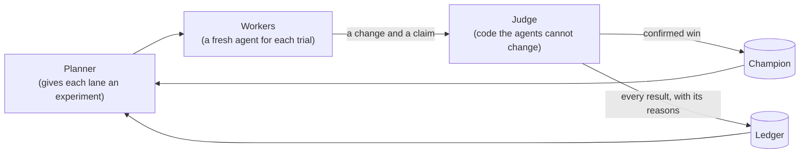

Thermite lets AI agents work on a research problem for as long as it takes, while code that they cannot touch decides which of their results count. This page says what that means in practice, who Thermite is for, and the few ideas that the rest of its design follows from.

## What it does

You bring a project and a way to judge it. Thermite brings the agents, the measuring and the record of everything that was tried.

Take an example. You have a matrix-multiply routine and you want it faster, without wrong answers. You tell Thermite where the code is, which files the agents may change, and how to build the program, run it, time it and check its output. Then this happens, over and over:

1. An agent reads the code and proposes one change.
2. Thermite's **judge** builds the change and runs it on your hardware, side by side with the best version so far. It checks that the output is still right.
3. If the change looks faster, the judge measures it again on fresh runs, and on test cases the agents have never seen when the campaign has them. Only a change that holds up becomes the new **champion**, the best confirmed version, and the agents build on it.
4. A change that loses is kept too, with the judge's reasons.

When you are happy with the result, you download the champion as a patch for your project.

In the picture below, the search is split into **lanes**, and a **planner** gives each lane its next **experiment** from the run's queue of things to try. A **trial** is one session of one agent, called a **worker**, in one lane. The **ledger** is the record of every result, and holds the queue.

The work happens on a **rig**: two containers on a computer, with the CPU or GPUs that the work is measured on. A central service called **control** shows every rig on one dashboard. [How the parts fit together](how-it-fits-together.md) explains both.

## Who it is for

Thermite is for **one researcher or one lab** that runs research on computers it controls.

- **You run it yourself:** on your own computer, on your own machines with GPUs, or on a Kubernetes cluster. There is no hosted service.
- **One person is the owner.** The owner's token is the only one that signs in to the dashboard, and only the owner approves results that wait for a person. The owner can give scripts and AI agents tokens that may watch and steer, but not decide. [Tokens and roles](../reference/tokens.md) lists what each token may do.
- **It is not a multi-tenant service.** It is built for one owner, not for separate customers who share one installation. A Claude or ChatGPT subscription may serve only its owner's own Thermite; a Thermite that several people use takes API keys.

You need Linux or macOS and Docker or Podman. A GPU is optional, and so is a paid model: the judge works without any model, and agents can start with a free one. [Start here](../start-here.md) picks a first path for you.

## The ideas in one minute

- **Agents propose; code judges.** An agent never grades its own work. It submits a change and a claim, and a judge that it can neither read nor change measures the change and decides what counts. "The agent says it is faster" and "it is faster" stay separate. → [Why agents never judge](why-agents-never-judge.md)
- **It runs until the job is done.** There are no default limits on turns, attempts, failures or time. A campaign runs until its goals are met or its questions are answered, its research stops adding or reaches the maximum duration you gave it, or you stop it. Only the limits you set apply. → [Why Thermite runs until the job is done](runs-until-done.md)
- **The harness owns the memory.** The **harness** is the rig's container where the judge and the agents work. Every agent call starts fresh, from a brief that the rig builds out of its record of what was tried, measured and decided. A crashed or confused agent session loses nothing, because no state lives in it. → [Agents, lanes and the planner](agents-lanes-planner.md)
- **Many isolated workers, one planner, one queue.** The search is split into **lanes**. Each lane's worker sees only its own copy of the code and its own lane's results. Each run keeps one queue of experiments to try, which you can see on the dashboard: the planner, the advisors and you add to it, and the workers propose ideas for it. The planner hands the lanes their next experiments, never the same one to two lanes, so the search stays wide instead of settling early on one idea. → [Agents, lanes and the planner](agents-lanes-planner.md)
- **Keep the best, and keep everything else.** Each campaign builds on its best confirmed result. Every attempt that loses is kept as well, with its code and the reason it lost, because an idea can lose on the main number and still be worth reading later.
- **What agents learn is kept.** Agents write short field notes as they work: what they observed, decided and learned. Each campaign's records go into its own collection in Thermite's knowledge base, and later runs read it, with other campaigns' collections when you allow it. What they read is data to weigh; the judge still decides. → [Journals and the knowledge base](journals-and-knowledge.md)
- **Three kinds of research.** Push a number up without breaking anything else; work until a list of goals is met, or until the evidence shows that they cannot be; or research questions until they are answered and get a paper whose answers rest on quotes that code has checked. → [Campaign modes](campaign-modes.md)
- **One place to watch and steer.** One dashboard, with a REST API and MCP, shows every campaign on every rig. People and their agents can pause, redirect, message and reassign the work, and choose what each run tries next. → [How the parts fit together](how-it-fits-together.md)

## What Thermite does not do

- **It does not invent your benchmark.** For each project, someone writes a **kit**: how to build the project, run it, time it and check its output. The **New campaign** page can write a simple kit from your answers. [Why the benchmark lives in a kit](kits.md) says why it is kept apart from the project.
- **It does not decide what matters.** A **contract** says what to improve or reach, what must not get worse and which files the agents may change. You write it, or the New campaign page writes it from your answers.
- **It does not come with a model.** You connect one: a free model, a model server on your own computer, an API key or a subscription. [Choose a model](../how-to/models/choose-a-model.md) compares them.

## Where to go next

- [Your first run](../tutorials/first-run.md) starts Thermite on your computer and lets you watch the judge check a rig.
- [Kits and rigs, side by side](kits-and-rigs.md) clears up the two words new users mix up most.
- [Where Thermite came from](where-thermite-came-from.md) tells which lessons shaped it.
