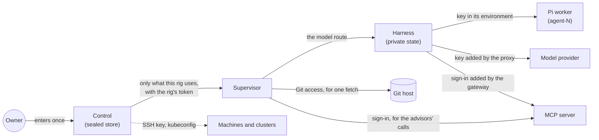

Thermite needs secrets to work: API keys for model providers, logins for subscriptions, SSH keys and kubeconfigs for the places rigs run, access to private repositories, the sign-ins of MCP servers, and tokens for people, programs and rigs. This page follows each kind of secret: where it is kept, where it travels, and who can read it.

The design follows a few rules:

- **Enter each secret once, on control.** Control seals it, and never shows it again.
- **A rig gets only what it uses.**
- **The code the agents run holds no key it does not need.**
- **Keep a hash where a hash will do.**

The words here are in the [glossary](../reference/glossary.md).

## Control's sealed store

Everything you add on the dashboard's **Settings › Providers** page is **sealed**: model provider keys, subscription logins, Git access, SSH keys, kubeconfigs, RunPod keys, and MCP servers' keys, client secrets and sign-ins. Control encrypts each one with AES-256-GCM, under a key kept in a separate file, outside its database. A copy of the database alone reveals no secret, and a sealed value that was changed fails to open. The [ports, volumes and secret files reference](../reference/ports-volumes-secrets.md#secret-files) says where each file lives.

The dashboard shows only a hint of each key: its last four characters, such as `key …abcd`. No page, REST route or MCP tool shows you a key again. The MCP tool `providers` lists what control holds without any key, token or kubeconfig, and `mcp_servers` lists the MCP servers with only each secret's hint.

## Model provider keys

A rig receives a provider's key only when you give one of its agents a model from that provider. Its supervisor fetches the rig's **model route** (the provider's address, the model and its key) from control, with the rig's own token. It hands the route to the harness when it changes, and never logs or keeps the key. The harness keeps the route in its private state, where no agent's or lane's user can read it, and the isolation self-test checks that. The key is never in a command, an event, an export or a log.

Who then uses the key depends on the worker harness:

- **Pi**, the built-in worker harness, runs each worker as its own user, `agent-N`, with the key in its environment. The lane's commands run as another user, which can't read that environment.
- **OpenCode v2** never gets the key. It reaches the provider through a proxy in the harness, with its trial's token. The proxy adds the key on the way out, and the trial's token stops working when the trial ends.
- **Codex**, the Codex CLI, never gets the key either. Its configuration names one provider: the same proxy, with its trial's token. It runs as the lane's own user, with a home of its own and its approvals and sandbox off; the user it runs as is the boundary, as for OpenCode.
- **The planner and the model check** use short-lived tokens for the same proxy, or the route itself inside the harness. A planner with a model of its own in OpenCode or Codex gets a token that the proxy takes to the planner's own provider, with that provider's key.
- **Advisors** with a model from **Edit rig** get their key from control in the supervisor's memory, each round. An advisor in Pi calls the provider from the supervisor's own process. An advisor in OpenCode v2 or the Codex CLI never gets the key: for each call, the supervisor serves a proxy on `127.0.0.1` with a token made for that call, and the program's configuration names that proxy. The proxy adds the key on the way out, and stops when the call ends.

[Connect a model provider](../how-to/models/connect-a-provider.md) shows how to add one.

## Subscriptions

A subscription serves one person's own Thermite. A Thermite that several people use takes API keys.

**A Claude subscription.** You get a token with `claude setup-token` on your own computer and paste it on **Providers**. Control seals it and makes no call to Anthropic with it, because Anthropic allows a subscription only in its own program, Claude Code. A rig gets the token only while one of its agents uses a Claude model. The harness keeps it with the model route in its private state, and passes it only to Claude Code, on a file descriptor that Claude Code reads when it starts. The token is in no environment variable and no file, so the commands that Claude Code runs for an agent do not get it. Claude Code starts with a home of its own and no setting sources. Its only MCP servers are those the run's kit gives it, at the harness's gateway. An advisor on a Claude subscription runs in Claude Code with none of Claude Code's own tools: only a read-only search of the run's past research and the MCP servers the run's kit gives the advisors, which the supervisor serves on `127.0.0.1` for the call. The supervisor gives the token to that Claude Code the same way, on a file descriptor, never in an environment variable.

**A ChatGPT subscription.** Control runs the sign-in with OpenAI and seals the login. It is the only one that renews it, because OpenAI replaces the refresh token at each renewal: the refresh token never leaves control. A rig gets a one-hour access token with its route, renewed while it uses it. Workers in OpenCode v2 or Codex reach OpenAI through the harness's proxy with their trial's token, so the hourly token itself stays in the harness, and the proxy lets it reach only OpenAI's `POST /responses` and `GET /models`. When OpenAI answers there that the plan's usage is full, the proxy notes it, so the agents wait even when their program keeps only the error's message. To show the plan's usage windows on **Providers**, control also sends the access token to ChatGPT's usage endpoint, at most once in 5 minutes for each subscription, and nowhere else. Deleting the provider signs Thermite out at OpenAI.

[Use a Claude subscription](../how-to/models/claude-subscription.md) and [Use a ChatGPT subscription](../how-to/models/chatgpt-subscription.md) show the steps.

## Machines and clusters

These secrets let control set rigs up. They never go to a rig.

- **An SSH key** for a machine is pasted, or made by control for you to add to the machine. Control uses it with the OpenSSH client in its own image, from a file that exists only for the call. You compare and trust the machine's host key once, and control refuses a machine that later presents another one.
- **A kubeconfig** for a cluster is given to kubectl the same way, in a file that exists only for the call. Control takes only a kubeconfig that holds everything inline: no login plugins and no references to other files.
- **The rig's own tokens** reach a machine inside the setup script, on standard input, never on a command line. On the machine they sit in a folder that only its user can open. On a cluster they are a Kubernetes secret in the rig's namespace, which moving the rig onto new images leaves as it is.

A **RunPod key** is sealed too. Control uses it to read the account, to start and stop the test pods you ask for, and to launch, stop, start, restart and terminate rigs on RunPod. It never goes to a pod. RunPod puts a key of its own in every pod's environment; a rig in [pull mode](trust.md#rigs-in-pull-mode) takes it out of its supervisor's environment at start and never uses it.

A rig in pull mode holds no token for control. Its pod makes its own keys at its first start and keeps them where only the supervisor's user can read them; control pins their public halves when the pod enrolls with its one-time code. A snapshot of them, with the rest of the rig's state, sits on the pod's volume, sealed with a key control made for that pod at its launch and kept nowhere but in the pod's settings at RunPod ([Where the state lives](../reference/harness-image.md#where-the-state-lives)). Everything with a secret in it, such as a model route with its key or a Git access, reaches the pod sealed to the pod's key, so RunPod's proxy never sees it in plain text ([Enrollment](trust.md#enrollment)).

## Git access

A private repository needs **Git access**: a deploy key that control makes (you add its public half to the repository) or an HTTPS token you paste. Both are sealed, and each is for one host, which you name when you add it. Control uses it for that host only, and hands it to a rig only while an assignment of that rig that names it is live: waiting for the rig or taken by it, its run not closed. The supervisor asks for it at the moment it fetches, checks that the repository is on the access's host, and control records each hand-over in its audit log. Only the owner's and the operator's tokens may name a Git access in an assignment. An SSH key goes into a file in a fresh folder that is removed after the fetch, and a token into an HTTPS header, never into the address or a command line. The host's key is pinned the first time. The access never travels in a signed command, and the harness never sees it: it receives only a git bundle, which it checks against the signed commit.

The **results repository**, where rigs push their exports, uses a deploy key of its own that can write, mounted into the supervisor ([settings](../reference/settings.md#the-results-repository)). It is used for the results repository alone: a project or kit whose source names no Git access is fetched with no key. [Set up the results repository](../how-to/operate/results-repository.md) shows how. A rig without one sends its exports to control with its own token, and needs no other key.

A **Hugging Face token**, for gated model files, is the supervisor's own too: a file mounted into it (`THERMITE_HF_TOKEN_FILE`). The supervisor sends it only to Hugging Face, and only over HTTPS, never to the file servers Hugging Face sends the download on to. It never puts it in a command, the inbox, a report or a log, so the harness and its agents never see it: they get only the downloaded file, which the harness checks against the signed SHA-256. See [Model files on a rig](../reference/model-files.md#gated-models-on-hugging-face).

## MCP servers

An **MCP server** gives a campaign's agents tools from outside Thermite, such as a knowledge base like GBrain or a code host ([Give agents MCP tools](../how-to/campaigns/give-agents-mcp-tools.md)). You add it once on **Settings › Providers**, with how it signs in: an OAuth sign-in on the server's own page, a key in a header, a client ID and secret, or nothing. Control seals the key, the client secret and the OAuth sign-in like every other secret, and the dashboard shows only a hint, such as `Authorization · key …c41b`. No page, route, MCP tool, log or audit entry shows a secret again: an MCP call that takes one is logged as `given (…c41b)`, and control takes each secret out of the error texts it shows.

- **Control** opens the secret to read the server's tools when you add it or press **Read tools again**, and to sign in. For OAuth it keeps the refresh token and renews the access token itself; for a client ID and secret it gets an access token from the server. A refresh token or a client secret never leaves control.
- **A rig** gets a server only when a run that control assigned it names that server in its kit. Control hands it to the supervisor as the headers each call carries (the key, or an access token), on the same beat as the model route, and its audit log records each change in what a rig is handed (`mcp_servers_handed`, names only). The supervisor keeps the advisors' servers in memory and calls them for the advisors. It hands the workers' and the planner's servers to the harness, which keeps them in memory, never on disk, and calls them for those agents.
- **No agent holds a secret.** A worker or the planner calls the harness's gateway with its trial's token, or a token made for one planner call; an advisor in Claude Code, OpenCode v2 or Codex calls a server the supervisor serves on `127.0.0.1` for that call, with a token made for it: on Claude Code's command line (`--mcp-config`), and in OpenCode's and Codex's environment. The gateway adds the headers and passes the server's answer back. OpenCode's and Claude Code's MCP configuration name the gateway and that token, nothing else. Codex's names only the gateway: Codex reads the token from its environment.
- **On the wire**, a secret goes in a request header, never in the address: control refuses an address with a user, a password, a fragment or a secret-like query parameter, and one that is not https, except for localhost.
- **It stays with its server.** Another address on another server, or another way to sign in, needs the secret again, so a sealed secret never goes to a server it was not given for. Deleting the server deletes its secrets and its sign-in.

[Manage MCP servers](../how-to/operate/mcp-servers.md) shows the steps.

## Tokens

When you deploy control, you make the owner's token on your own computer with `thermite token new`, and give control only its SHA-256, so control's machine holds nothing that signs in as you. The operator, agent and reader tokens work the same way. Control keeps the tokens of rigs it enrolled, join commands and dashboard sessions as hashes too. A join command's token works once, within an hour.

Control keeps no copy of two tokens: the supervisor's token for its own harness, which the rig's two containers share, and a trial's token, which one worker holds for one trial and which stops working when the trial ends. [Tokens and roles](../reference/tokens.md) lists every token and what it may do.

Inside the harness, the broker reads the rig's secret files when it starts. It hands their values to the harness's controller alone, closes their folders, and refuses to start if a secret file can still be read by other users ([Isolation inside a rig](isolation.md)).

## Signing keys

- **Control's signing key** signs every command. It is in control's own folder, readable by control alone. Rigs get only its public half.
- **A rig's signing key** signs its reports. It is in the harness's private state, and it survives a full reset.

[Trust between control and rigs](trust.md) explains what each key proves.

## Keys on the message bus

With the [message bus](how-the-parts-talk.md#who-may-use-the-message-bus), each part that signs in to it has a key of its own, which it made itself:

- **A rig's key on the bus** is in the supervisor's state folder, readable by the supervisor alone. Only its public part travels, to control, on the supervisor's regular call. It survives a full reset.
- **A rig's seal key** is beside it, the same way. Control seals the rig's config on the bus to it: the model routes with their providers' keys, and the MCP servers with their sign-ins. Only that rig's supervisor can open them, so neither the bus nor its store, nor another rig, holds them in the clear.
- **Control's two keys on the bus**, its own user and its system user, which asks the server to reload its users and for its store's figures, are sealed in control's store like the secrets above.
- **The backup's key on the bus** is a file in control's state folder, `bus-backup.seed`, readable by control's user alone, for `thermite backup` and `thermite restore`, which run where that folder is mounted. Its user may only take and restore a snapshot of the `EVENTS` stream: whoever holds it can read every rig's events, never change or remove one. A backup holds it, with control's other keys, so keep a backup as you keep control's state.
- **Control's certificate authority for the bus** is in control's own folder, beside its signing key, readable by control alone. It signs the bus's server's certificate. Rigs get only its certificate, which is public, and trust the server through it.
- **The bus's server's TLS key** is in the folder control writes for the server, readable by control's user and group only: the server reads it through that group.

The bus's server holds no other secret: control gives it a users file with each key's public part and what that user may do, and every secret it keeps for a rig is sealed to that rig's seal key.

## The advisors file

Advisors you configure in the advisors file on the supervisor read their API keys from the files it names, at each call, so a new key takes effect without a restart. An advisor you give a model from control (**Edit rig**, MCP or the REST API) instead keeps its key or token sealed in control, which hands it to the supervisor in memory. The [advisors file reference](../reference/advisors-file.md) lists every field.
