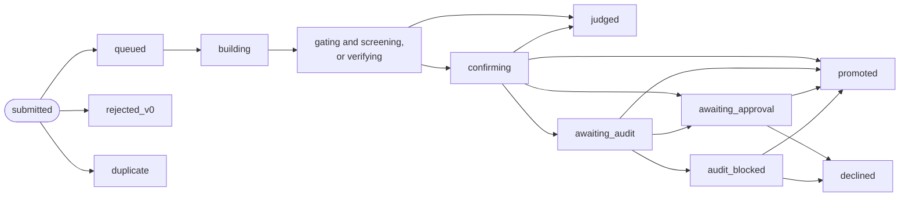

The **judge** gives each **attempt** (one submitted change) a **verdict**. The attempt also moves through a series of states while the judge works on it. This page lists every verdict and every state, with the words the dashboard shows for each. [Why agents never judge](../explanation/why-agents-never-judge.md) explains the steps in order. The [glossary](glossary.md) explains the other terms.

## An attempt's path

The diagram leaves out three returns to `queued`: after one infrastructure failure, when the champion changed before confirmation, and when another change became the champion first. After a second infrastructure failure the attempt is `errored`, as it is when its judge job is blocked after three lost leases; a blocked job's attempt goes back to `queued` when the harness starts and queues the job once more. It also leaves out a hill climb in [setup](#setup), whose changes go from `building` and `screening` to `promoted` or `judged` by the judge's baseline job alone. When its run closes, an attempt still `queued` becomes `not_judged`, and the judge never takes its job. The owner can also decline an attempt in `awaiting_audit`. A patch that does not apply to its parent never becomes an attempt: the submission is refused and counted as a `submission_refused` event.

## Verdicts

A verdict is written once and never changed. A later verdict on the same attempt, such as the confirmation after a screen, is added after it. The dashboard shows the newest one.

Only two verdicts can make an attempt the champion by beating it: `win_confirmed` and `goal_progress`. A third, `starting_point`, makes a hill climb's setup change the champion as its new starting point ([Setup](#setup)).

### Hill climb

Before any change, the judge measures the starting point alone, the run's [baseline](contract.md#the-baseline). It gives no verdict: it records a `baseline` event, or `baseline_failed` with the reasons. Then the judge times each change against the champion in **blocks**: each block runs every case (a **cell** of the kit) that the contract names, for both, in a random order. It looks at the result after the block counts in `acceptance.looks`. The [contract reference](contract.md) describes each setting named here.

| Verdict | Given at | Meaning | Dashboard says |
| --- | --- | --- | --- |
| `win_screened` | Screen | The gain's interval is above zero, its estimate is at least `min_effect`, and no guard is broken or unclear. A confirmation follows | "looked faster in screening; being confirmed on fresh runs" |
| `neutral` | Screen | The interval lies inside ± `equivalence_band` (reason `equivalent`), or it is above zero but wholly below `min_effect` (reason `gain below min_effect`) | "no measurable difference" |
| `regress` | Screen | The interval lies wholly below zero (reason `worse`) | "worse than the champion" |
| `tradeoff` | Screen or confirmation | At the screen: the change would be a win, but a guard metric got worse by more than its step allowance. At confirmation: a guard got worse by more than its step allowance, or a guard's total allowance against the starting point is spent: by the steps since it (`cumulative guard allowance spent: <metric>`), or by the change's values against the baseline's (`the guard's total allowance against the starting point is spent: …`) | (the verdict's name) |
| `infeasible` | Screen or confirmation | A `min` or `max` hard constraint failed | (the verdict's name) |
| `inconclusive` | Screen | No decision by the last look, or a guard still unclear at the last look | "too noisy, or not checkable, to tell" |
| `win_confirmed` | Confirmation | On fresh blocks alone, the gain's interval is above zero, no guard is broken or unclear, and the held-out cases pass | "confirmed faster on fresh runs" |
| `not_confirmed` | Confirmation | The gain did not hold on fresh blocks, a guard stayed unclear, or a held-out case failed | "did not hold up on fresh runs" |

Reasons name the metric with its estimate and interval, for example `flops_per_s 12.40% [8.10%, 16.90%] n=6`, and end with `; vs champion seq <n>`. A screen's and a confirmation's `verdict` event also carry `values`: the main metric's measured values that the gain comes from, `{metric, cells}`, each public case with the median of its blocks for the change (`candidate`) and for the champion it was compared with (`reference`). A held-out case's never do. The run's page shows them beside each gain, such as `+49.0%  412 → 614 tok/s` (one case's values, or the cases' geometric mean, with each case's on hover), in the unit of the run's baseline; MCP's `get_run` gives each attempt's `values`. The champion's value against the starting point's shows on the run's gain chart, the campaign's headline and the leaderboard, such as `412 → 614 tok/s`, and the champion's alone on the champion card at the top of a hill climb's page. A champion whose verdict has no values shows an estimate from the starting point's value and its gain, marked `≈`: `412 → ≈614 tok/s`. At confirmation, each guard in the verdict's record also has `vs_start`, `{estimate, noise, spent}`, when the run has a baseline: the guard against the starting point, as log ratios. A confirmation that held on the measured cases but failed on a held-out case is `not_confirmed` with `confirmation failed: <kinds>; on the measured cells: <their reasons>`, such as `confirmation failed: a held-out check timed out; on the measured cells: confirmed on fresh data; flops_per_s 12.40% [8.10%, 16.90%] n=4`. When the measured cases failed too, the verdict stays as they decided it (`not_confirmed`, `tradeoff` or `infeasible`), and the kinds follow their reasons: `<their reasons>; <kinds>`. The figures are the measured cases' only. [Held-out failures](#held-out-failures) lists the kinds, and what the owner sees besides.

### A change written on an older champion

Two lanes can start from one champion, and one lane's win can become the next champion while the other's change waits for the judge. That change was written on an older champion. The judge screens it against the current champion, as any change, and its verdict stands. Then a **port** may follow: an experiment at the top of the run's queue, added by the judge, in which a worker implements the change again on the current champion, from its original diff. The judge judges the port as any change. A port goes one step only, from the champion a change was written on to the current one:

- **It became champion.** A change written on an older champion that beats the current one is promoted, as any win. The champion it replaced is not in it, so that champion's change is ported onto it (`port_queued`).
- **It lost, but helped on its own.** Such a change that does not beat the current champion is measured once more, against the champion it was written on: the judge's `parent_screen` job, which gives no verdict and leaves the change's state as it is. Its outcome is a `parent_screened` event with the change's effect there. If it would have been a win there, the change is ported onto the current champion.

A port is titled `Port <attempt> onto champion #<n>`. Its details give the change's effect, why it is ported, what its worker wrote, and its diff, cut to fit 4000 characters. Each change is ported onto each champion once. A change that is a champion, or was one, is never measured against an older champion.

### Setup

A hill climb is in **setup** while the judge could not measure its starting point ([The baseline](contract.md#the-baseline)). Each change submitted then is judged by a baseline job of its own, not screened:

| Verdict | Meaning | Dashboard says |
| --- | --- | --- |
| `starting_point` | The judge measured the change alone on every case: it becomes the run's starting point, a new champion, and its values the run's baseline. Its reasons begin `the judge measured this setup change on every cell: it is the run's starting point, champion #<n>` | "measured: it became the run's starting point" |
| `invalid` or `crash_candidate` | The judge could not measure it, as for any candidate. Its reasons begin `the judge could not measure this setup change, so the run is still in setup: `, then the cell and the failure, such as `cell small: exit 3: …` | as below |

While the judge measures such a change, the run's page says the judge is `measuring setup change <attempt> to see whether it can be the starting point`. When one becomes the starting point, **History** says `<attempt> became champion #<n>, the run's new starting point: the judge could measure it. The gain counts from here.` and `The judge measured the starting point, champion #<n> (setup change <attempt>), on every case: …`. Its outcome word is **Champion #N**, and the run's **Champions** list counts its gain from 0 again.

A change submitted in setup that is still waiting when another one became the starting point is screened against the champion, as usual.

### Goal campaigns

The judge checks the change against each goal and compares the result with what the champion meets. Goals checked by the review panel are left out here: the review panel reviews only champions.

| Verdict | Given at | Meaning | Dashboard says |
| --- | --- | --- | --- |
| `goal_screened` | Screen | It meets a goal the champion does not, and loses none. A confirmation follows | "looked like goal progress; being confirmed on fresh runs" |
| `no_progress` | Screen | No new goal met, none lost | "met no new goal" |
| `regress` | Screen | It fails a goal the champion meets | "worse than the champion" |
| `inconclusive` | Screen | It could not be checked on a goal the champion meets | "too noisy, or not checkable, to tell" |
| `goal_progress` | Confirmation | In fresh runs the new goals still hold, none is lost or unclear, and the held-out cases pass | "confirmed: it meets more goals and loses none" |
| `not_confirmed` | Confirmation | Anything else. Its reasons say why, after `confirmation failed: `: the [held-out kinds](#held-out-failures), `no longer met: <goals>`, `lost: <goals>`, `could not check: <goals>` | "did not hold up on fresh runs" |

A goal checked by a metric threshold whose `cells` name both measured and held-out cases is screened on its measured cases and confirmed on its held-out ones. The held-out pass checks only the goals the change newly met. Before the run closes, the champion's second validation checks the held-out cases of every goal it meets ([The goal report](#the-goal-report)).

### The goal report

The judge also checks every goal on the champion: a **validation**, once for each champion (the starting point, then each promotion) and again after a validation that failed. Its event `goal_report` has the body `{run, champion_seq, goals, complete, confirming?, not_confirmed?}`, and each goal is `{goal, description, status, reasons, values?}`. The run's **Goals** block shows each goal's reasons under it, met or not; the planner reads the report, and each worker's brief has every goal's status and reasons.

| A goal checked by | Its reasons | `values` |
| --- | --- | --- |
| A metric threshold | `<metric> <op> <value>: ` and each case's mean and 95% interval: `big: 4.51235e+7 [4.49012e+7, 4.53458e+7]` | none |
| A kit verifier, met | `verifier <name> passed on <cases>: ` and each case's values: `small: ops_per_s 4.51235e+7, sum 6.00000e+7; big: ops_per_s 4.40000e+7, sum 3.00000e+8` | each case's `{cell, ok, metrics}` |
| A kit verifier, not met | each case that failed and why (`quick: crash: killed: timeout`), then `; measured: ` and the values of the cases that gave some | the same |
| A kit verifier whose gate did not pass | `not run: it requires <verifiers>, which did not pass` | none |
| The review panel | what the review panel and the owner decided | none |
| Any goal whose held-out check failed at the second validation | `not confirmed: ` and the [held-out kinds](#held-out-failures) of its cases, then `; on the measured cells: ` and its reasons as above. Its status is `unmet` | as above |

- **A case's values** are the kit's metrics as the judge works them out, by name, in the kit's order, then the other numbers the kit's check printed at its top level, by their own names (such as `ratio`, `ppl_a1` and `ppl_pn3`), at most 24 of them a case: a kit whose cases check different things can't declare those as metrics, because a metric must be a number in every case's check. A case whose output the kit's check refused gives the numbers its check reported, for the kit's metrics taken from the check (`from: "check"`) and the others, so an unmet goal shows by how much; a case that crashed or ran out of time gives none. The reasons give six significant figures, and a whole number below a million as it is (`recalled 8`). At most 100 cases a goal.
- **Only measured cases.** A held-out case runs only at confirmation (an attempt's, or the champion's second validation), and its values never reach the goal report. A kit verifier's held-out case keeps none; a threshold goal's keeps its value against its threshold, for the owner alone: [Held-out failures](#held-out-failures).
- **The rig's ledger** keeps every goal check, the champion's and each attempt's, with the same reasons, in its `goal_check` table.

**Completion is checked twice.** When a validation finds every required goal met (`complete: true`), the report has `confirming: true`, and the judge queues a second, independent validation of the same champion. Until it is done, the run starts no new round and no new trial. A trial at work goes on. The run's page says `Champion #<n> met every required goal, and the judge is checking it a second time: no new trial starts until that check is done.`, and **Live** says `no new trial starts: the judge is confirming that champion #<n> meets every required goal; …`.

- The second validation runs the measured cases, as the first does, and then the held-out cases of each goal it finds met (a review goal has none). An attempt's confirmation runs the held-out cases only of the goals it newly met, so without this a goal met long before would never run them. A contract without held-out cases, or whose goals met have none, runs no held-out case here.
- If every required goal still holds and every held-out case passes, the run closes (`goal_complete`).
- If it does not, or it fails or is blocked after three lost leases, the lanes go on, and **Live** says `trials start again: the judge's confirmation of champion #<n> did not close the run`.
- If a held-out case fails, the run does not close. Each goal whose held-out check failed is `unmet`, with the reasons above, in the report and in the goal tree, so a change that meets it again is progress, and that change's own confirmation runs the goal's held-out cases. The report has `complete: false` and `not_confirmed`, the kinds of failure in the agents' words, such as `a held-out check failed the kit's check`. **History** says `It was not confirmed on the held-out cases (<kinds>): the lanes go on.` The planner reads `not_confirmed`, and each worker's brief says `The judge did not confirm it on the held-out cases: <kinds>.` above the goals.
- A second validation queued for an earlier champion, when a promotion came first, counts as the first validation of the champion now: the run never closes on one validation.

### Held-out failures

A **held-out case** (the contract's `held_out_cells`; the dashboard calls them hidden tests) runs only at confirmation: an attempt's, and, in a goal campaign, the champion's second validation before the run closes. When one fails, the judge records the case's name and its **kind** of failure, from a closed list, and never the case's inputs, its output or the check's words:

| Kind | When | The agents read |
| --- | --- | --- |
| `threshold_missed` | A goal's metric threshold: the case's 95% interval is not wholly on the passing side, or it has one value only. A hill climb: the ratio of the medians on the case (the change's over the champion's when higher is better, the champion's over the change's when lower is better) is not above `1 / (1 + 2 × equivalence_band)` | `a held-out check missed its threshold` |
| `timed_out` | A run was stopped at its time limit | `a held-out check timed out` |
| `crashed` | A run exited with an error, or was stopped at its memory or disk limit | `a held-out check crashed` |
| `check_failed` | The kit's check failed the run's output, or the output was refused | `a held-out check failed the kit's check` |
| `non_finite` | The value the threshold needs was missing or not a finite number, or a metric the check reports was not a number above zero | `a held-out check gave no finite value` |
| `no_cell` | The kit has no case of that name | `a held-out check names a cell the kit does not have` |

A build that fails never reaches the held-out cases: its verdict is `invalid` or `crash_candidate`, with its reason. In a hill climb, the champion runs the held-out cases too; when it fails on one, the job is an infrastructure failure (`crash_infra`), and the judge tries it once more. Any other error in the judge's own work while held-out cases run, such as a kit run that fails for a reason that is not the change's, is an infrastructure failure too, and its reasons are only `a held-out check could not finish (an infrastructure failure)`: an error's own words can name a case or carry its parameters or its time. The rig's log keeps the error, for the owner.

**The owner** sees each held-out case of the newest confirmation: its name, what it was checked for (a goal, a kit verifier, or "no worse than the champion" in a hill climb), passed or its kind, and, where the check gives one, the measured value against its threshold. A threshold goal's value is the mean of its runs with its interval, in the metric's unit; a hill climb's is the ratio of the medians. It is on the attempt's page under **Held-out checks**, in the run's **History** (`<attempt> failed its held-out check: big timed out.`, or `<attempt> passed its held-out check: 3 cases.`), in `held_out` of each attempt in [`get_run`](mcp-tools.md#get_run) and `GET /v1/rigs/<rig>/view`, and in the judge's event `held_out_checked`, whose body is `{run, job, pass, cells, cells_total}`: each cell `{cell, goal?, verifier?, ok, kind?, value?, low?, high?, threshold?, op?, measure?, unit?}`, at most 50, and `cells_total` counts them all. The rig's ledger keeps the whole record in its `held_out` table, which no export holds.

**The champion's check**, in a goal campaign, is the owner's as an attempt's is: on the run's page under its goals, in a block titled `Held-out checks of champion #<n>`; in **History** (`Champion #<n> failed its held-out check: big timed out. The run does not close.`, or `Champion #<n> passed its held-out check: 3 cases.`); as `champion_held_out` of the run in [`get_run`](mcp-tools.md#get_run) and `GET /v1/rigs/<rig>/view`, the same fields with `champion_seq`; and in a `held_out_checked` event whose subject is the run and whose body also has `champion_seq`. The `held_out` table keeps it with its run and champion, and no attempt.

**The agents** read only that a held-out check failed, and its kind, in the words above, each kind once: in the verdict's reasons (which a lane's brief shows), as `held_out` in the planner's and the teachers' evidence, and as `held_out` in a worker's `status` of the attempt. Of the champion's check they read the goal report: `not_confirmed`, and which goal was not confirmed with its kinds, so the lanes can work on it. They never get a held-out case's name, its values, its inputs, its output or the check's words, and the `held_out_checked` event reaches control, never an agent: no brief, tool or knowledge base item is built from it. Control's agent token, for an agent that works over MCP, reads them as the agents do: in [`get_run`](mcp-tools.md#get_run) and [`recent_events`](mcp-tools.md#recent_events), a held-out check, the champion's too, is its kinds and their words, and no held-out case is named.

A kind comes from how the judge saw the run fail, never from what the run or the check printed. [Goal 082](https://github.com/iammrduncan/thermite/blob/main/docs/plan/goals/_completed/082-judge-findings-in-view.goal) says what a kind reveals, and why that is safe.

### Any mode

| Verdict | Meaning | Dashboard says |
| --- | --- | --- |
| `invalid` | The change's build failed, or its build or run left files the judge refuses, or the kit's check failed, or a measured value was impossible (for example not a number) | "broken: it failed a correctness check or did not build" |
| `crash_candidate` | The change's run exited with an error or was stopped at a kit limit, or its build was stopped at a kit limit for the second time: the first time, the build may have met a busy host, so the job is an infrastructure failure (`crash_infra`, `build killed (timeout); tried once more`) and runs once more | "crashed when run" |
| `crash_infra` | Something failed that was not the change's fault, such as the champion's own run or a busy device. The judge tries once more. It never counts against the research | "the rig failed while measuring it (not the change's fault)" |
| `invalidated` | The owner withdrew the evidence it rested on ([Withdrawn evidence](#withdrawn-evidence)). It supersedes the verdict before it, which stays in the record. Its reasons are the owner's, or `lineage of invalidated evidence: …` for a change built on a withdrawn one | "its evidence was invalidated" |

The [kit manifest reference](kit-manifest.md) lists which kit failure gives which verdict.

v0.1.0's list of verdicts also had `neutral_simplify`, for a change that measured the same and made the code simpler. Nothing ever recorded it, and the judge has no measure of simpler code, so it is gone from the list: no ledger holds one.

### Withdrawn evidence

Evidence the judge recorded can turn out bad: a change that games a check, or measurements taken on a card that ran slow. The owner withdraws it with [`invalidate_evidence`](signed-commands.md#invalidate_evidence): from the attempt's page, `thermite invalidate`, REST or MCP, always after a preview of what it reaches. Agents, an operator and the advisors can't. Nothing is deleted: each step is a new record. [Withdraw bad evidence](../how-to/campaigns/withdraw-bad-evidence.md) shows how.

| Withdrawn | What it reaches | What becomes of it |
| --- | --- | --- |
| An attempt | The attempt, and every attempt built on it (on its commit), in turn | Each gets `invalidated`, for good: it never gets another verdict and can't become the champion. A change submitted later on top of one is withdrawn as it arrives, and never judged |
| A judge job's measurements | Each attempt whose current verdict rests on that job (its screen, or its confirmation and the screen before it), and every attempt built on those | Each gets `invalidated` and goes back to the judge's queue to be measured again: a new verdict follows. Not in a closed run, nor for a change the judge never measures (`rejected_v0`, `duplicate`) or one withdrawn for good before |

Either way, the judge's jobs still waiting for those attempts, or under way, are `cancelled`; an attempt not judged again that waited for the judge, an audit or the owner settles as `judged`. Each champion that rested on an attempt reached is reopened, and the run's champion moves back to the newest that stands, the starting point at least, with its own event; new trials build on it, and a goal run's judge checks its goals again. A withdrawn champion already published keeps its patch in the results repository and on control; control no longer offers it.

**On the dashboard** the attempt's page shows its chip **Withdrawn** and a block **Its evidence was withdrawn**: when, by whom and why, what was withdrawn, the attempts it reached, the `invalidated` verdicts it recorded, the champions it reopened and where the run's champion moved. The run's **History** says `You withdrew attempt <attempt>: <why>. It and the <n> attempts built on it are withdrawn for good. Nothing is deleted.` (for a job: `You withdrew the measurements of judge job <job>: <why>. <n> attempts lose their verdicts, resting on them or built on what did: the judge measures them again unless the run is closed. Nothing is deleted.`), then `The run's champion moved back from #<n> to #<m> (<attempt>): its evidence was withdrawn. New trials build on #<m>.`, and for each job cancelled `The judge's job (…) was cancelled: its evidence was withdrawn: <why>.` The run's **Champions** list leaves the reopened ones out. Control's views hold each withdrawal in the run's `invalidations`, `{id, at, by, kind, subject, reason, attempts, verdicts, champions, champion}`, which [`get_run`](mcp-tools.md#get_run) and `GET /v1/runs/<run>` give as one of the run's lists.

## Attempt states

| State | Meaning | Dashboard says |
| --- | --- | --- |
| `queued` | Waiting for the judge. Also after a screen again or a retry, and when the owner withdrew the measurements its verdict rested on | "waiting for the judge" |
| `rejected_v0` | Refused by the static checks before any build: a file outside the editable paths, a forbidden pattern in an added line, a binary file, a link or a submodule, or no change at all. Kept, never built, no verdict. Its violations, such as `binary change: assets/table.bin`, are in its record: see [Why a change was refused](#why-a-change-was-refused) | "rejected v0" |
| `duplicate` | The same change as an earlier attempt of the run. Not judged again | "the same change as an earlier attempt" |
| `building` | The judge is building the change and the champion | "being built" |
| `gating` | Hill climb: each case runs once for both; the change must pass the kit's check | "gating" |
| `screening` | Hill climb: timed against the champion in blocks; in setup, timed alone by the baseline job | "being measured" |
| `verifying` | Goal campaign: the goals are being checked | "being checked" |
| `confirming` | A screened win, waiting for its confirmation or, in a hill climb, in it. A goal campaign's confirmation shows `verifying` | "being confirmed on fresh runs" |
| `judged` | The judge is done, and the verdict does not make it the champion | "judged" |
| `awaiting_audit` | A promotable result held for the auditor | "held for an audit" |
| `awaiting_approval` | A promotable result waiting for the owner | "waiting for your approval" |
| `audit_blocked` | The auditor blocked it. Only the owner can overrule | "blocked by the auditor" |
| `promoted` | It became the champion | "became the champion" |
| `declined` | The owner said no. It never becomes the champion | "declined by you" |
| `errored` | Infrastructure failed twice, or its judge job was blocked. Not counted against the research | "failed in the judge" |
| `not_judged` | Its run closed while it waited in the queue. A closed run is never resumed, so its job is cancelled and it gets no verdict | "not judged: its run closed first" |

A lane's next trial starts only once its last attempt is **settled**: `judged`, `promoted`, `rejected_v0`, `duplicate`, `errored`, `not_judged`, `awaiting_approval`, `awaiting_audit` or `audit_blocked`. A run that keeps working while the judge works (the contract's `lanes.keep_working`, or a `keep_working` rule) starts it once its last trial ends instead, and ends a round when its trials end. Attempts in `queued`, `building`, `screening`, `confirming`, `verifying`, `awaiting_audit` or `awaiting_approval` count as **open** against the contract's `budget.max_open_attempts`: while the run has that many, no trial starts.

### Why a change was refused

The static checks give one violation for each problem they find:

| Violation | When |
| --- | --- |
| `no files changed` | The change changes no file |
| `binary change: <path>` | A file the checks cannot read as text, so they cannot scan it for forbidden patterns |
| `symlink or submodule: <path>` | A link, which could point a build or the judge at private files, or a submodule, which pulls in other code |
| `path not editable: <path>` | A file outside the contract's `editable_paths` |
| `forbidden pattern <pattern>: <line>` | An added line that matches one of the contract's `forbidden_patterns`, with the line's first 120 characters |

The violations go everywhere the change is looked at, not only to the trial that submitted it:

- **The submitting trial** gets them all in its answer (`violations`).
- **The attempt's event**, `attempt_recorded`, has the first 20, each cut to 300 characters, in `violations`, and how many there were in `violations_total`. Control reads them from there.
- **On the dashboard**, the attempt's page lists them under **Refused before building**, with `and <n> more` past the first 20, and the run's **History** says `The static checks refused it: <the first one>, and <n> more.`
- **Over REST and MCP**, each attempt in [`get_run`](mcp-tools.md#get_run), [`get_attempt`](mcp-tools.md#get_attempt), `GET /v1/runs/<run>` and `GET /v1/rigs/<rig>/view` has `violations` and `violations_total`.
- **In the knowledge base**, the attempt's item says `Refused before building: …` ([Knowledge base](knowledge-base.md)).
- **The agents** see them too: a lane's brief lists its recent attempts, a refused one with `Refused before building: …` (the first 20); the planner's and the teachers' evidence give each refused attempt's first 5 under `refused`, with `total`; and a worker's `status` of any attempt of its campaign answers with all of them.

An attempt reported by an older harness has none in its event, and shows none.

### Why a result waits

On a rig with an auditor, a promotable result goes to the auditor first when:

- the agent declared known flaws (trigger `known_flaws`);
- in a hill climb, the gain is above `acceptance.audit.absolute` (trigger `absolute`), or above `acceptance.audit.ratio_to_median` times the median of the run's earlier confirmed gains, once there are three (trigger `ratio`);
- in a goal campaign, the contract has an `adversarial_checklist` (trigger `adversarial_checklist`).

The auditor answers `clear`, `block` or `needs_owner`. Its clear is the last step: the result is promoted, its declared flaws accepted (`flaws_accepted`), unless the run asks the owner. Its block stops it (`promotion_blocked`, with the auditor's reasons). On a rig with no auditor, the judge records `audit_skipped` with the trigger, and goes on. Then the run's rules decide: `owner_approval` waits for the owner; `auto` promotes at once, unless the run's `ask_owner` asks about a gain above its `above_gain` or about declared flaws (`promotion_pending`, with the reason). A promotion with declared flaws that nothing asked about accepts them, and the record says by which step. A promotion writes the new champion, the acceptance of its declared flaws (`flaws_accepted`, with who accepted them), an audit the owner's approval overrides (`audit_overridden`) and the change's state together, in one transaction, whether the judge, the auditor's clear or the owner promotes it; the champion's git ref follows. [Decide what waits for you](../how-to/campaigns/decide-what-waits.md) shows how to choose and how to answer.

## Outcome words on the dashboard

Attempt lists show one word for each attempt, in this order of precedence:

| Word | When |
| --- | --- |
| **Champion #N** | It became champion number N: the current champion or an earlier one. The run's starting point is champion #1, so the first change to win is #2. In a hill climb in setup, the setup change that became the starting point is a champion too |
| **Withdrawn** | Its verdict is `invalidated`: the owner withdrew its evidence ([Withdrawn evidence](#withdrawn-evidence)), and it is not being judged again |
| **Blocked** | The auditor blocked it |
| **Run closed** | It waited for the owner or for an audit when its run closed: no one decides it now, and it does not become the champion |
| **Auditing** | The rig's auditor is checking it |
| **Needs you** | It waits for the owner, or for an audit on a rig with no auditor |
| **Declined** | The owner declined it |
| **Promoted** | Its state is `promoted`, but the run's list of champions does not name it |
| **Judging** | It is `queued`, `building`, `screening`, `confirming` or `verifying`, or it has only a screening verdict |
| **Duplicate** | The same change as an earlier attempt |
| **Not judged** | `not_judged`: its run closed while it waited for the judge |
| **Errored** | `errored`: the judge's job for it lost its lease 3 times in a row (`MAX_LEASE_EXPIRIES`) and was set aside, so its lane goes on. An infrastructure failure, never a research loss: a start of the harness queues the job again |
| **Won** | `win_confirmed` or `goal_progress` |
| **Broken** | `invalid` or `crash_candidate` |
| **Unclear** | `crash_infra` or `inconclusive` |
| **Lost** | Any other verdict: `neutral`, `regress`, `tradeoff`, `infeasible`, `not_confirmed`, `no_progress` |

An attempt with no verdict at all also shows **Judging**. This includes an attempt in `rejected_v0`, which never gets a verdict: the row's state, under the change, says `rejected v0`.

## Run states

A **run** is a campaign at work on one rig. The rig records one of three states for it, with a reason.

| State | Set when | Reason recorded |
| --- | --- | --- |
| `running` | The run is assigned to the rig | none |
| | The owner or an agent resumes it (`resume_run`) | none |
| | The smoke check ends and resumes a run it paused | `resumed after the smoke check` |
| `paused` | Someone pauses it (`pause_run`) | the reason given. The dashboard's **Pause** sends what you typed in **why (optional)**, or `paused from the dashboard` when you typed nothing |
| | Another run is assigned or resumed on the same rig: a rig works on one run at a time | `replaced by <run>` |
| | The contract's `budget.wall_hours` has passed since the run was created | `the wall-time budget is spent` |
| | The judge's time on the run reaches `budget.device_hours` | `the device-hours budget is spent` |
| | The agents' model spending reaches `budget.llm_usd` | `the model budget is spent ($<amount>)` |
| | A full reset is about to wipe the rig | `wiping` |
| `closed` | A goal campaign meets its goals, and a second, independent check agrees, with the held-out cases of the goals met ([The goal report](#the-goal-report)) | `every required goal is met` |
| | The owner accepts a "not possible" proposal | `not possible: the owner accepted the evidence` |
| | A "not possible" proposal, in a run that does not ask the owner | `not possible: the evidence holds, and the run does not ask the owner` |
| | A research run's review panel's decisions gave every question an end and every required hypothesis a verdict, and the pass was accepted (hands-off, or by the owner where the run asks), once code accepted its research paper and its running trials ended, or, on a rig with no final writer, once the trials ended ([When a research run ends](../explanation/campaign-modes.md#when-a-research-run-ends)) | `every question is answered` |
| | A research run's open questions were all saturated and no item improved for a quarter of its running time (the progress rule), once its paper was in, or there was no final writer, and its running trials ended | `research stopped adding: its open questions are saturated` |
| | A research campaign's time is over | `the research window is over` |
| | The owner closes it by hand (`close_run`, **Close run** under **⋯** on the run's page), running or paused | the reason given: what you typed in **Why**, or the payload's `reason` |
| | A smoke check finishes its own run | `the smoke check is done` |
| | The harness restarted during a smoke check | `its smoke check was interrupted` |

- **A closed run stays closed.** Resuming or pausing it is refused with `run <run> is closed`, and closing it again with `run <run> is already closed (<its reason>): there is nothing to close` (without the reason in brackets when it closed with none). A job the judge was measuring when the run closed finishes, but never closes the run a second time: the first reason stays.
- **Nothing waits in a closed run.** What waited for the owner or the auditor when it closed stays as it was, out of **Needs you**, and the owner's decisions on it are refused, such as `run <run> is closed: none of its changes can become the champion` ([`close_run`](signed-commands.md#close_run)).
- **A hill climb never closes on its own.** It runs until someone pauses or closes it, or a budget the contract sets pauses it. [Why Thermite runs until the job is done](../explanation/runs-until-done.md) says why.
- **Budgets pause; they do not close.** They apply only to runs with agents and a model. When one is spent, no new trial starts, and the run is paused once the running trial ends. `wall_hours` counts from the run's creation, paused time included, so a resumed run is paused again. [Set a budget or a stop time](../how-to/campaigns/budget-and-stop-time.md) and [Limits and pacing](limits-and-pacing.md) say more.
- **Judging waits with the run.** The judge works only on running runs. A paused run's queued judge jobs stay queued until it resumes. A closed run's are cancelled when it closes, and each change that waited for one becomes `not_judged`; a harness that starts does the same for runs closed before. A job the judge was already measuring finishes.

### Run labels on the dashboard

A run's page and its **Live** header show the run with one label: the first that applies, in this order.

| Label | When |
| --- | --- |
| **Completed** | A goal run is `closed`, and its newest goal report met every required goal, confirmed by the judge's second check: it closed with `every required goal is met`. Or a research run is `closed` with `every question is answered` |
| **Finished** | Any other `closed` run: the owner closed it, a goal campaign ended as not possible, a research run's time is over, a smoke check is done, or a hill climb was closed |
| **Paused** | The run is `paused`, even when a decision waits in it |
| **Approval** | A result waits for the owner's approval |
| **Decision** | A "not possible" proposal waits for the owner |
| **Review** | The review panel passed a goal, or found a research run's questions answered, and the owner has not answered yet |
| **Audit** | An audit blocked a result: it waits for you |
| **Auditing** | An audit is open: the rig's auditor decides it |
| **Running** | Otherwise |

What waits in a paused run still shows in **Needs you**, as for a running one. What waited in a closed run does not.

A campaign's page lists its paused and closed runs under **Earlier runs**, with the state **Paused**, **Completed** or **Finished** and, under **Why it stopped**, the reason the run recorded. A run of a retired rig, or from before its rig's full reset, is there too, with its rig marked `on <rig>, retired` or `before <rig>'s full reset`; one that was not closed has the state **Stopped**, since it runs no more.

### Judge-only runs

A run started with its agents off (**Agents** › **Off: a try** on **Start a run**, `--agents off`, or `agents: false` over REST and MCP) is judge only: no workers run on it. The judge still checks the champion and measures the changes people submit. Its advisors still work, so the teachers may add experiments to its queue, but no lane ever takes one. The dashboard says so:

- The line under the run's name reads, for example, `on rig-1 · goal · judge only · Running`.
- On every tab of the run's page, a box says `Judge only: No workers run. The judge checks the champion; the advisors' ideas wait in the queue for a run with workers.` A try of a kit, named `<campaign>-try-<n>`, has its own box instead (`A try of the kit.`), and a rig check's run has none.
- Under **The run** on its **Overview**, **Agents** says `None: judge only. No workers run; changes come from people`.
- When experiments wait in its queue, its **Experiments** tab says above **Up next**: `Judge only: no worker takes these experiments, so they wait for a run with workers. To carry them over, Start a run of the campaign with Copy the untried experiments of <run> ticked.` **Start a run** there opens the campaign's **Start a run** panel with that run chosen under **Experiments to start with** ([Start a campaign from the dashboard](../how-to/campaigns/start-from-dashboard.md)).
- Its card under **At work now** (on **Campaigns** and its campaign's page) or **At work** (on **Overview** and its rig's page), and its row under **Earlier runs**, have the mark **judge only** beside its name. A rig check's run has it too.

## Campaign states

A **campaign** has no state of its own: its runs do. While one of its runs is running, the campaign is at work. Otherwise its newest run, by when it started, decides, so an older paused run does not hide that a newer one completed.

- **The Campaigns page** (in the sidebar) counts a campaign as at work when one of its runs is running. Otherwise it counts it as paused when its newest run is paused, and as finished when its newest run is closed, **Completed** or **Finished**, even when an older run is paused. Campaigns named `rig-check-…`, which the [smoke check](rig-checks.md#smoke-check) makes, are rig checks. The filters are **Active and paused** (the default), **At work**, **Paused**, **Rig checks**, **All** and **Archived**. The default hides finished campaigns, rig checks and archived campaigns; **All** shows every campaign, archived ones too. The **Runs** column counts each campaign's runs as "N at work", "N paused", "N completed" and "N finished".
- **The sidebar's Campaigns section** lists every campaign that is not archived, finished ones too: those in folders first, in their folders, then those in no folder ([Archive campaigns and sort them into folders](../how-to/campaigns/archive-and-folders.md)). A rig check's campaign shows only while it is at work. Each shows one label. While one of its runs is running, that is the most urgent of those runs' labels, in this order: **Approval**, **Decision**, **Review**, **Audit**, **Auditing**, **Running**. Otherwise it is its newest run's label: **Completed**, **Finished** or **Paused**. So a campaign whose newest run met its goals shows **Completed**, even with an older run paused, and a campaign whose newest run is paused shows **Paused**.

A campaign appears on the **Campaigns** page once a rig reports a run of it. A campaign saved on the **New campaign** page, or copied with **Copy** on a campaign's page or over REST, MCP or the command line, with no run yet is not listed there; its own page says "Saved on control, with no run yet." beside a **Start a run of** button with its name. That page also opens for a campaign assigned over MCP, the REST API or the command line whose run no rig reports now. It then says "Assigned to a rig over the API, MCP or the CLI; no run of it reports now." beside the same button.

## Experiment states

An **experiment** is one thing for a lane to try, in a run's [experiment queue](glossary.md). The harness keeps each run's experiments in its ledger, and records every change as an event that names who made it. The run page's **History** tab has a sentence when an experiment is added, proposed, queued, moved, edited or dropped, and for each hand-out, such as "The teachers added "…" to the queue." or "The planner gave out round 4: lane-1 on "…".". The **Experiments** tab shows the experiments themselves; [Choose what a run tries next](../how-to/campaigns/choose-what-runs-next.md) shows how to change them.

| State | Meaning | On the **Experiments** tab |
| --- | --- | --- |
| `proposed` | A lane's idea, waiting for the planner or the owner to queue it or drop it | **Ideas from the lanes** |
| `queued` | Waiting its turn. Its place is its index among the queued experiments, 0 first | **Up next** |
| `assigned` | A lane's trial works on it | **In progress** |
| `done` | Its trial ended, with its attempt or the reason there is none | **Tried** |
| `dropped` | Someone dropped it, and said why. It stays in the record | **Tried** |

- Only `proposed` and `queued` experiments can be edited or dropped, and only `queued` ones move. A command that breaks this is refused, for example `experiment <id> is done: only queued experiments move`.
- One experiment goes to one trial. The planner can give a lane a queued experiment or a lane's idea.
- **A copied experiment says where it came from.** **Start a run** can begin a new run's queue with another run's untried experiments, and with past experiments from the [knowledge base](knowledge-base.md) collections the campaign may read. Each keeps its first author, and `from_run` names the run it came from. One from past research ends its details with `In <run> (<campaign>) it was <result>.`, or `From <run> (<campaign>).` when that run gave it no result. A copied experiment that MCP's `issue_command` takes from control's records gets the same `In <run> (<campaign>) it was <result>.` line when its item has a result.
- **An experiment its trial never really tried comes back.** When a trial is interrupted (by **Pause**, **Restart the lanes** or a harness restart), or ends on the model provider's error (a rate limit, a 5xx or a broken connection, no credits, a refused key, an unserved model, or calls that failed for 30 minutes until the run's agents stopped) before it submits, the same experiment goes back to `queued`, at the top: not a copy. It keeps its author and its why, and counts how many times it came back (`returns`), with the last cause (`cause`). Its `experiment_returned` event has `{id, lane, trial, result, cause, returns, position}`, with `interrupted` or `error` as the result. **History** says `"<title>" went back to the top of the queue: its trial on <lane> was interrupted (<cause>).`, or `… ended on the provider's error (<cause>).` While the run's agents are stopped, it waits there; it is the next one given out when they go on. A ledger from before kept a copy instead, whose `experiment_added` event has `requeued_from`.
- **A tried experiment says how its trial ended.** Every experiment that is `done` keeps its trial's cause in words (`cause`): the provider's or the program's words for an error, the time or turn limit, the model stopping. The planner's and the teachers' brief show it beside each tried experiment's result, and the **Tried** list shows it.

### An experiment's result

**Tried** lists every experiment that is `done` or `dropped`, newest first. Its **Result** column says what became of each:

| Result | When |
| --- | --- |
| `<attempt>: <outcome>` | Its trial submitted an attempt. The outcome is the attempt's [outcome word](#outcome-words-on-the-dashboard), such as `Won` or `Lost`, followed by `, waits for you` while it waits for your approval |
| `<attempt>: not judged yet` | Its trial submitted an attempt that control has no record of yet |
| `no attempt` | The worker stopped without submitting |
| `no attempt: <reason>` | Its trial ended without an attempt: `interrupted`, `error`, `wall` (its time ran out), `turns` (the turn cap) or `context` (the model's context was full) |
| `finished: <yield>` | A research task whose trial ended on its own, with what it added, such as `finished: 3 verified claims, 2 from sites new to its question, 1 finding`; `finished: its research is in the run's notes` when it recorded no yield |
| `dropped by <who>: <why>` | Someone dropped it: `you` (the owner, or an operator for the owner) or the `planner`. An idea dropped with its **Drop** button under **Ideas from the lanes** has the why `the owner dropped this idea` |

The filter chips above the table each show a count, and group the results by the attempt's [outcome word](#outcome-words-on-the-dashboard):

| Chip | Results |
| --- | --- |
| **All** | Every row |
| **Wins** | `Champion #N`, `Promoted` or `Won`, and every attempt that waits for you: `Needs you`, or one that waits for your approval |
| **Not better** | `Lost`: not better than the champion. A `regress` verdict (slower, or a goal lost) reads `Lost`, so it is here |
| **Broken or blocked** | `Broken` or `Blocked` |
| **Other results** | `Unclear`, `Withdrawn`, `Declined`, `Duplicate`, `Run closed` and `Judging` |
| **Research finished** | `finished: <yield>`, or `finished: its research is in the run's notes`. Shown only when there are some |
| **No attempt or dropped** | `no attempt`, `no attempt: <reason>`, `<attempt>: not judged yet` and `dropped by <who>: <why>` |

Beside the chips, two lists narrow the rows further: **Every direction** (the **Direction** column) and **Anyone added it** (the **Added by** column). Each offers only the values in the table. The chip and both lists apply together.

## Other states

| Thing | States | Meaning |
| --- | --- | --- |
| Trial ending | `submitted`, `no_submission`, `finished`, `interrupted`, `turns`, `wall`, `context`, `error` | Why a trial ended: it submitted; it stopped without submitting; a research trial ended on its own; a pause, reset or restart ended it; the turn cap; its time ran out; the model's context was full; an error |
| Judge job | `queued`, `leased`, `done`, `failed`, `blocked`, `cancelled` | A job is `blocked` after three lease expiries or harness restarts. A lease lasts 15 minutes; the judge renews it as it measures, and every few minutes while it builds, also while it waits for another executor's build of the same change. A blocked job's attempt is `errored`, so its lane's round can end without it. When the harness starts, each blocked job is queued once more (`job_unblocked`), its attempt `queued` again, and one more lost lease blocks it again. The start queues the blocked jobs before it takes back the leases of the process that died: a job whose third lost lease is that one, such as a job that killed the harness, stays blocked through this start, and gets its one more try at the next. A queued job is `cancelled` when its run closes, or when the harness starts and finds its run closed: it never runs. A queued or leased job is `cancelled` when the owner withdraws its attempt's evidence (`job_cancelled`): a judge measuring it can no longer record its outcome |
| Judge job kind | `baseline`, `validate`, `confirm`, `evaluate`, `parent_screen`, `calibrate` | Taken lowest priority number first: `baseline` 10, `validate` 40 (or 60 for a new champion), `confirm` 50, `evaluate` 100, `parent_screen` 150 (a change written on an older champion, measured against it for a port: [A change written on an older champion](#a-change-written-on-an-older-champion)), `calibrate` 200. A hill climb's `baseline` measures its starting point, or a change in setup; until the run has its baseline, the judge takes no other job of it |
| Goal check | `met`, `unmet`, `inconclusive`, `not_runnable` | One check of one goal. A threshold goal is `met` only when every case's interval is on the passing side |
| Goal (on the champion) | `untouched`, `verified`, `unmet`, `attempted`, `not_runnable` | The champion's goals: not checked yet, met, unmet, unclear, cannot be checked. The dashboard shows each goal's latest check: "met", "unmet", "inconclusive", "not runnable" or "waiting on another goal" |
| Audit decision | `clear`, `block`, `needs_owner`, `skipped` | The auditor's answer, or `skipped` when the rig has no auditor. The dashboard shows "waiting for the auditor", "waiting for you (no auditor configured)", "blocked by the auditor", "cleared by the auditor", "passed to you" or "skipped" with why, such as "this rig has no auditor"; the change's page says `This rig has no auditor: the audit was skipped` |
| Review | review panel `review_passed` or `review_failed`; owner `accepted` or `rejected` | A goal checked by the review panel counts as met when the review panel passes it, or, where the run asks the owner about reviews, when the owner accepts it. A research run's review (its goal is `research`) passes when every reviewer found every question answered and code checked each answer; once accepted, the run ends ([When a research run ends](../explanation/campaign-modes.md#when-a-research-run-ends)). A review that a reviewer still gave no answer to at its fifth try is posted as `review_failed` |
| "Not possible" proposal | `accepted`, `rejected` | Accepting closes the run. Rejecting reopens the approach families it used |
| Approach family | `live`, `exhausted` | A family becomes `exhausted` when a "not possible" proposal counts it as refuted |
| Research claim | verified, draft | Verified when every quote is found word for word in its archived source and every number in the claim is in its quotes. A quote names its source by its id, or by the address or file name of exactly one archived source ([`add_claim`](command-line.md#thermite-trial)). A draft lists its problems. In a research run each claim answers one of the campaign's questions, given by its index (with one question, that one), and counts toward that question's answer card; a claim that names none, when the campaign has more, is refused and not recorded. Workers in every mode may record claims. Each claim is a `claim_added` event, `{claim, verified, question, text, quote, sources, problems, more_problems?}`: `text` and `quote` (its first quote) cut to 500 characters; `sources`, each quote's source id, or what was cited when it names no archived source; `problems`, a draft's problems, `[]` for a verified claim, at most 20, each cut to 300 characters, and `more_problems` counts the rest. The run's **History** says `lane-1 recorded a verified claim: "…".` or `lane-1's claim stays a draft: "…". Why: …`, with its first three problems |
| Research finding | supported (a finding), draft | A finding counts when every claim it cites is verified and every number in it is in those claims. A draft finding lists its problems. See [Campaign modes](../explanation/campaign-modes.md#research) |
| Epoch source | `planner`, `fallback` | Who gave out the epoch's work, which the dashboard calls a round. `planner`: the planner model, and History says "The planner planned round N: …". `fallback`: the fixed rules, used in a hill climb or goal campaign when the planner has no model, is off, or gave no usable plan: lanes take queued experiments in order. History then says why: "(by the fixed rules: no model)", "(by the fixed rules: the planner is off on this rig (Edit rig))" or "(by the fixed rules: the model gave no usable plan, because …)", with the reason; after more than one try, each try's reason in turn: "try 1: …; try 2: …". A research run's rounds are `planner` when its planner's model planned them, and `fallback` when its answers were refused or its model couldn't be reached, with notes that start `the gap-driven plan:`. With its planner off they are `fallback` too, with `plan: "research"` in their `epoch_started` event: the gap-driven plan set them on purpose, and History says "The gap-driven plan set round N (the planner is off): …". A hill climb's setup rounds are `fallback` too, with `plan: "setup"`, and History says "Round N is a setup round: lane-1 works to make the starting point build and run its cases."; neither counts as a fallback |
| Promotion policy | `auto`, `owner_approval` | Set for the run when it is assigned, or the rig's default |

[Signed commands](signed-commands.md) lists the states of a command, and [Stop, restart, remove or reset a rig](../how-to/operate/rig-lifecycle.md) the steps of a full reset.
